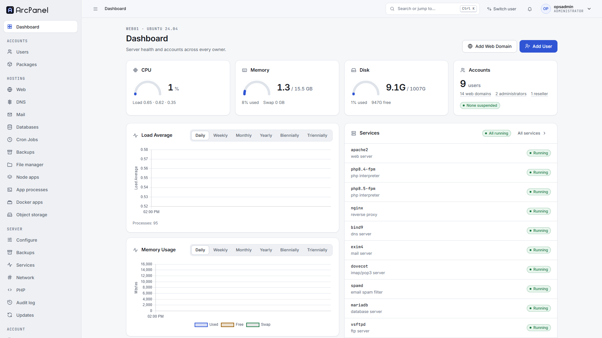

# ArcPanel

**Lightweight and powerful control panel for the modern web.**

[](https://github.com/arc-panel-oss/arcpanel/releases/latest)
[](LICENSE)
[](#installing-arcpanel-on-a-server)
[](https://github.com/arc-panel-oss/arcpanel/discussions)
[](https://github.com/arc-panel-oss/arcpanel/contribute)

Web domains, mail, DNS, databases, SSL, backups, resellers, Node.js and Docker apps on one Debian or Ubuntu server. Free and open source: no licence keys, no per-account fees, no paid edition.

<picture>
  <source media="(prefers-color-scheme: dark)" srcset=".github/readme/dashboard-dark.png">
  
</picture>

## Quick start

On a fresh Debian 12/13 or Ubuntu 22.04/24.04/26.04 server (amd64), as root:

```bash
wget https://arcpanel.org/install.sh
sudo bash install.sh
```

The panel answers on `https://<server>:8083` when the installer finishes. Options, upgrades and requirements are in [Installing ArcPanel on a server](#installing-arcpanel-on-a-server) and on [arcpanel.org/install](https://arcpanel.org/install).

## Why ArcPanel

- **Free for real.** GPL-3.0, every feature in one edition, nothing to activate.
- **Resellers built in.** Resellers create customers and packages inside their own limits; every page and command is scoped to its owner.
- **Modern workloads.** Node.js apps under pm2, Docker apps from a catalog that run as the hosting user, long-running app processes and a PHP manager (5.6 to 8.5).
- **The command line is the system of record.** More than 500 `v-*` commands do everything the panel does, and REST API v2 has an OpenAPI document, a TypeScript SDK and the `arc` CLI.
- **A familiar core.** Based on HestiaCP 1.10.5: NGINX and Apache, Exim and Dovecot, BIND, MariaDB and PostgreSQL, Let's Encrypt.

**Community:** questions and ideas in [Discussions](https://github.com/arc-panel-oss/arcpanel/discussions), a first contribution from the [good first issues](https://github.com/arc-panel-oss/arcpanel/contribute), and every contributor is thanked in the release notes.

## About

ArcPanel is an open-source control panel for Linux web servers. From one dashboard and one command line it manages web domains, DNS zones, mail, databases, cron jobs, backups, firewall and SSL on a single host, and it adds what a modern hosting stack needs: resellers, a port registry, per-user Node.js and Docker apps, long-running app processes, a PHP manager, template metadata, a first-party file manager and REST API v2.

ArcPanel is based on [HestiaCP](https://github.com/hestiacp/hestiacp) 1.10.5 and, since 2.0, a hard fork of it. It keeps the architecture (the `v-*` commands, the REST API, the flat-file data model) under ArcPanel names: `/usr/local/arcpanel`, `/etc/arcpanel/arcpanel.conf`, `arcpanelweb`, `v-*-arcpanel-*`. Scripts and integrations written for HestiaCP need these names, and API clients read the `ArcPanel-Exit-Code` header.

| Item      | Value                                                                                                                                                                          |
| --------- | ------------------------------------------------------------------------------------------------------------------------------------------------------------------------------ |
| Releases  | Stable line 2.2 from the signed APT repository `apt.arcpanel.org`; see the [CHANGELOG](CHANGELOG.md) and [GitHub Releases](https://github.com/arc-panel-oss/arcpanel/releases) |
| Next      | 2.3 (firewall on nftables with IPv6); what each release brings is on the [roadmap](https://arcpanel.org/roadmap)                                                               |
| Platforms | Debian 12 / 13, Ubuntu 22.04 / 24.04 / 26.04 LTS, amd64 only (arm64 is not supported for now; no 32-bit)                                                                       |
| Website   | [arcpanel.org](https://arcpanel.org): install, documentation, support plans                                                                                                    |
| Questions | [GitHub Discussions](https://github.com/arc-panel-oss/arcpanel/discussions)                                                                                                    |
| License   | [GPL-3.0-or-later](LICENSE), no paid edition                                                                                                                                   |

---

## Features

### Hosting stack

From the HestiaCP baseline; see [current features](https://arcpanel.org/features).

- NGINX and Apache2 with PHP-FPM, multiple PHP versions (5.6 to 8.5)
- BIND DNS with clustering, Let's Encrypt with wildcard certificates
- Exim, Dovecot, ClamAV, SpamAssassin, Sieve, Roundcube and SnappyMail webmail
- MariaDB / MySQL and PostgreSQL, phpMyAdmin and phpPgAdmin
- vsftpd / ProFTPD, SFTP jail, web terminal
- Backups (local, remote, incremental with restic), migrations from cPanel and DirectAdmin
- iptables, Fail2Ban and ipset, brute-force protection
- REST API v1 and 750+ `v-*` commands

### What ArcPanel adds

| Area                              | Status (2.2)                                                                                                                                                                 | Documentation                                                                                                      |
| --------------------------------- | ---------------------------------------------------------------------------------------------------------------------------------------------------------------------------- | ------------------------------------------------------------------------------------------------------------------ |
| Full rename and packaging         | Done in 2.0: every internal name is ArcPanel's; packages from a signed APT repository, automatic updates that stay on the installed line                                     | —                                                                                                                  |
| Laravel panel app at the root URL | Every page of the panel (E7); since 2.0 (E8) at the root URL, the HestiaCP web interface removed and old URLs redirected                                                     | —                                                                                                                  |
| Reseller role                     | Users, packages, shared quotas, login-as                                                                                                                                     | [Resellers](https://arcpanel.org/docs/resellers)                                                                   |
| Port registry                     | Allocation, sub-allocation, public ports, firewall link                                                                                                                      | [Port registry](https://arcpanel.org/docs/port-registry)                                                           |
| Design system and new shell       | Component library, role-aware shell, command palette, notification tray                                                                                                      | —                                                                                                                  |
| File Manager v2                   | Every file operation run as the user, uploads, code editor, restic snapshot browsing; FileGator removed (2.0)                                                                | [File manager](https://arcpanel.org/docs/file-manager)                                                             |
| Node.js runtimes and apps         | Per-user runtimes and global packages, apps run by a per-user pm2 daemon                                                                                                     | [Node.js apps](https://arcpanel.org/docs/nodejs-apps)                                                              |
| App processes                     | Laravel Octane, queue workers, Gunicorn, Uvicorn, Puma, Go binaries and custom commands, each as a service of the hosting user                                               | —                                                                                                                  |
| Docker apps and system packages   | A curated catalog of Docker apps run as the hosting user, with updates and rollback; system packages from the distribution archive                                           | [Docker apps](https://arcpanel.org/docs/docker-apps), [System packages](https://arcpanel.org/docs/system-packages) |
| Web templates with metadata       | Sixteen new templates (Node.js frameworks, Python, Go, Ruby, Laravel Octane, hardened WordPress), per-domain variables, template picker                                      | [Web domains](https://arcpanel.org/docs/web-domains)                                                               |
| PHP Manager                       | PHP versions, extensions, php.ini and PHP-FPM profiles                                                                                                                       | —                                                                                                                  |
| Malware scan                      | Scan of the PHP files of web domains, with quarantine                                                                                                                        | —                                                                                                                  |
| Webmail and database tools        | Roundcube, SnappyMail, phpMyAdmin and phpPgAdmin on their own ports, with webmail sign-on                                                                                    | [Mail](https://arcpanel.org/docs/mail), [Databases](https://arcpanel.org/docs/databases)                           |
| REST API v2                       | Owner-scoped endpoints for what the panel does, scoped access keys, dry runs, a generated OpenAPI document in `docs/api/v2/`                                                 | [REST API](https://arcpanel.org/docs/rest-api)                                                                     |
| Security remediation              | The web UI never runs as root; root never follows user paths; pinned SHA-256 for every download; a `sudo` allow-list for the panel user; owner scoping tested on every route | [Security policy](SECURITY.md)                                                                                     |
| Coming next                       | Firewall on nftables with IPv6 (2.3), object storage and an S3 backup host (2.4), Update Center (2.5), backup destinations and schedules, audit log (2.6)                    | [Roadmap](https://arcpanel.org/roadmap)                                                                            |

---

## Architecture at a glance

```text
Browser ── HTTPS :8083 ──► arcpanel-nginx ──► arcpanel-php (FPM, user arcpanelweb)
                                              ├── web-app/   Laravel 13 panel app (/)        ─┐
                                              └── lib/api/   REST API script (/api/)         ─┤
                                                                                               │ sudo
                                                                 bin/v-* commands (root) ◄─────┘
                                                                 func/*.sh libraries
                                                                 flat files under /usr/local/arcpanel/data
                                                                 managed services: nginx, apache2, php-fpm,
                                                                 bind, exim, dovecot, mariadb, postgresql, iptables
```

- **The CLI is the API.** The panel app and the REST API call `v-*` commands through `sudo`; the commands validate arguments, write the flat files and configure the services. The panel never writes hosting state itself.
- **Strangler migration.** In 1.x the Laravel app and the legacy app shared one port and one session, and pages moved to Laravel one module at a time; 2.0 removed the legacy app.
- **Owner model.** Admin, reseller and user roles with a one-level ownership tree; every page and command is scoped by owner.
- **Hard fork.** No upstream merges since 2.0; HestiaCP security fixes are read and ported by hand.

Commands, configuration files and exit codes are described on [arcpanel.org/docs](https://arcpanel.org/docs): [CLI](https://arcpanel.org/docs/cli), [configuration files](https://arcpanel.org/docs/configuration-files), [exit codes](https://arcpanel.org/docs/exit-codes).

---

## Installing ArcPanel on a server

ArcPanel installs on a **fresh** operating system only. Upgrading an existing HestiaCP server in place is not supported. Basic Linux server administration knowledge is assumed.

1. Log in as `root` (or a sudo user) on the server.
2. Download the installer:

   ```bash
   wget https://arcpanel.org/install.sh
   ```

   If the download fails with an SSL error, install `ca-certificates` first (`apt-get update && apt-get install ca-certificates`).

3. Run it and follow the prompts:

   ```bash
   sudo bash install.sh
   ```

   The installer adds the ArcPanel APT repository and installs the `arcpanel`, `arcpanel-nginx` and `arcpanel-php` packages (plus `arcpanel-web-terminal` when selected). The panel answers on `https://<server>:8083` when it finishes; the login details are printed and, if an e-mail address was given, mailed.

To choose components or run unattended, pass flags (`sudo bash install.sh -h` lists them): for example `--apache no --phpfpm yes --multiphp yes --named yes --mariadb yes --postgresql no --exim yes --dovecot yes --clamav no --spamassassin no --iptables yes --fail2ban yes --webterminal yes --port 8083 --hostname panel.example.com --email admin@example.com --interactive no`. Locally built packages install with `--with-debs <dir>`.

**Upgrading:** automatic updates are on by default (Server settings → Updates). Manually: `apt-get update && apt-get upgrade`. Upgrade steps of a release live in `install/upgrade/versions/<version>.sh` and run from the package.

**Names.** Since 2.0 every internal name is ArcPanel's; the HestiaCP names and the 1.x aliases are gone (see the [CHANGELOG](CHANGELOG.md)).

---

## Repository layout

```text
bin/            v-* commands (upstream + ArcPanel additions): the system's API
func/           shell libraries; ArcPanel adds tenancy.sh, ports.sh, hooks.sh, node.sh, nodeapp.sh, fs.sh, docker.sh, …
install/        installers, default packages, templates, API permission sets, upgrade steps
src/deb/        Debian packaging of the panel stack (arcpanel, arcpanel-nginx, arcpanel-php, web terminal)
lib/            libraries of the commands: Quick Install, 2FA, mail wrapper, API script, locales, logos (moved from web/ in 2.0)
web-app/        Laravel 13 panel app: ArcCommand, auth bridge, policies, services, Blade + Alpine, Vue islands, Pest and Vitest tests
test/           BATS suites, smoke script, Playwright e2e, dev-sync.sh (deploy a checkout to a test server)
docs/api/       generated REST API documents (v1, v2) and their Swagger UI; user documentation is on arcpanel.org/docs
build.js        esbuild + Lightning CSS build of the panel app assets
```

---

## Developer setup

### Requirements

| Tool           | Version                                                                                       | Used for                                              |
| -------------- | --------------------------------------------------------------------------------------------- | ----------------------------------------------------- |
| Node.js + npm  | Node LTS, npm 11 (`packageManager` in `package.json`)                                         | asset build, lint, Vitest, Playwright                 |
| PHP + Composer | PHP 8.5, Composer 2                                                                           | the panel app (`web-app/`), Pest, Pint                |
| A test server  | Debian 12 / Ubuntu 24.04 with ArcPanel installed (VM, LXC, WSL or a Docker systemd container) | BATS, smoke test, e2e                                 |
| Git            | any recent                                                                                    | BATS helpers are git submodules (`test/test_helper/`) |

### First checkout

```bash
git clone --recurse-submodules https://github.com/arc-panel-oss/arcpanel.git
cd arcpanel
npm ci        # tooling + pre-commit hooks (Prettier, Biome, markdownlint, brand check)
npm run build # frontend assets (npm run dev = watch mode)
cd web-app && composer install && cd ..
```

### Lint, format, unit tests (no server needed)

```bash
npm run lint             # Prettier --check, Biome, markdownlint
bash test/shellcheck.sh  # every shell script, severity error
bash test/brand-check.sh # user-visible text must say ArcPanel
npm run test:js          # Vitest: Alpine modules and Vue islands of the panel app
cd web-app && vendor/bin/pint --test && vendor/bin/pest
```

### Running against a test server

Install ArcPanel on a disposable server (see above), then deploy the checkout to it with the sync script, which copies the tree with root ownership and package modes, installs Composer dependencies, builds the panel caches and restarts the panel:

```bash
sudo bash test/dev-sync.sh # on the server; --no-composer / --no-restart to skip steps
```

On the server, as root:

```bash
bats test/arcpanel-*.bats                     # every ArcPanel suite (or one, e.g. test/arcpanel-ports.bats)
bash test/arcpanel-login-smoke.sh             # HTTP smoke test: shared session, web domains, resellers
bash test/e2e/prepare.sh prepare '<password>' # seed users for the browser suite
```

From the workstation:

```bash
E2E_BASE_URL='https://<server>:8083' npm run test:e2e # Playwright + axe + Lighthouse accessibility
```

The scripts create and delete their own users (`arce2e*`, `arcsmoke*`); never run them against a production server. Windows users with a WSL test distribution can run the sync step with `wsl.exe -d <distro> -u root -- bash /mnt/<drive>/.../test/dev-sync.sh`; see [AGENTS.md](AGENTS.md) §8 for the known pitfalls.

### Building packages

`src/arcpanel-build.sh --arcpanel --noinstall --keepbuild '~localsrc'` builds the `arcpanel` package from the working tree (the CI workflow `pr-docker-bats.yml` does the same inside a systemd container and installs it with `--with-debs`). `--all` also builds `arcpanel-nginx` and `arcpanel-php`.

---

## Documentation

The user documentation is on [arcpanel.org/docs](https://arcpanel.org/docs). The design documents, specs and decision records of the maintainers are kept in a separate repository. The generated REST API documents stay here, in `docs/api/`, so that each release carries the documents that match its code.

| Document                                       | Content                                                                                              |
| ---------------------------------------------- | ---------------------------------------------------------------------------------------------------- |
| [Documentation](https://arcpanel.org/docs)     | Installation, first steps, every section of the panel, the CLI, configuration files, troubleshooting |
| [Roadmap](https://arcpanel.org/roadmap)        | What the next releases bring                                                                         |
| [Features](https://arcpanel.org/features)      | What ArcPanel does today                                                                             |
| [Changelog](CHANGELOG.md)                      | What changed in every release                                                                        |
| [REST API](https://arcpanel.org/docs/rest-api) | The two REST APIs; the generated OpenAPI documents are in `docs/api/` of this repository             |
| [AGENTS.md](AGENTS.md), [CLAUDE.md](CLAUDE.md) | Rules for AI coding agents working in this repository                                                |
| [SECURITY.md](SECURITY.md)                     | How to report a vulnerability                                                                        |

---

## Contributing

- Features go to `develop`; fixes go to the oldest supported release line `vX.Y.x` and are merged forward. `master` follows the newest stable release.
- ArcPanel owns every file: keep the conventions of the inherited code, use ArcPanel names only (`test/brand-check.sh`), and keep the original copyright headers.
- Every change comes with tests at the right layer (BATS for commands, Pest for the panel app, Vitest for Alpine modules, Playwright for flows) and with the documentation updates the design calls for.
- Commit messages follow Conventional Commits with the epic as scope, for example `feat(e12): add the Ports pages`.
- Questions and ideas: [GitHub Discussions](https://github.com/arc-panel-oss/arcpanel/discussions). Bugs: [GitHub issues](https://github.com/arc-panel-oss/arcpanel/issues); first-time contributors start with [good first issues](https://github.com/arc-panel-oss/arcpanel/labels/good%20first%20issue). Vulnerabilities: see [SECURITY.md](SECURITY.md), never a public issue.

## Attribution

ArcPanel is based on [HestiaCP](https://github.com/hestiacp/hestiacp), which is in turn based on [VestaCP](https://vestacp.com/). We thank both projects and their contributors; the original copyright notices are kept in the source files. ArcPanel is an independent project, not affiliated with or endorsed by the HestiaCP project. "Hestia Control Panel", "HestiaCP" and the Hestia logo belong to their respective owners and are used here only to describe where ArcPanel comes from.

## License

ArcPanel is licensed under the [GNU General Public License v3.0 or later](LICENSE).
