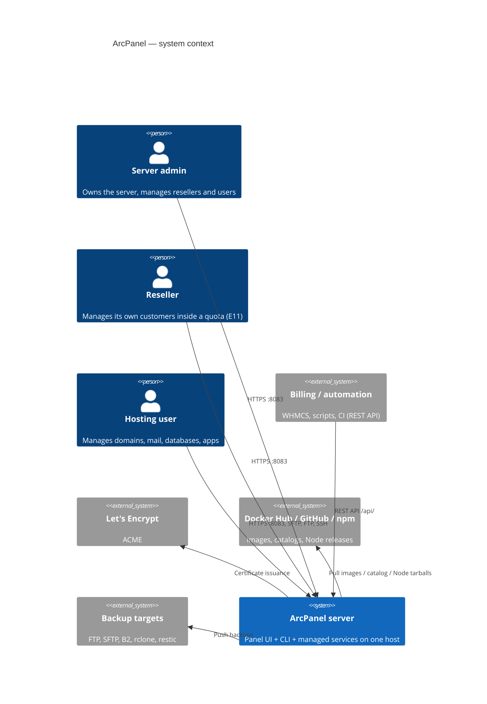
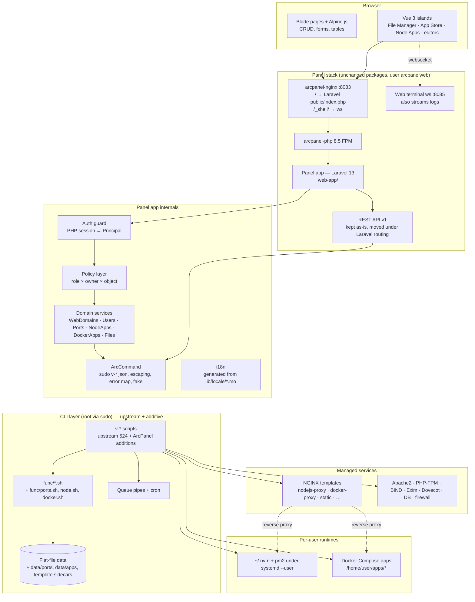
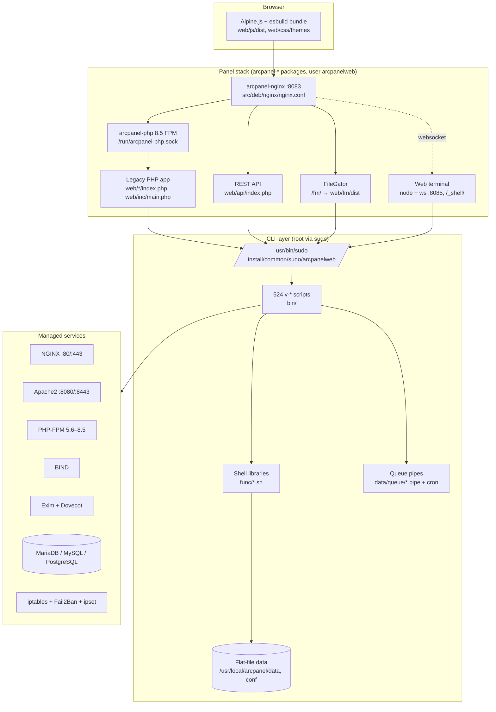

# 01 — Architecture Overview

**Epics:** all · **Status:** Draft v1; the 2.0 layout (panel app at the root URL, `web/` deleted, `lib/` for the libraries of the commands) is implemented by the [E8 spec](../features/specs/2026-10-06-004-e8-legacy-retirement-design.md)

This document describes the target architecture of ArcPanel 2.0, the principles every epic design follows, the runtime topology, packaging and the migration phases. The HestiaCP 1.10.5 starting point is summarised in Appendix A only as far as the designs depend on it.

---

## 1. System context

ArcPanel is a single-server hosting control panel. It runs on one Linux host (Debian 12/13, Ubuntu 22.04/24.04/26.04) and manages the services installed on that same host: NGINX, Apache2, PHP-FPM, BIND, Exim, Dovecot, MariaDB/MySQL/PostgreSQL, vsftpd/ProFTPD, iptables, Fail2Ban. There is no central control plane and no multi-server orchestration (out of scope, roadmap §7).



---

## 2. Target architecture (ArcPanel 2.0)



What changes between the starting point (Appendix A) and 2.0:

| Area          | 1.10.5                                                      | 2.0                                                                                                                                                       |
| ------------- | ----------------------------------------------------------- | --------------------------------------------------------------------------------------------------------------------------------------------------------- |
| Web UI        | `web/*/index.php` + `web/templates/pages/*.php`             | Laravel 13 in `web-app/`: controllers, Blade views, Vue islands; `web/` deleted (E8), the pieces commands use moved to `lib/`                             |
| Routing       | `arcpanel-nginx` serves PHP files from `web/`               | `arcpanel-nginx` sends `/` to `web-app/public/index.php`, `/api/` to `lib/api/index.php`; `/app/*` (the 1.x prefix, ADR-0002) answers 301 for one release |
| Auth          | `$_SESSION` checks in `main.php`                            | Laravel guard reading the same session (until E8), then a native session handler at the same path with the same keys so the web terminal keeps working    |
| Authorization | admin vs user via `userContext`; policies in `policies.php` | Policy classes: role × owner × object; the same classes back UI and API                                                                                   |
| Roles         | user, admin, dns-cluster                                    | user, reseller, admin, dns-cluster; `OWNER` relationship                                                                                                  |
| CLI           | 524 commands                                                | 524 unchanged + ArcPanel additions (ports, node, docker, apps, reseller, templates-meta)                                                                  |
| Runtimes      | PHP only                                                    | PHP, Node (per user, nvm + pm2), Docker Compose (per user), system packages (admin)                                                                       |
| File manager  | FileGator (third party)                                     | First-party Vue island on `v-*-fs-*`                                                                                                                      |
| Templates     | file-name dropdown                                          | `template.json` sidecars + card picker + 25 new templates                                                                                                 |
| Testing       | BATS, lint                                                  | BATS + Pest + Playwright + brand check                                                                                                                    |

What does **not** change: the `arcpanel-nginx` / `arcpanel-php` packages and their user, the sudoers rule, the flat-file data model, the queue mechanism, the installer entry points (`arcpanel-install*.sh`), `ARCPANEL_*` paths and constants, the REST API wire format.

---

## 3. Architectural principles

### 3.1 CLI is the system of record

The panel app never writes to `/usr/local/arcpanel/data` or to service configuration. It calls `v-*` commands and reads their `json` output. This keeps three properties:

- **Parity.** Anything the UI can do, the CLI and API can do, and the audit trail (`v-log-action`, `history.log`) stays complete.
- **Safety.** Argument validation (`is_format_valid`, `is_object_valid`, `check_arcpanel_demo_mode`) lives in one place, under root, and is shared by UI, API and SSH.
- **Upstream compatibility.** HestiaCP's `web/` can be deleted without losing behaviour because `web/` never held behaviour.

Consequence: every new feature starts with its `v-*` commands and BATS tests; the UI comes after.

### 3.2 Additive CLI changes

New behaviour is added as:

- new `bin/v-*` scripts (named in the upstream style: `v-{add|delete|change|list|suspend|unsuspend|update|check}-{object}`),
- new `func/<area>.sh` libraries sourced only by new scripts,
- new keys in `user.conf` / `.pkg` / `arcpanel.conf` (upstream's `source_conf` ignores unknown keys),
- new files under `data/` (`data/ports/`, `data/apps/`, `data/templates/web/.../*.json`),
- new installer options and upgrade steps in `install/`.

Hooks into existing flows use mechanisms upstream already provides: queue pipes, cron, `nginx.conf_*` includes, template `.sh` post-render scripts, `conf.d` directories, package post-install. The single modification of an existing script (`v-change-user-role` accepting `reseller`) is sent upstream and kept as a patch in `install/upgrade/patch/` until merged.

**User lifecycle hook points (E12, implemented 2026-10-05).** `func/hooks.sh` runs the scripts of `func/hooks.d/<event>/` from `v-add-user` (`post_add_user`), `v-change-user-package` (`post_change_user_package`), `v-suspend-user` (`post_suspend_user`), `v-unsuspend-user` (`post_unsuspend_user`) and `v-delete-user` (`pre_delete_user`); each of these commands gains two lines (the include and the call), a deliberate exception to the additive rule that is offered upstream. A failing hook is logged and never fails the command. The [E12 spec](../features/specs/2026-10-05-004-e12-port-registry-design.md) §6 replaces items (1) and (2) below for these five events; `post_rebuild_user` and `post_restore_web_domain` are still to come (E13, E14).

Earlier plan, kept for the remaining events: upstream `/etc/arcpanel/hooks/` today exposes only `pre_install.sh`, `post_install.sh`, `le_pre.sh` and `le_post.sh`. Several designs (03, 04, 07, 08, 12) want to react to `v-add-user`, `v-suspend-user`, `v-unsuspend-user`, `v-delete-user`, `v-rebuild-user` and `v-restore-web-domain`. The plan is: (1) propose the hook points upstream as one PR (`post_add_user.sh`, `post_suspend_user.sh`, `post_unsuspend_user.sh`, `post_delete_user.sh`, `post_rebuild_user.sh`, `post_restore_web_domain.sh`, each called with the user/domain as arguments, as `le_pre.sh` is today); (2) until merged, the panel's `UserService` calls the ArcPanel follow-up commands itself after the upstream command returns, and a nightly reconciliation (`v-check-sys-ports`, `v-check-sys-node`, `v-check-sys-docker`, `v-update-reseller-counters all`) converges state for users created, suspended or deleted from the CLI/API. Every reconciler fails safe (closes ports, stops daemons) rather than open.

**Since 2.0: a hard fork.** [ADR-0007](../adr/0007-full-rename-and-hard-fork.md) ends upstream merges. ArcPanel owns every file, inherited or not; the rule "additive changes only" and the list of recorded exceptions of 1.x (`test/upstream-exceptions.txt`, `.arcpanel/retired-paths`, `scripts/upstream-merge-cleanup.sh`) are gone. Changes keep the conventions of the inherited code, and HestiaCP security fixes are ported by hand.

The `Brand check` CI job (`test/brand-check.sh`) fails on any HestiaCP name outside the reasoned exceptions of `scripts/rename/keep.txt` (attribution, upstream links, names owned by third parties, the backup formats that restores read).

### 3.3 Strangler migration with one session

Both apps share one login because both read the same PHP session file. A URL prefix decides which app handles a request. A page is migrated by:

1. building the Laravel route + view,
2. switching the legacy navigation link to the new URL,
3. redirecting the old URL to the new one (`web/<old>/index.php` becomes a 301 stub),
4. deleting the stub in E8.

No feature freeze and no big-bang cut-over.

> **History (1.x).** The migration is complete. From E1-S2 to E7 the old URLs answered 302 behind the `ARCPANEL_APP_PAGES` switch (`arc_redirect_if_migrated()`) instead of 301 stubs. E8 deleted `web/` and the switch; the panel app serves the root URL, and the 1.x URLs redirect through `App\View\LegacyUrls` for one release (removed in 2.1).

### 3.4 Owner scoping is central, not per page

A single `OwnerScope` (03 §5) answers "which users may this principal see or change?". Controllers, list queries, policies and API key checks all call it. No Blade template and no Vue component contains an owner check.

### 3.5 Boring tools, one process model

- No message broker, no Redis requirement, no database server for the panel itself. Laravel uses the `file` cache and the shared PHP session; queued work goes through existing pipes (later a single systemd-managed Laravel worker, E15).
- Vue islands are built with the existing esbuild pipeline; no SSR, no Vite dev server in production.
- Per-user runtimes rely on systemd user instances and the existing per-user cgroup slice instead of a bespoke supervisor.

---

## 4. Runtime topology

### 4.1 Processes and users on the host

| Process                         | User                                                       | Listens                         | Started by                                 |
| ------------------------------- | ---------------------------------------------------------- | ------------------------------- | ------------------------------------------ |
| `arcpanel-nginx`                | `arcpanelweb` (workers), root (master)                     | `:8083` TLS                     | systemd `arcpanel-nginx.service`           |
| `arcpanel-php` FPM              | `arcpanelweb`                                              | `/run/arcpanel-php.sock`        | systemd `arcpanel-php.service`             |
| Laravel (inside FPM)            | `arcpanelweb`                                              | —                               | per request                                |
| Web terminal (`server.js`)      | root (needs `node-pty` as any user)                        | `127.0.0.1:8085` ws             | systemd `arcpanel-web-terminal.service`    |
| `v-*` commands                  | root                                                       | —                               | `sudo` from `arcpanelweb`, cron, SSH       |
| Queue processing                | root                                                       | —                               | cron → `v-update-sys-queue <pipe>`         |
| Panel queue worker (E15, later) | `arcpanelweb` (calls `v-*` through sudo like web requests) | —                               | systemd `arcpanel-worker.service`          |
| pm2 daemon (E14)                | each hosting user                                          | ports from registry (localhost) | `systemd --user`, `loginctl enable-linger` |
| Docker Engine (E4)              | root (daemon) or per-user rootless — ADR-0003              | ports from registry             | systemd                                    |
| Managed services                | their own users                                            | 80/443/8080/8443/53/25/…        | systemd                                    |

### 4.2 Request flow — a UI action

```mermaid
sequenceDiagram
  participant B as Browser
  participant N as arcpanel-nginx :8083
  participant L as Laravel (arcpanelweb)
  participant P as Policy layer
  participant H as ArcCommand
  participant S as sudo
  participant V as v-add-web-domain (root)
  participant Q as queue / nginx

  B->>N: POST /web/domains (CSRF token, ARCPANELSID cookie)
  N->>L: fastcgi → web-app/public/index.php
  L->>L: SessionBridge: load PHP session → Principal(user, look, role)
  L->>P: authorize('create', WebDomain, effectiveUser)
  P-->>L: allowed (role ok, effectiveUser in principal's tree, package not full)
  L->>H: run('v-add-web-domain', [user, domain, ip, 'no', aliases])
  H->>S: /usr/bin/sudo /usr/local/arcpanel/bin/v-add-web-domain 'user' 'domain' ...
  S->>V: exec as root
  V->>V: is_format_valid, is_object_valid, is_package_full
  V->>Q: write vhost from template; echo restart → restart.pipe
  V-->>H: exit 0 / stdout
  H-->>L: CommandResult(ok, output) or ArcCommandException(code, message)
  L-->>B: 303 → /web/domains?ok=1 (toast)
```

The legacy app of 1.x performed the same steps with `exec()`; the only new elements are the explicit `Principal`, the policy call and the typed result.

### 4.3 Request flow — an API call

Two APIs answer on the panel port, both with the same access keys; `arcpanel-nginx` sends `/api/v2/` to the panel app and the rest of `/api/` to the API v1 script (the longest prefix wins).

- **API v1** (`POST /api/`), unchanged in wire format: the script moved from `web/api/index.php` to `lib/api/index.php` with E8 and still runs one `v-*` command by name with positional arguments and the `ArcPanel-Exit-Code` header. `v-check-access-key` checks the key; a non-admin key is scoped by its permission sets and by one user argument. Documented in [`docs/api/openapi.yaml`](../api/openapi.yaml) (E29, generated from the command headers).
- **API v2** (`/api/v2/…`, [E34 spec](../features/specs/2026-10-07-002-e34-api-v2-design.md)): resource routes of the Laravel panel app in a stateless middleware group (no session, no CSRF). `AuthenticateAccessKey` reads `Authorization: Bearer ACCESS_KEY:SECRET_KEY`, runs `v-check-access-key-permissions` (secret in a `Secret` temp file) and binds the key's owner as the `Principal`; from there a call runs the same chain as a UI action (§4.2): FormRequest, policy and `OwnerScope`, service, `ArcCommand`. `PlanGate` checks every command of a plan against the key's permission sets before the first one runs and answers `?dry_run=1` without running any. Errors are `{"error": {"code", "message", "fields"}}` with the statuses of `ExitCode::httpStatus()` (02 §4.3). Documented in [`docs/api/v2/openapi.json`](../api/v2/openapi.json), generated from the code by `php artisan arcpanel:api-docs`.

[`docs/api/README.md`](../api/README.md) describes both and how to regenerate their documents.

### 4.4 Long-running operations

Until E15: a `v-*` command appends a line to a pipe (`data/queue/<name>.pipe`) and returns immediately; cron runs `v-update-sys-queue <name>`. The UI polls a `v-list-*` command for state. New pipes are added additively (`apps.pipe` for Docker installs, `node.pipe` for `npm ci`/builds) with their own cron entries installed by the upgrade script.

Live output (build logs, container logs) is streamed through the existing web terminal WebSocket server (07 §6.4, 08 §6.5): the server already authenticates the `ARCPANELSID` cookie and already spawns processes as the effective user.

---

## 5. Repository layout (target)

```text
bin/                    v-* commands — upstream + ArcPanel additions (prefix-free, upstream naming)
func/                   shell libraries — upstream + reseller.sh, ports.sh, fs.sh, node.sh, docker.sh, apps.sh, tplmeta.sh
install/
  common/
    apps/docker/        Docker catalog manifests (E4)
    apps/system/        apt/snap whitelist manifests (E5)
    packages/           default.pkg, system.pkg + developer.pkg (E13)
    api/                permission sets of API v1 + v2-read, v2-write (E34)
  deb/templates/web/    .tpl/.stpl + <name>.json sidecars (E6)
  upgrade/              versions/*.sh + patch/ (upstream patches)
lib/                    libraries of the commands since 2.0 (E8): Quick Install, 2FA, mail wrapper, API script, locales, logos, error pages
web-app/                Laravel 13 panel app (E1)
  app/
    Console/            artisan commands (i18n import, catalog sync)
    Hestia/             ArcCommand, CommandResult, exceptions, fakes
    Auth/               SessionBridge guard, Principal
    Policies/           per-object policies + OwnerScope
    Services/           WebDomains, Users, Resellers, Ports, Node, Docker, Files, Templates
    Http/Controllers/   thin: validate → authorize → service → redirect/JSON
  resources/
    views/              Blade + component library (E2)
    js/                 Alpine modules + Vue islands (E2, E3, E4, E14)
    lang/               generated from lib/locale/*.mo (do not edit by hand)
  routes/web.php, routes/api.php
  tests/                Pest unit + feature (fake ArcCommand)
  public/               index.php + built assets
src/deb/                arcpanel, arcpanel-nginx, arcpanel-php, web-terminal packaging (+ Laravel vendor in arcpanel)
test/                   BATS (bin/) + e2e/ Playwright (E10)
docs/                   roadmap, current-features, design/, specs, adr/
```

---

## 6. Deployment and packaging

- The `arcpanel` deb (`src/deb/arcpanel/`) ships `web-app/` including `vendor/` (built in CI with `composer install --no-dev --classmap-authoritative` on the bundled PHP 8.5). `arcpanel-nginx` ships the updated `nginx.conf` with the Laravel `location`. Nothing else changes in packaging.
- Fresh install: `install/arcpanel-install-*.sh` gains steps to create `web-app/storage/*` writable by `arcpanelweb`, generate `APP_KEY` into `/etc/arcpanel/arcpanel.env` (root:arcpanelweb 0640), and run `php artisan optimize`.
- Upgrade: `install/upgrade/versions/<ver>.sh` (ADR-0007; 2.0 is installed fresh only, so the first step belongs to the release after 2.0.0) runs the same steps idempotently, then `v-update-sys-queue restart` for `arcpanel-nginx`/`arcpanel-php`. Each epic that adds data files or package keys adds a migration step here (`v-update-user-ports` seeding, `developer.pkg` copy, sidecar generation).
- Rollback: panel packages are reverted from the apt cache (`v-rollback-sys-arcpanel` arrives with E33; until then the documented apt procedure). Because the panel app has no database, rollback is a package downgrade plus `php artisan optimize:clear`.
- Config: `/etc/arcpanel/arcpanel.env` holds only `APP_KEY`, `APP_ENV`, `APP_DEBUG` (mirrors `DEBUG_MODE`), `LOG_LEVEL`. Everything else is read live from `v-list-sys-config json`.

---

## 7. Non-functional requirements

| Requirement   | Target                                      | How the design meets it                                                                                     |
| ------------- | ------------------------------------------- | ----------------------------------------------------------------------------------------------------------- |
| Panel latency | p95 < 300 ms for list pages on a 2 vCPU VPS | One `v-list-*` call per page; results cached per request; `v-list-sys-config` cached 60 s in the file cache |
| Memory        | Panel stack < 150 MB RSS idle               | FPM pool unchanged (`pm.max_children` as today); opcache + `optimize`; no extra daemons until E15           |
| Availability  | Panel outage does not affect hosted sites   | Panel stack and hosted services remain separate processes; pm2/Docker survive panel restarts                |
| Security      | No new privileged path; no secrets in logs  | Only `v-*` through sudo; `ArcCommand` masks arguments flagged secret; see 12                                |
| Upgradability | Upstream merge < 1 day                      | Additive rule + CI diff check; `web/` replaced wholesale                                                    |
| Accessibility | Lighthouse a11y ≥ 90 on every page          | Component library with keyboard and ARIA built in (05)                                                      |
| i18n          | All 45+ languages keep working              | `.po` → Laravel lang import in CI; Crowdin stays the source                                                 |
| Testability   | Every controller testable without a server  | `ArcCommand` fake with recorded fixtures (02 §4.5)                                                          |

---

## 8. Migration phases at a glance

| Phase | Roadmap                             | Panel app serves                      | Legacy serves                          | Notes                                              |
| ----- | ----------------------------------- | ------------------------------------- | -------------------------------------- | -------------------------------------------------- |
| 0     | pre-E1                              | nothing                               | everything                             | baseline                                           |
| 1     | Q1 (E1, E2, E11 part 1, E12, E6 b1) | `/app/login`, `/app/`, `/app/web/*`   | everything else                        | session bridge proven; owner model and ports exist |
| 2     | Q2 (E3, E11 part 2, E13, E14)       | + files, users, packages, ports, node | rest                                   | FileGator still installed, hidden from nav         |
| 3     | Q3 (E4, E7 part 1)                  | + apps, db, dns, mail, cron, backups  | server settings, firewall, logs, stats | ≥ 70 % routes                                      |
| 4     | Q4 (E7 part 2, E8, E5)              | everything at `/`                     | nothing                                | `web/` deleted; Laravel at root; 2.0               |

See [10-page-migration-and-retirement.md](./10-page-migration-and-retirement.md) for the per-module order and the cut-over procedure.

---

## 9. Open questions

1. **URL prefix during migration** — `/app/*` (recommended) vs. a second port. Decided in ADR-0002.
2. **Web terminal as log transport** — decided: reuse `server.js` with a backwards-compatible `tail` control frame; one authenticated WebSocket endpoint is easier to secure. See [07](./07-node-platform.md) §6.4.
3. **Where API v1 lives after E8** — resolved by E8: the API stays a plain script, `lib/api/index.php`, still served at `/api/` by `arcpanel-nginx`; a port to a controller belongs to E29 (webhooks and OpenAPI). The original question: keep `web/api/index.php` as a standalone script under the Laravel `public/` directory (zero-risk) vs. port to a controller. Recommendation: keep the script, route `/api/` to it from `arcpanel-nginx`, and build OpenAPI (E29) on top; revisit when webhooks need shared code. The OpenAPI document exists since 2026-10-07 ([`docs/api/`](../api/README.md)).

---

## Appendix A — Starting point (HestiaCP 1.10.5)

### A.1 Containers



### A.2 Facts the designs rely on

These are verified in the code and are load-bearing for everything that follows.

| Fact                                                                                                                                                                                                                                                                                                                                                                  | Where                                                                       | Why it matters                                                                                                                                                                                                                                                                     |
| --------------------------------------------------------------------------------------------------------------------------------------------------------------------------------------------------------------------------------------------------------------------------------------------------------------------------------------------------------------------- | --------------------------------------------------------------------------- | ---------------------------------------------------------------------------------------------------------------------------------------------------------------------------------------------------------------------------------------------------------------------------------- |
| The panel's own NGINX runs as `arcpanelweb`, listens on `8083 ssl`, `root /usr/local/arcpanel/web`, and passes `\.php$` to `unix:/run/arcpanel-php.sock`                                                                                                                                                                                                              | `src/deb/nginx/nginx.conf`                                                  | The strangler route is one more `location` block in this file (see 02 §2)                                                                                                                                                                                                          |
| PHP-FPM pool runs as `arcpanelweb:arcpanelweb`, bundled PHP 8.5                                                                                                                                                                                                                                                                                                       | `src/deb/php/php-fpm.conf`                                                  | Laravel runs as `arcpanelweb`; no new system user is needed                                                                                                                                                                                                                        |
| `arcpanelweb ALL=NOPASSWD:/usr/local/arcpanel/bin/*`                                                                                                                                                                                                                                                                                                                  | `install/common/sudo/arcpanelweb`                                           | The only privilege boundary between web and root is the `v-*` scripts' own argument validation. Nothing new is added to sudoers                                                                                                                                                    |
| Every web action is `exec(ARCPANEL_CMD . "v-... " . quoteshellarg(...))` with `ARCPANEL_CMD = "/usr/bin/sudo /usr/local/arcpanel/bin/"`                                                                                                                                                                                                                               | `web/inc/main.php:21`                                                       | `ArcCommand` (02 §4) reproduces exactly this contract                                                                                                                                                                                                                              |
| Session is PHP `files` handler, name `ARCPANELSID`, save path `$ARCPANEL/data/sessions`                                                                                                                                                                                                                                                                               | `src/deb/php/php.ini`, `src/deb/web-terminal/web-terminal-session-auth.php` | The session bridge reads the same files; the web terminal already does this from Node                                                                                                                                                                                              |
| Session keys: `user`, `look` (impersonated user), `userContext` (role at login), `role`, `login_shell`, `token` (CSRF), `LAST_ACTIVITY`, `INACTIVE_SESSION_TIMEOUT`, `user_combined_ip`, `DISABLE_IP_CHECK`, `language`, `userTheme`, `userSortOrder`, every `arcpanel.conf` key (`VERSION`, `POLICY_*`, `ROOT_USER`, …) and 2FA state under `login` / `failed_twofa` | `web/inc/main.php`, `web/login/index.php`                                   | The bridge must read these and nothing else; the legacy app keeps writing them until E8                                                                                                                                                                                            |
| Role model today: `ROLE` is `user`, `admin` or `dns-cluster` in `user.conf`; admin checks use `$_SESSION["userContext"] === "admin"`; read-only mode computed in `web/inc/policies.php`                                                                                                                                                                               | `bin/v-change-user-role`, `web/inc/policies.php`                            | E11 adds `reseller` and `OWNER`; `func/main.sh:get_user_owner()` already greps `OWNER` from `user.conf` when `RESELLER_KEY` is set, so the key is upstream-blessed                                                                                                                 |
| Data is flat files: `data/users/<user>/{user,web,dns,mail,db,cron,backup}.conf`, one object per line as `KEY='value'` pairs; packages in `data/packages/*.pkg`; access keys in `data/access-keys/`; legacy API keys in `data/keys/`                                                                                                                                   | `func/main.sh`, `bin/v-add-user`                                            | No database is introduced before 2.0; hosting state stays in these files forever. E15 (post-2.0) adds a SQLite file for panel-owned operational data only ([14](./14-later-backlog.md) §0.1). Laravel reads hosting state through `v-list-*` JSON, never from these files directly |
| Long operations go through `data/queue/{backup,restart,letsencrypt,dns-cluster,…}.pipe`, processed by `v-update-sys-queue` from cron                                                                                                                                                                                                                                  | `bin/v-update-sys-queue`, `bin/v-schedule-user-backup`                      | New long-running work (Docker installs, `npm ci`) uses the same pattern until E15 adds a job center                                                                                                                                                                                |
| Web templates are `%var%`-substituted files; every generated vhost includes `%home%/%user%/conf/web/%domain%/nginx.conf_*` and `nginx.ssl.conf_*`                                                                                                                                                                                                                     | `install/deb/templates/web/nginx/php-fpm/default.tpl`, `func/domain.sh`     | New per-domain features (WAF, custom directives) are drop-in files, no template edits                                                                                                                                                                                              |
| Per-user tools follow one pattern: `v-add-user-composer` installs into `$HOMEDIR/$user/...` with `user_exec`, path-escape checks and a `.bash_aliases` line                                                                                                                                                                                                           | `bin/v-add-user-composer`, `bin/v-add-user-wp-cli`                          | nvm (E13) copies this pattern                                                                                                                                                                                                                                                      |
| `v-list-fs-directory` prints one pipe-separated line per entry (type, mode, date, time, owner, group, size, name) via `user_exec find`; all `v-*-fs-*` commands run as the user                                                                                                                                                                                       | `bin/v-list-fs-directory`                                                   | File Manager v2 (E3) has its backend already                                                                                                                                                                                                                                       |
| REST API: `web/api/index.php` authenticates with `v-check-access-key KEY SECRET CMD IP json`, which returns the key's `USER` and `USER_ARG_POSITION`; permission sets are files in `install/common/api/` with `ROLE` and `COMMANDS`                                                                                                                                   | `web/api/index.php`, `install/common/api/billing`                           | Reseller-aware API keys (E11) reuse this; OpenAPI (E29) documents it                                                                                                                                                                                                               |
| Resource limits per user are systemd slices `user-<uid>.slice` set by `v-update-user-cgroup` from package keys `CPU_QUOTA`, `MEMORY_LIMIT`, `SWAP_LIMIT`                                                                                                                                                                                                              | `bin/v-update-user-cgroup`                                                  | pm2 daemons and rootless Docker inherit the user's slice for free                                                                                                                                                                                                                  |
| Frontend build: esbuild bundles `web/js/src/index.js` → `web/js/dist/main.min.js`; Lightning CSS builds `web/css/src/themes/*.css`; Vue 3 + Vitest are already devDependencies (docs site; `vue` moves to `dependencies` for the islands)                                                                                                                             | `build.js`, `package.json`                                                  | The design system (E2) extends this pipeline instead of adding Vite to production                                                                                                                                                                                                  |
| CI today: lint (Prettier, Biome, markdownlint), docs Vitest, a BATS Docker workflow                                                                                                                                                                                                                                                                                   | `.github/workflows/*.yml`, `test/*.bats`                                    | E10 adds Pest, Playwright and an upstream-diff check on top                                                                                                                                                                                                                        |
