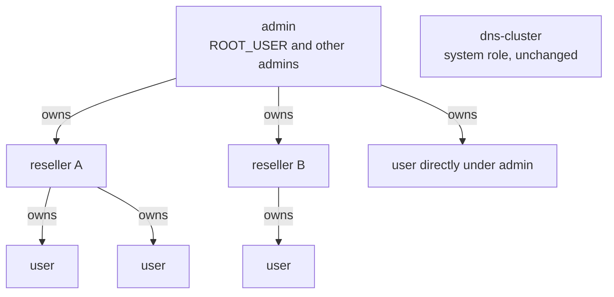
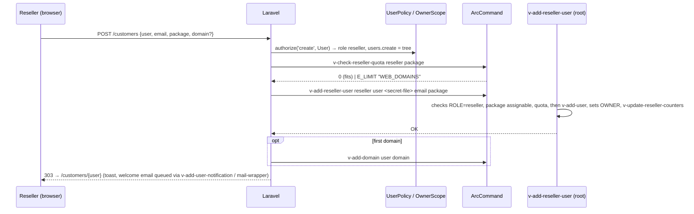

# 03 — Tenancy and Authorization (admin / reseller / user)

**Epic:** E11 · **Status:** Implemented 2026-10-05, see the [E11 spec](../features/specs/2026-10-05-003-e11-reseller-design.md) · **Depends on:** E1 · **Unblocks:** E7 (every migrated page), E12, E23, E30

> **Implemented with these changes** (decisions of the [E11 spec](../features/specs/2026-10-05-003-e11-reseller-design.md)):
>
> - **Storage (D2):** `OWNER` and `R_*` live in `data/users/<user>/tenancy.conf`, the package keys in `data/packages/<package>.tenancy`. Upstream commands rewrite `user.conf` (`v-add-user`, `v-change-user-package`) and `.pkg` (`v-add-user-package`) with a fixed key list, so §4.1–4.2 keys there would be lost. Library `func/tenancy.sh`, not `func/reseller.sh`.
> - **Commands (§5):** `v-list-user-owners` replaces `v-list-user-tree`; `v-check-reseller-quota RESELLER PACKAGE [USER]`; new `v-change-reseller-user-package`, `v-change-reseller-package`, `v-delete-reseller-package`, `v-list-package-tenancy`, `v-change-package-tenancy`, `v-delete-package-tenancy`, `v-rename-package-tenancy`, `v-add-sys-tenancy`.
> - **Quota (§4.3):** own usage `U_X` + Σ customers' package limit X + new package's X ≤ reseller's X (D7).
> - **`ROLE='reseller'`:** one-line change in `is_role_valid` (`func/main.sh`), no patch file (D10).
> - **Pages (§9):** one Users module `/users` ("Customers" for resellers) and one Packages module `/packages`; no `/customers` (D3). Statistics, Backups and Logs per tree stay with E7.
> - **Login as (§9.1):** resellers use the session key `arc_look`, checked on every request and never read by the legacy app; it works on panel pages only (D4).
> - **API keys (§8):** deferred to the Laravel API (D6), then built as REST API v2 (E34): see §8.

---

## 1. Goal

Add a **reseller** role that owns a set of users and manages them inside its own package limits, with zero cross-tenant visibility in UI or API, and make owner scoping a property of the platform rather than of individual pages.

Non-goals (post-2.0): reseller White Label, reseller billing, collaborators (E30).

---

## 2. Current state (verified in code)

- `user.conf` has `ROLE='user'|'admin'|'dns-cluster'`; `v-change-user-role USER ROLE` validates the role with `is_format_valid 'role'` and writes it. No owner field is written by `v-add-user`.
- `func/main.sh:get_user_owner()` reads `OWNER` from `user.conf` when `RESELLER_KEY` is set in `arcpanel.conf` — a dormant hook from VestaCP's reseller plugin. The key name `OWNER` is therefore upstream-compatible.
- `is_package_full` (`func/main.sh:270-295`) checks a user's own counters against its own package; nothing aggregates across users.
- Admin checks in the legacy UI are `$_SESSION['userContext'] === 'admin'`; `look` switches the effective user. A non-admin cannot impersonate (`web/login/index.php:107`).
- API keys: `v-check-access-key KEY SECRET CMD IP json` returns `USER` and `USER_ARG_POSITION`; permission sets in `install/common/api/<name>` have `ROLE='admin'|'user'` and `COMMANDS='…'`. For a non-root key, `web/api/index.php` enforces that the user argument equals the key's user.
- `U_*` counters in `user.conf` (`U_DISK`, `U_BANDWIDTH`, `U_WEB_DOMAINS`, …) are updated by `v-update-user-counters`, `v-update-user-stats`, `v-update-user-disk`.

---

## 3. Roles



| Role        | `ROLE` value         | Who                                     | Scope                                            |
| ----------- | -------------------- | --------------------------------------- | ------------------------------------------------ |
| Admin       | `admin`              | server owner(s)                         | everything                                       |
| Reseller    | `reseller` (**new**) | hosting provider / agency               | its tree: itself + users with `OWNER=<reseller>` |
| User        | `user`               | hosting customer                        | itself                                           |
| DNS cluster | `dns-cluster`        | system account for `v-sync-dns-cluster` | API only, unchanged                              |

A reseller **is also a user**: it has its own domains, mail and databases, counted against its package like any user. Its sub-users' usage is additionally rolled up into it (§4.3).

---

## 4. Data model (additive)

### 4.1 `user.conf`

| Key                                                                                                                                     | Values                                           | Written by                                   | Notes                                                                                                                                                                                                            |
| --------------------------------------------------------------------------------------------------------------------------------------- | ------------------------------------------------ | -------------------------------------------- | ---------------------------------------------------------------------------------------------------------------------------------------------------------------------------------------------------------------- |
| `ROLE`                                                                                                                                  | `user` · `admin` · `reseller` · `dns-cluster`    | `v-change-user-role`                         | `reseller` is new. The one-line format change is sent upstream; until merged it is a patch in `install/upgrade/patch/v-change-user-role.patch` applied by the upgrade script (CI upstream-diff allows this file) |
| `OWNER`                                                                                                                                 | username of a reseller, or `admin`'s `ROOT_USER` | `v-add-reseller-user`, `v-change-user-owner` | Absent = owned by `ROOT_USER` (matches `get_user_owner()` fallback). Never set on admins                                                                                                                         |
| `R_USERS`                                                                                                                               | integer                                          | `v-update-reseller-counters`                 | number of sub-users (reseller only)                                                                                                                                                                              |
| `R_DISK`, `R_BANDWIDTH`, `R_WEB_DOMAINS`, `R_DNS_DOMAINS`, `R_MAIL_DOMAINS`, `R_MAIL_ACCOUNTS`, `R_DATABASES`, `R_CRON_JOBS`, `R_PORTS` | integers                                         | `v-update-reseller-counters`                 | sum over the tree **including** the reseller's own `U_*`. Kept separate from `U_*` so upstream statistics of the reseller's own account stay correct                                                             |

### 4.2 Package (`.pkg`)

| Key                 | Values                              | Meaning                                                                                                                         |
| ------------------- | ----------------------------------- | ------------------------------------------------------------------------------------------------------------------------------- |
| `USERS`             | integer · `unlimited` · `0`         | max sub-users a user with this package may own. `0` (default for existing packages) = this package cannot be used by a reseller |
| `RESELLER_PACKAGES` | comma list of package names, or `*` | packages a reseller on this package may assign to sub-users; `*` = any package flagged `RESELLER_VISIBLE='yes'`                 |
| `RESELLER_VISIBLE`  | `yes` · `no`                        | whether resellers may assign this package to their customers (default `no`)                                                     |
| `PORTS`             | integer · `unlimited`               | port pool size (E12); for a reseller, the pool to sub-allocate from                                                             |

A new `reseller.pkg` ships in `install/common/packages/` as an example (`USERS='25'`, `RESELLER_PACKAGES='*'`, `PORTS='50'`, generous limits).

### 4.3 Quota semantics (ADR-0004)

Two interpretations exist; the ADR recommends **soft nested quota**:

- A sub-user's package limits are enforced as today by `is_package_full` against the sub-user's own package.
- The reseller's package is enforced at **allocation time** only: `v-add-reseller-user` and `v-change-user-package` (via a pre-check in the Laravel service and a new `v-check-reseller-quota`) refuse when `R_<X> + new package's <X>` would exceed the reseller's `<X>` (for `unlimited`-valued keys the check is skipped).
- Runtime usage (`R_DISK`, `R_BANDWIDTH`) above the reseller's limit does **not** suspend sub-users automatically; it is reported on the reseller dashboard and (E16) raised as an alert to the admin. This mirrors how `U_DISK` over `DISK_QUOTA` behaves for users today without filesystem quota.

Hard nested quota (suspend the tree when the reseller is over) is rejected for 2.0 because it needs a new enforcement loop in cron and a new user-facing failure mode; it can be added later as a policy toggle.

### 4.4 `arcpanel.conf`

| Key                               | Values                 | Meaning                                                         |
| --------------------------------- | ---------------------- | --------------------------------------------------------------- |
| `POLICY_RESELLER_CREATE_PACKAGES` | `yes` · `no` (default) | resellers may create packages whose limits fit inside their own |
| `POLICY_RESELLER_WHITE_LABEL`     | `yes` · `no` (default) | reserved for post-2.0                                           |
| `POLICY_RESELLER_LOGIN_AS`        | `yes` (default) · `no` | resellers may impersonate own sub-users                         |

---

## 5. Commands (all **new**, in `bin/`, library `func/reseller.sh`)

| Command                      | Arguments                                                  | Behaviour                                                                                                                                                                                                             |
| ---------------------------- | ---------------------------------------------------------- | --------------------------------------------------------------------------------------------------------------------------------------------------------------------------------------------------------------------- |
| `v-add-reseller-user`        | `RESELLER USER PASSWORD EMAIL [PACKAGE] [NAME] [LASTNAME]` | validates `RESELLER` has `ROLE='reseller'`, package is assignable (§4.2), quota fits (§4.3), then calls `v-add-user` and `v-change-user-config-value USER OWNER RESELLER`, then `v-update-reseller-counters RESELLER` |
| `v-list-reseller-users`      | `RESELLER [FORMAT]`                                        | users with `OWNER='RESELLER'`, same columns as `v-list-users`                                                                                                                                                         |
| `v-change-user-owner`        | `USER OWNER`                                               | `OWNER` must be a reseller or `ROOT_USER`; re-checks quota on the new owner; updates counters of both owners; logs a `Security` action                                                                                |
| `v-update-reseller-counters` | `RESELLER` or `all`                                        | recomputes `R_*`; scheduled with the existing daily/`disk` queue by an additive cron line                                                                                                                             |
| `v-check-reseller-quota`     | `RESELLER PACKAGE [KEY]`                                   | exit `0` if a sub-user on `PACKAGE` fits; `E_LIMIT` with the first violated key otherwise. Used by the Laravel validator for live feedback                                                                            |
| `v-list-user-tree`           | `USER [FORMAT]`                                            | the owner chain and sub-users of `USER`; used by `OwnerScope` cache warm-up and admin tree view                                                                                                                       |
| `v-list-reseller-packages`   | `RESELLER [FORMAT]`                                        | packages this reseller may assign                                                                                                                                                                                     |
| `v-add-reseller-package`     | `RESELLER PACKAGE ...limits`                               | only when `POLICY_RESELLER_CREATE_PACKAGES='yes'`; validates each limit ≤ reseller's own; stores `RESELLER_OWNER='RESELLER'` in the `.pkg` so it is listed only for that reseller                                     |

Suspend/unsuspend/delete of a reseller: `v-suspend-user RESELLER` already suspends only that account. The Laravel service exposes "suspend reseller **and** tree" as an explicit bulk action that loops `v-suspend-user` over `v-list-reseller-users`; deleting a reseller requires the tree to be empty or re-owned (`v-change-user-owner`) first — enforced in the service and documented for the CLI.

Existing commands that must stay correct with a reseller in the tree: `v-change-user-package` (Laravel pre-checks quota; the CLI is not modified), `v-delete-user` (triggers `v-update-reseller-counters` through the existing `/etc/arcpanel/hooks/` mechanism — an additive hook script `post_delete_user.sh` — if upstream lacks a hook here, the counters converge at the next scheduled recompute, which is acceptable).

---

## 6. Permission matrix

The roadmap's matrix, made executable. `✔` = allowed, `tree` = only for users in the principal's tree, `self` = only for the effective user, `pkg` = if the effective user's package allows.

| Capability                                                                      | admin                                 | reseller                                    | user                   |
| ------------------------------------------------------------------------------- | ------------------------------------- | ------------------------------------------- | ---------------------- |
| Server settings, services, IPs, firewall, updates, templates, packages (global) | ✔                                     | ✖                                           | ✖                      |
| Users: list / create / edit / suspend / delete                                  | ✔                                     | tree                                        | ✖                      |
| Users: change package                                                           | ✔                                     | tree, only assignable packages, quota check | ✖                      |
| Users: change owner                                                             | ✔                                     | ✖                                           | ✖                      |
| Packages: create                                                                | ✔                                     | only if `POLICY_RESELLER_CREATE_PACKAGES`   | ✖                      |
| Login-as                                                                        | any                                   | tree (if `POLICY_RESELLER_LOGIN_AS`)        | ✖                      |
| Web / DNS / Mail / DB / Cron / Backups objects                                  | any user                              | tree                                        | self                   |
| Port registry                                                                   | assign to anyone, change server range | sub-allocate own pool to tree               | read own; request more |
| Node / Docker apps                                                              | any user                              | tree                                        | self, pkg              |
| App Store install                                                               | ✔                                     | pkg                                         | pkg                    |
| Statistics / RRD                                                                | all + server graphs                   | tree aggregate, no server graphs            | self                   |
| Logs / auth log                                                                 | all                                   | tree                                        | self                   |
| Access keys                                                                     | any user; any permission set          | self; tree through API v2 (§8)              | self; user-role sets   |
| Notifications                                                                   | all                                   | tree (send to customers)                    | self                   |

The matrix is encoded once in `web-app/app/Policies/Capabilities.php` as data (`[capability => [role => Scope]]`) and consumed by the policies (§7), the role-aware navigation (05 §4) and the e2e role tests (11 §4). A capability missing from the table is denied.

---

## 7. Policy layer (Laravel)

### 7.1 `OwnerScope`

```php
final class OwnerScope
{
    public function __construct(private ArcCommand $arcpanel, private Principal $principal) {}

    /** Usernames the principal may act on, or null for "all" (admin). */
    public function visibleUsers(): ?array;

    public function canSee(string $user): bool;          // admin: true; reseller: $user in tree; user: $user === self
    public function canManage(string $user): bool;       // same as canSee, minus the reseller itself for destructive actions on itself? (no: resellers may manage themselves as users)
    public function assertVisible(string $user): void;   // throws AuthorizationException → 404 (not 403) to avoid existence leaks
    public function tree(string $reseller): array;       // the reseller and its customers, from v-list-user-owners json read once per request (TenancyDirectory)
}
```

Rules:

- The tree is read from `v-list-reseller-users` (root reads `user.conf` files); never from client input.
- `assertVisible` returns **404** for objects outside the tree so a reseller cannot probe usernames.
- Every controller that takes a `{user}` route parameter runs through the `effective-user` middleware, which calls `assertVisible` and binds `EffectiveUser`.
- List pages for admins and resellers call `visibleUsers()` and filter the `v-list-*` output server-side; for a user, the list command is called for `effectiveUser()` only.

### 7.2 Policies

One policy class per object type (`UserPolicy`, `PackagePolicy`, `WebDomainPolicy`, `DnsDomainPolicy`, `MailDomainPolicy`, `DatabasePolicy`, `CronJobPolicy`, `BackupPolicy`, `PortPolicy`, `NodeAppPolicy`, `DockerAppPolicy`, `ServerPolicy`, `ImpersonationPolicy`, `AccessKeyPolicy`). Each method is three lines: look up the capability in `Capabilities`, resolve the scope with `OwnerScope`, apply read-only. Example:

```php
final class UserPolicy {
	public function update(Principal $p, UserRecord $target): bool {
		return Capabilities::allows(
			$p->loginRole,
			"users.update",
			fn() => $this->scope->canManage($target->name),
		) && !$p->isReadOnly();
	}
	public function changePackage(Principal $p, UserRecord $target, string $package): bool {
		return $this->update($p, $target) &&
			($p->loginRole !== Role::Reseller || $this->resellers->canAssign($p->loginUser, $package));
	}
}
```

Policies decide; the CLI still validates. A policy bug can only ever **widen** UI access to something the CLI permits root to do, which is why E11 also ships owner-aware **commands** (§5) and tree-scoped API permission sets (§8) rather than relying on the panel alone.

### 7.3 Where owner checks are forbidden

- Blade templates and Vue components: they receive already-filtered data and a `can` map; they never compare usernames.
- JavaScript: nothing security-relevant.
- `ArcCommand`: it does not know about roles.

---

## 8. API access keys

> **Replaced by REST API v2** ([E34 spec](../features/specs/2026-10-07-002-e34-api-v2-design.md), implemented 2026-10-07). The `SCOPE` line, `v-check-access-key-scope`, the `reseller-billing` set and `v-add-reseller-access-key` below were never built. Owner awareness comes from API v2 instead:
>
> - A v2 call acts as the **owner of the key** (its `Principal`, with that user's role and read-only state), so the policies, `OwnerScope` and `TenancyDirectory` of §7 apply exactly as for that user signed in: outside the tree **404**, refused inside it **403**. A reseller's key manages its customers through the same routes as an administrator's.
> - `v-check-access-key-permissions ACCESS_KEY_ID SECRET_FILE IP [FORMAT]` checks the key and prints its user, role, sets and allowed commands.
> - v2-only sets (`ROLE='user'`, `API_VERSION='2'`) limit what a key may run; `get_apis_commands` skips them for API v1, so they open nothing there. `v2-read` and `v2-write` are the union of the area sets `v2-accounts`, `v2-web`, `v2-dns`, `v2-mail`, `v2-db` and `v2-cron`. A key may hold several area sets. Every command of a v2 plan is checked against the sets before the first one runs.
> - API v1 (`lib/api/index.php`) is unchanged: a non-admin key is still scoped by its sets and one user argument.

The original design, kept for reference:

- Permission set files gain an optional `SCOPE='self|tree|all'` line (default: `all` for `ROLE='admin'`, `self` for `ROLE='user'`), read by `v-check-access-key` through an **additive** helper in `func/reseller.sh` — the existing command is not changed; instead a new `v-check-access-key-scope KEY CMD USER_ARG` is called by the API layer after `v-check-access-key` succeeds, and refuses when the user argument is outside the key owner's scope.
- New permission set `install/common/api/reseller-billing`: `ROLE='reseller'`, `SCOPE='tree'`, `COMMANDS='v-add-reseller-user,v-suspend-user,v-unsuspend-user,v-delete-user,v-change-user-package,v-list-reseller-users,v-list-user,v-change-user-password,v-make-tmp-file'`.
- `v-add-access-key` already stores `USER`; a reseller may create keys only with sets whose `ROLE` is `reseller` or `user`. The Laravel `AccessKeyPolicy` enforces this; `v-add-access-key` is additionally wrapped by `v-add-reseller-access-key` (**new**) that validates the set for CLI/API callers.
- `web/api/index.php` (`lib/api/index.php` since 2.0) is modified only by inserting the scope call (it was legacy `web/`, which ArcPanel owns).

---

## 9. User interface

Built with E2 components; migrated Users and Packages pages (E7) are delivered as part of E11 part 2 because they are reseller-centric.

### 9.1 Role-aware shell

Navigation is generated from `Capabilities` for the login role:

| Role     | Sidebar                                                                                                                                                                                                              |
| -------- | -------------------------------------------------------------------------------------------------------------------------------------------------------------------------------------------------------------------- |
| admin    | Dashboard · Users · Web · DNS · Mail · DB · Cron · Backups · Apps · Files · Server (Settings, Services, IPs, Firewall, Ports, Updates, Logs, Templates)                                                              |
| reseller | Dashboard · Customers · Packages · Ports · Statistics · Backups · Logs · **My hosting** (the reseller's own Web / DNS / Mail / DB / Cron / Files / Apps, rendered with the same module pages as a user) · My account |
| user     | Dashboard · Web · DNS · Mail · DB · Cron · Backups · Apps · Files · Account                                                                                                                                          |

An "Acting as reseller" / "Logged in as <customer>" badge sits in the top bar with a customer switcher (impersonation, §5.7 of 02).

### 9.2 Reseller pages

| Page                        | Route               | Data                                                                                                                                                                 | Actions                                                                                                                                                                                                                                                                                          |
| --------------------------- | ------------------- | -------------------------------------------------------------------------------------------------------------------------------------------------------------------- | ------------------------------------------------------------------------------------------------------------------------------------------------------------------------------------------------------------------------------------------------------------------------------------------------ |
| Dashboard                   | `/`                 | `v-list-user RESELLER` (`R_*` vs package), `v-list-reseller-users`, `v-list-user-ports` (E12), expiring SSL across tree (`v-list-web-domains` per user, `SSL` dates) | quick create customer, switch to customer                                                                                                                                                                                                                                                        |
| Customers                   | `/customers`        | `v-list-reseller-users json`                                                                                                                                         | login-as, suspend/unsuspend, change package, reset password, delete (if no Node/Docker apps running — else confirm), bulk actions; **create-customer wizard**: username, contact, package (from `v-list-reseller-packages`), optional first domain + mail + DB via `v-add-domain`, welcome email |
| Customer detail             | `/customers/{user}` | tabs reuse E7 module views with `EffectiveUser` fixed                                                                                                                | all module actions, "open as customer"                                                                                                                                                                                                                                                           |
| Packages                    | `/packages`         | `v-list-reseller-packages`, own package                                                                                                                              | create (if policy) with live `v-check-reseller-quota`                                                                                                                                                                                                                                            |
| Ports                       | `/ports`            | E12                                                                                                                                                                  | sub-allocate to customers                                                                                                                                                                                                                                                                        |
| Statistics / Backups / Logs | E7 pages            | filtered by `visibleUsers()`                                                                                                                                         | aggregate + per-customer selector                                                                                                                                                                                                                                                                |

### 9.3 Admin additions

Users list: `Owner` column and filter; tree view (`v-list-user-tree`); "Convert to reseller" (`v-change-user-role USER reseller` + choose package with `USERS > 0`); per-reseller limits editor (edits the reseller's package assignment); impersonate reseller.

### 9.4 User additions

"Your provider" card showing the owner's `NAME`/`CONTACT` (from `v-list-user OWNER json`, filtered to those two fields by the service) instead of the admin contact; "request more ports" sends `v-add-user-notification OWNER …`.

---

## 10. Sequence: reseller onboards a customer



---

## 11. Failure modes and security

| Risk                                                        | Mitigation                                                                                                                                                                                                                      |
| ----------------------------------------------------------- | ------------------------------------------------------------------------------------------------------------------------------------------------------------------------------------------------------------------------------- |
| Reseller reads another tenant through a list page           | Lists are filtered server-side from `visibleUsers()`; 404 on direct access; e2e test logs in as two resellers and diffs every list/JSON endpoint                                                                                |
| Reseller escalates via API key with an admin permission set | `AccessKeyPolicy` + `v-add-reseller-access-key` restrict sets by `ROLE`; `v-check-access-key-scope` enforces the user argument                                                                                                  |
| Reseller impersonates admin                                 | `ImpersonationPolicy`: target must be in tree **and** `ROLE='user'`; `look` set only through Laravel; legacy `?loginas=` path requires `userContext === 'admin'` already                                                        |
| `OWNER` points to a deleted reseller                        | `v-delete-user` on a reseller requires an empty tree (service) — CLI users are told to `v-change-user-owner` first; nightly `v-update-reseller-counters all` flags orphans in its log and `v-run-sys-doctor` (E17) reports them |
| Quota drift (`R_*` stale)                                   | Allocation-time checks recompute from `v-list-reseller-users` + package files, not from `R_*`; `R_*` is for display                                                                                                             |
| `v-change-user-role` patch lost on upstream merge           | Upgrade script re-applies the patch idempotently; BATS test `v-change-user-role x reseller` must succeed                                                                                                                        |

---

## 12. Testing

- **BATS:** full reseller lifecycle (create reseller, package with `USERS=2`, two customers, third refused with `E_LIMIT`, change owner, counters, delete order).
- **Pest unit:** `Capabilities` table completeness (every route's `can` has an entry), `OwnerScope` with fixture trees, each policy's matrix.
- **Pest feature:** every Laravel endpoint with three principals (admin, reseller A, reseller B) against a fixture with two trees — asserts 200/404 per the matrix; API key scope tests.
- **Playwright:** reseller onboarding end-to-end; cross-tenant negative tests in UI and API; admin tree view; "Your provider" card for a customer.

---

## 13. Open questions

1. Should resellers be allowed to own other resellers (multi-level)? **No** for 2.0: `v-change-user-owner` rejects an owner whose own `OWNER` is not `ROOT_USER`. Keeps `OwnerScope` to one level.
2. `v-delete-user` hook availability: upstream has no user-lifecycle hooks today (only `le_pre/le_post/pre_install/post_install`). Follow the plan in [01](./01-architecture-overview.md) §3.2: propose the hook points upstream, call the follow-ups from `UserService` meanwhile, and rely on `v-update-reseller-counters all` for CLI-created changes.
3. Should `admin` accounts other than `ROOT_USER` be able to own users (`OWNER=<admin>`)? Recommendation: no; all admin-created users have `OWNER=ROOT_USER`. Simplifies the tree.
