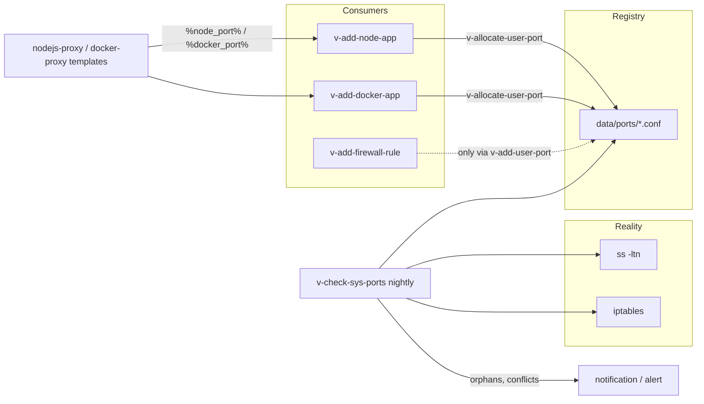

# 04 — Port Registry

**Epic:** E12 · **Status:** Draft v1 · **Depends on:** E1, E11 (for reseller sub-allocation) · **Unblocks:** E4 (Docker apps), E14 (Node apps)

---

## 1. Goal

One authoritative answer to "which TCP/UDP ports may user X bind, and which of them are reachable from the internet?". Admins allocate ports or ranges to users, resellers sub-allocate from their pool, and every feature that needs a port (Node apps, Docker apps, firewall rules) draws from the registry instead of guessing. The registry also reconciles itself against what is really listening.

Non-goals: enforcing binds at the kernel level for arbitrary user processes (a user with SSH can still `nc -l 31337`; the registry makes that visible and un-routed, not impossible — see §7).

---

## 2. Current state (verified in code)

- Nothing in the panel tracks high ports. Web/mail/DNS/DB/FTP ports are fixed in `hestia.conf` (`BACKEND_PORT=8083`, `WEB_PORT`, `WEB_SSL_PORT`, `PROXY_PORT`, `PROXY_SSL_PORT`, `WEB_TERMINAL_PORT`) or in service configs; the FTP passive range lives in the vsftpd/proftpd config.
- Firewall rules are objects in `data/firewall/rules.conf` managed by `v-add-firewall-rule ACTION IP PORT [PROTOCOL] [COMMENT] [RULE]`; `v-list-firewall-rules`, `v-delete-firewall-rule RULE`.
- `v-list-sys-ips json` lists public IPs; `v-list-sys-services json` lists service state. `ss -ltn`/`-lun` is available on every supported OS.
- Users have no notion of "my ports"; the web terminal and SSH users can bind anything > 1024.

---

## 3. Concepts

| Term               | Definition                                                                                                                                                                                                                                  |
| ------------------ | ------------------------------------------------------------------------------------------------------------------------------------------------------------------------------------------------------------------------------------------- |
| **Server range**   | `PORT_RANGE_START`–`PORT_RANGE_END` in `hestia.conf` (default `30000`–`39999`): the only range the registry allocates from                                                                                                                  |
| **Reserved ports** | ports the registry never hands out: `BACKEND_PORT`, `WEB_TERMINAL_PORT`, SSH, 25/465/587/110/143/993/995, 53, 3306/5432, 21 + FTP passive range, 80/443/8080/8443, anything currently listening that is not in the registry at install time |
| **Pool**           | the set of ports allocated to a user (explicit list and/or ranges). A reseller's pool is what it may sub-allocate                                                                                                                           |
| **Allocation**     | one registry entry: port, protocol, owner user, consuming app, public or private, comment, date                                                                                                                                             |
| **Public**         | `PUBLIC='yes'`: a matching firewall `ACCEPT` rule exists; the port is reachable from the internet. `PUBLIC='no'`: the service listens on `127.0.0.1` only and is reached through a domain reverse proxy                                     |
| **Orphan**         | a listening socket in the server range with no registry entry, or a registry entry whose owner/app no longer exists                                                                                                                         |

---

## 4. Data model (additive)

### 4.1 `/usr/local/hestia/data/ports/<user>.conf` (**new**)

One object per line, Hestia style, so `v-list-*` helpers in `func/main.sh` (`parse_object_kv_list`, `is_object_valid 'ports/<user>' 'PORT' …`) work unchanged:

```text
PORT='30001' PROTO='tcp' APP='node:api.example.com' PUBLIC='no' IP='' COMMENT='Express API' SUSPENDED='no' TIME='10:12:33' DATE='2026-10-04'
PORT='30002' PROTO='tcp' APP='docker:uptime-kuma' PUBLIC='yes' IP='203.0.113.10' COMMENT='' SUSPENDED='no' TIME='10:14:02' DATE='2026-10-04'
PORT='30010-30019' PROTO='tcp' APP='' PUBLIC='no' IP='' COMMENT='reserved block' SUSPENDED='no' TIME='…' DATE='…'
```

- `APP` is `<kind>:<id>` (`node:<domain>`, `docker:<app>`, `manual`, or empty for an unassigned block). Kind strings are owned by E14 and E4.
- `IP` is set only for public ports (the public IP the firewall rule was written for; empty = all IPs).
- A range entry (`PORT='a-b'`) is a block owned by the user; single ports inside it are split out when consumed (`v-allocate-user-port` rewrites the block as `a-(p-1)` + `p` + `(p+1)-b`).
- Files are `root:root 0640` like other `data/` files. The panel reads them only through `v-list-user-ports`.

### 4.2 `/usr/local/hestia/data/ports/reserved.conf` (**new**)

Same format, owner-less, written at install/upgrade by `v-update-sys-ports-reserved` from `hestia.conf` and service configs; admins may add entries. Used by every allocation check.

### 4.3 `user.conf`

| Key       | Written by                                                                   | Meaning                                                  |
| --------- | ---------------------------------------------------------------------------- | -------------------------------------------------------- |
| `U_PORTS` | `v-update-user-counters` extension (additive cron) and every `v-*-user-port` | ports allocated to the user (single ports + range sizes) |

### 4.4 Package

| Key     | Values                                | Meaning                                                                                                                                                                                                                                                                                                                                                                                                                     |
| ------- | ------------------------------------- | --------------------------------------------------------------------------------------------------------------------------------------------------------------------------------------------------------------------------------------------------------------------------------------------------------------------------------------------------------------------------------------------------------------------------- |
| `PORTS` | integer · `unlimited` · `0` (default) | size of the pool automatically allocated on user creation (`v-add-user` is unchanged: the block is allocated by `v-add-user-port-pool`, called from the Laravel `UserService` after `v-add-user`, from the proposed `post_add_user.sh` hook for CLI/API creations once upstream ships it, and otherwise lazily on the first `v-allocate-user-port` call for that user). `unlimited` disables the pool check (admin-trusted) |

### 4.5 `hestia.conf`

| Key                                   | Default           | Meaning                                                                                                             |
| ------------------------------------- | ----------------- | ------------------------------------------------------------------------------------------------------------------- |
| `PORT_RANGE_START` / `PORT_RANGE_END` | `30000` / `39999` | server range                                                                                                        |
| `PORT_REGISTRY`                       | `yes`             | master switch; `no` makes `v-allocate-user-port` return any free port without pool checks (escape hatch for admins) |

---

## 5. Commands (**new**, library `func/ports.sh`)

| Command                       | Arguments                                                   | Behaviour                                                                                                                                                                                                                                                                               |
| ----------------------------- | ----------------------------------------------------------- | --------------------------------------------------------------------------------------------------------------------------------------------------------------------------------------------------------------------------------------------------------------------------------------- |
| `v-add-user-port`             | `USER PORT_OR_RANGE [PROTO=tcp] [PUBLIC=no] [COMMENT] [IP]` | validates range inside server range, not reserved, not allocated to anyone (scans all `data/ports/*.conf`), caller's pool rules (§6); writes the entry; if `PUBLIC=yes` runs `v-add-firewall-rule ACCEPT 0.0.0.0/0 PORT PROTO "arcpanel:USER:PORT"` and stores the rule id in `FW_RULE` |
| `v-delete-user-port`          | `USER PORT`                                                 | refuses if `APP` is non-empty unless `force`; deletes the firewall rule by `FW_RULE`; merges adjacent free blocks                                                                                                                                                                       |
| `v-change-user-port-public`   | `USER PORT PUBLIC [IP]` (PUBLIC = yes or no)                | adds/removes the firewall rule; Node/Docker services are told to re-bind (E14/E4 listen on `0.0.0.0` only when public)                                                                                                                                                                  |
| `v-list-user-ports`           | `USER [FORMAT]`                                             | the user's entries + live `LISTEN` state for each (from one `ss -Hltn -lun` pass)                                                                                                                                                                                                       |
| `v-list-sys-ports`            | `[FORMAT] [--orphans]`                                      | registry across all users, reserved list, live sockets in the server range with owner resolution (`ss -p` → pid → uid → user), conflicts and orphans                                                                                                                                    |
| `v-allocate-user-port`        | `USER APP [PROTO=tcp]`                                      | **the API other epics use**: next free port from the user's pool (splitting a block), or — when the pool is exhausted and the package `PORTS` is `unlimited` — the next free port in the server range; prints the port; `E_LIMIT` when the pool is exhausted and limited                |
| `v-release-user-port`         | `USER APP`                                                  | frees every port whose `APP` matches (used by `v-delete-node-app`, `v-delete-docker-app`); keeps the port in the user's pool as an unassigned entry                                                                                                                                     |
| `v-check-user-port`           | `USER PORT [PROTO]`                                         | exit 0 if `USER` owns `PORT` and nothing else listens on it; used before a Node/Docker start                                                                                                                                                                                            |
| `v-add-user-port-pool`        | `USER [SIZE]`                                               | allocates a contiguous block of `SIZE` (default: package `PORTS`) as one range entry                                                                                                                                                                                                    |
| `v-change-user-port-owner`    | `USER PORT NEW_USER`                                        | reseller sub-allocation (§6) and admin moves; refuses if `APP` is set                                                                                                                                                                                                                   |
| `v-update-sys-ports-reserved` | —                                                           | regenerates `reserved.conf`                                                                                                                                                                                                                                                             |
| `v-check-sys-ports`           | `[notify]`                                                  | nightly reconciliation: orphans, conflicts, public ports without firewall rule, firewall rules tagged `arcpanel:` without entry; writes `data/ports/.report.json` and, with `notify`, `v-add-user-notification admin …` (E16 later turns this into an alert)                            |

Suspend/delete integration: `v-suspend-user` and `v-delete-user` are unchanged. The follow-ups (`v-change-user-port-public USER PORT no` for every public port on suspend; deleting `data/ports/<user>.conf` and the tagged firewall rules on delete) run from the proposed hook points `post_suspend_user.sh` / `post_delete_user.sh` once upstream has them, and from the panel's `UserService` until then ([01](./01-architecture-overview.md) §3.2). For CLI/API-driven changes the nightly `v-check-sys-ports` removes firewall rules for non-existent or suspended users (fail-safe direction: closing ports).

Locking: all writers take `flock /usr/local/hestia/data/ports/.lock` so two concurrent allocations cannot hand out the same port.

---

## 6. Pool rules by role

| Caller   | May allocate                                                                                                                                                                                   | Public ports                                                                                                  |
| -------- | ---------------------------------------------------------------------------------------------------------------------------------------------------------------------------------------------- | ------------------------------------------------------------------------------------------------------------- |
| admin    | any free port in the server range, to any user; may change the server range                                                                                                                    | yes                                                                                                           |
| reseller | only from its own pool (its `data/ports/<reseller>.conf` entries with empty `APP`), to users in its tree, via `v-change-user-port-owner`; the sum given away cannot exceed its package `PORTS` | only if the admin allocated the block as public-capable (`COMMENT` flag `public-ok`) — otherwise `E_FORBIDEN` |
| user     | consumes its own pool through `v-allocate-user-port` (indirectly, from Node/Docker commands)                                                                                                   | may toggle public only on ports flagged `public-ok` by the owner                                              |

These rules are enforced in `func/ports.sh` for CLI callers (the Laravel policies replicate them for better error messages). The CLI determines the caller through `$USER`/`SUDO_USER` semantics? **No** — `v-*` always run as root. The caller role is passed explicitly: the Laravel `PortService` calls `v-add-user-port` only after `PortPolicy` allowed it, and the CLI enforces the structural rules (inside range, not reserved, not taken, pool size). This is the same trust model as every other command (root CLI trusts the caller, the panel decides who may call).

---

## 7. Enforcement model



1. **Private by default.** Node and Docker apps bind `127.0.0.1:<port>`; the domain's NGINX template proxies to it. No firewall rule is involved, so nothing is exposed even if the firewall is off.
2. **Public is explicit.** Only `v-add-user-port … yes` / `v-change-user-port-public` write firewall rules, always tagged `arcpanel:<user>:<port>` in the rule comment so `v-check-sys-ports` can reconcile.
3. **Consumers are honest.** `v-add-node-app` / `v-add-docker-app` accept an explicit `PORT` only if `v-check-user-port` passes; otherwise they allocate.
4. **Reality is observed.** Orphan sockets (a user running something by hand) are listed with their owner on Admin → Ports and in the owner's "My ports" page. They are not killed; with `PORT_REGISTRY=yes` and `PUBLIC='no'` they are simply unreachable from outside because no firewall rule exists (the default iptables policy on Hestia drops unknown inbound ports when the firewall is enabled).

---

## 8. Laravel side

- `PortService` (`web-app/app/Services/Ports/`): `allocate(user, app)`, `release(user, app)`, `listForUser(user)`, `listSystem()`, `makePublic(user, port, ip)`, `subAllocate(reseller, user, range)`. All methods call the commands above through `ArcCommand`.
- `PortPolicy`: `viewAny` (admin), `viewOwn` (self/tree), `allocate` (admin any; reseller tree from own pool), `makePublic` (admin; owner-flagged), `changeServerRange` (admin).
- Pages:
  - **Admin → Server → Ports** (`/app/server/ports`): allocation table (user, ports, used/free, public count), live usage from `v-list-sys-ports`, conflicts/orphans panel with "Register to user" and "Close firewall rule" actions, server range editor (refuses to shrink below allocated ports), reserved list.
  - **User → My ports** (`/app/ports`): read-only table of own entries with app, public flag and live state; "Request more ports" → notification to `OWNER`.
  - **Reseller → Ports** (`/app/ports`): own pool, sub-allocation (type a range or pick a block), per-customer usage, requests from customers.
- The data table component (05) renders ports; no custom JS beyond the range picker.

---

## 9. Sequence: Node app gets a port

```mermaid
sequenceDiagram
  participant S as NodeAppService (Laravel)
  participant A as v-add-node-app (root)
  participant P as v-allocate-user-port
  participant F as data/ports/user.conf
  participant T as nodejs-proxy template

  S->>A: v-add-node-app user api.example.com api app.js 22
  A->>P: v-allocate-user-port user node:api.example.com
  P->>F: flock; find first free in pool (split block); write PORT APP
  P-->>A: 30001
  A->>A: write ecosystem.config.cjs with PORT=30001, HOST=127.0.0.1
  A->>T: v-change-web-domain-proxy-tpl / template var node_port=30001 (09)
  A-->>S: OK
```

---

## 10. Failure modes

| Failure                                               | Mitigation                                                                                                                                                               |
| ----------------------------------------------------- | ------------------------------------------------------------------------------------------------------------------------------------------------------------------------ |
| Two allocations race                                  | `flock` on `data/ports/.lock` around read-check-write                                                                                                                    |
| Admin opens a port by hand with `v-add-firewall-rule` | `v-check-sys-ports` lists untagged rules on high ports as "unmanaged"; admin can adopt (`v-add-user-port … yes` with the same port and the tool links the rule) or leave |
| Server range changed while ports are allocated        | `v-change-sys-config-value PORT_RANGE_*` is wrapped by `v-change-sys-port-range` (**new**) which refuses when allocations fall outside the new range                     |
| Pool exhausted for a user                             | `E_LIMIT` surfaces as a clear UI message with "request more ports"; resellers see the same for their pool                                                                |
| Registry says private, app binds `0.0.0.0` anyway     | Templates and ecosystem/compose files are generated with `127.0.0.1`; `v-check-sys-ports` flags a socket on `0.0.0.0` for a `PUBLIC='no'` entry as a conflict            |
| User deleted outside the panel (`userdel`)            | Nightly check deletes firewall rules whose user no longer exists; `data/ports/<user>.conf` is archived to `data/ports/.deleted/`                                         |

---

## 11. Testing

- **BATS:** allocate/split/merge blocks; reserved and server-range refusals; public toggle creates and removes exactly one tagged firewall rule; `v-check-user-port` against a real listener (`nc -l`); concurrent `v-allocate-user-port` × 20 yields 20 distinct ports; suspend/delete hooks.
- **Pest:** `PortPolicy` matrix (admin/reseller/user × allocate/public/sub-allocate); `PortService` with the fake.
- **Playwright (roadmap metric):** 5 users × (2 Node + 2 Docker apps) = 20 apps, zero conflicts; every public high port has an owner in Admin → Ports; reseller sub-allocates a block to a customer who then deploys a Node app.

---

## 12. Open questions

1. UDP support in v1: allocation supports `PROTO=udp` for completeness (Docker apps like game servers), but Node/Docker proxy templates are TCP-only. Keep UDP allocation, document that public UDP ports are firewall-only.
2. Should a user be allowed to allocate from the pool themselves (not only via apps)? Recommendation: yes, through "Reserve a port" on My ports (calls `v-add-user-port` with `APP='manual'`) so SSH users can register what they run; still private unless flagged `public-ok`.
3. IPv6: firewall rules via `v-add-firewall-rule` are IPv4 today; follow upstream when ip6tables support lands. Registry entries are address-family neutral.
