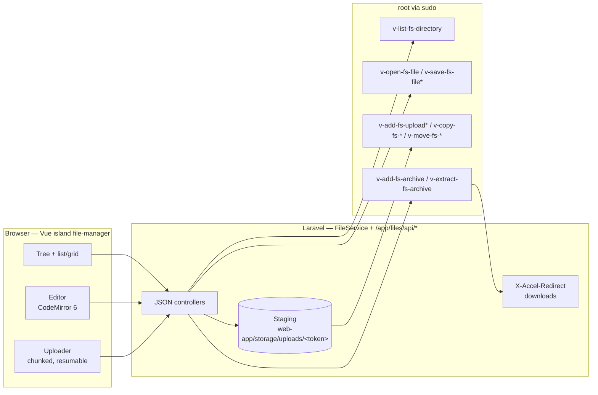
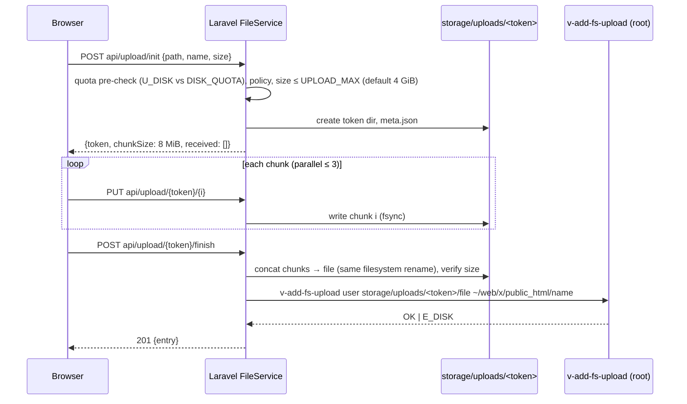

# 06 — File Manager v2

**Epic:** E3 · **Status:** §3–§6 implemented by the [E3 spec](../features/specs/2026-10-05-008-e3-file-manager-design.md), which wins where it differs (`/app/files/{user}?path=` instead of `?user=`; every read and write in the home runs as the user, so quotas apply; a SHA-256 guard instead of the mtime; `v-add-fs-zip` for Compress; downloads stream a zip from the user straight into the ticket; no editing of `~/conf/web` and no restart button; staging below `storage/app/files/`; the restic browser moves to E7); §7 (FileGator removal) stays with E8 · **Depends on:** E1, E2 · **Unblocks:** E8 (FileGator removal), deep links from E4/E14/backups

---

## 1. Goal

Replace FileGator with a first-party file manager (Vue 3 island) built on the existing `v-*-fs-*` commands: browse, upload (chunked, resumable), download (single and zip), edit (CodeMirror 6), preview, permissions, archives, search — with deep links from Web Domains, App Store, Node Apps and restic snapshots. Target: upload-and-edit task time −50 % vs FileGator; FileGator removed from the package in E8.

Non-goals: WebDAV, sharing links, per-file version history (restic covers restore).

---

## 2. Current state (grounding)

- FileGator is bundled in `install/deb/filemanager/filegator/`, installed by `v-add-sys-filemanager` into `web/fm/`, served at `/fm/` by `hestia-nginx`, authenticated through `HestiaAuth.php` which reads `$_SESSION['user']`/`look` and calls `v-list-user`. Max upload 1 GiB (`configuration.php`).
- Existing root-side, user-executing commands (`user_exec`): `v-list-fs-directory USER [DIR]` (prints `type|mode|date|time|owner|group|size|name`), `v-add-fs-file`, `v-add-fs-directory`, `v-copy-fs-file`, `v-copy-fs-directory`, `v-move-fs-file`, `v-move-fs-directory`, `v-delete-fs-file`, `v-delete-fs-directory`, `v-change-fs-file-permission`, `v-check-fs-permission`, `v-get-fs-file-type`, `v-search-fs-object`, `v-add-fs-archive`, `v-extract-fs-archive`, `v-open-fs-file` (prints content), `v-open-fs-config`. All confine paths to the user's home via `readlink -f`; copy/open additionally accept `/tmp` sources.
- No command writes arbitrary content to a user file (FileGator writes with its own adapter); no chunked upload support; `v-list-fs-directory` is pipe-delimited, not JSON.
- Restic: `v-list-user-files-restic USER SNAPSHOT [PATH]` lists snapshot contents; `v-restore-file-restic` restores one file.

---

## 3. Architecture



`*` = **new** command. The island never calls the CLI; Laravel's `FileService` does, and every call is made for the **effective user** (`Principal::effectiveUser()`, [02](./02-laravel-foundation.md) §5.3) after `FilePolicy` allows it.

---

## 4. Backend commands

### 4.1 Existing (used as-is)

| Command                                                                          | Use                                                                    |
| -------------------------------------------------------------------------------- | ---------------------------------------------------------------------- |
| `v-list-fs-directory USER DIR`                                                   | directory listing (parsed from the pipe format; `%P` name is relative) |
| `v-add-fs-file`, `v-add-fs-directory`                                            | new empty file / folder                                                |
| `v-copy-fs-file`, `v-copy-fs-directory`, `v-move-fs-file`, `v-move-fs-directory` | copy / move / rename                                                   |
| `v-delete-fs-file`, `v-delete-fs-directory`                                      | delete (no trash in v1; confirm dialog)                                |
| `v-change-fs-file-permission USER PERM PATH`                                     | permissions dialog                                                     |
| `v-get-fs-file-type USER PATH`                                                   | MIME sniff for preview/editor decision                                 |
| `v-open-fs-file USER PATH`                                                       | read content (text files under the size cap)                           |
| `v-add-fs-archive USER ARCHIVE PATH…`                                            | zip for download / "compress"                                          |
| `v-extract-fs-archive USER ARCHIVE [DIR]`                                        | extract                                                                |
| `v-search-fs-object USER PATTERN [DIR]`                                          | search by name                                                         |
| `v-list-user-files-restic USER SNAPSHOT [PATH]`, `v-restore-file-restic`         | snapshot browser                                                       |

### 4.2 New (library `func/fs.sh`, additive)

| Command                    | Arguments                                        | Behaviour                                                                                                                                                                                                                                                                                                                                                                            |
| -------------------------- | ------------------------------------------------ | ------------------------------------------------------------------------------------------------------------------------------------------------------------------------------------------------------------------------------------------------------------------------------------------------------------------------------------------------------------------------------------ |
| `v-list-fs-directory-json` | `USER DIR [OFFSET] [LIMIT] [SORT] [SHOW_HIDDEN]` | same `find -printf` core plus `%l` (symlink target) and `%i`, emits JSON `{entries:[{name,type,size,mode,owner,group,mtime,link,hidden}], total, truncated}`; server-side paging for directories > 2 000 entries; stays in the home dir like `v-list-fs-directory`                                                                                                                   |
| `v-add-fs-upload`          | `USER STAGED_FILE DST_PATH [MODE=0644]`          | root-side hand-off: validates `STAGED_FILE` is under `/usr/local/hestia/web-app/storage/uploads/` and owned by `hestiaweb`; validates `DST_PATH` resolves inside the user's home, parent dir writable by the user (`user_exec test -w`); `install -o USER -g USER -m MODE STAGED_FILE DST_PATH.part && mv DST_PATH.part DST_PATH`; removes the staged file; `E_DISK` on quota/ENOSPC |
| `v-save-fs-file`           | `USER STAGED_FILE DST_PATH [EXPECTED_MTIME]`     | editor save: same hand-off, atomic replace **preserving the destination's existing mode and ownership**, refuses with `E_INUSE` when `stat -c %Y DST` ≠ `EXPECTED_MTIME` (concurrent edit); prints new mtime                                                                                                                                                                         |
| `v-read-fs-file`           | `USER PATH [MAX_BYTES=2097152]`                  | like `v-open-fs-file` but refuses files above the cap with `E_LIMIT` and prints `mtime`+`size` header line first, so the editor gets the mtime it must send back                                                                                                                                                                                                                     |
| `v-get-fs-file-info`       | `USER PATH`                                      | one JSON object: type, size, mode, owner, mtime, mime (`file -b --mime-type` as the user), symlink target, "is inside home"                                                                                                                                                                                                                                                          |
| `v-list-fs-disk-usage`     | `USER [DIR]`                                     | `du -s` as the user for the sidebar quota widget (cached 60 s by Laravel)                                                                                                                                                                                                                                                                                                            |

Why the staging hand-off runs as root (`install`) rather than `v-copy-fs-file` from `/tmp`: `v-copy-fs-file` copies **as the user**, so the staged file would have to be world-readable in `/tmp`, exposing uploads to every other account. The staging dir is `hestiaweb:hestiaweb 0700`; only root (through the two new commands) moves files out of it, and the result is owned by the target user.

---

## 5. Laravel layer

### 5.1 `FileService`

```php
final class FileService
{
    public function list(string $user, string $path, ListOptions $o): DirectoryListing;
    public function info(string $user, string $path): FileInfo;
    public function read(string $user, string $path): FileContent;         // v-read-fs-file, cap 2 MiB (configurable)
    public function save(string $user, string $path, string $content, int $expectedMtime): int;
    public function mkdir/touch/copy/move/delete(...): void;
    public function chmod(string $user, string $path, string $mode, bool $recursive): void;
    public function archive(string $user, array $paths): DownloadTicket;  // zip to storage/downloads/<token>.zip via v-add-fs-archive into user's ~/tmp, then hand-off (see §6.3)
    public function extract(string $user, string $archive, ?string $dest): void;
    public function search(string $user, string $pattern, string $dir): array;
    public function upload(): UploadSession;                               // §6.2
}
```

### 5.2 Path handling

- Client sends paths **relative to the user's home**; `FileService::absolute()` joins with the home dir read from `v-list-user USER json` (`HOME`), normalises `.`/`..`, rejects `\0` and newlines, and refuses anything that escapes the home (`str_starts_with(realpath-free normalisation)`). The CLI performs the authoritative `readlink -f` check again; Laravel's check exists for good error messages and to never pass garbage to `sudo`.
- Symlinks: listed with their target; following a symlink that leaves the home is refused by the CLI (`readlink -f`), so the UI shows it as "outside home, not accessible".
- Hidden files: shown by default (hosting users need `.htaccess`, `.env`); toggle persisted in localStorage.

### 5.3 Routes (`/app/files`, island page) and JSON API (`/app/files/api/*`)

| Method / route                                                                                                | Purpose                                                                                            |
| ------------------------------------------------------------------------------------------------------------- | -------------------------------------------------------------------------------------------------- |
| `GET /app/files[?path=&user=]`                                                                                | island page; `user` only honoured for admin/reseller within `OwnerScope` (deep links)              |
| `GET api/list?path=&offset=&limit=&sort=&hidden=`                                                             | listing                                                                                            |
| `GET api/info?path=`                                                                                          | file info                                                                                          |
| `GET api/read?path=`                                                                                          | editor content + mtime                                                                             |
| `PUT api/save` `{path, content, mtime}`                                                                       | editor save; 409 on mtime mismatch                                                                 |
| `POST api/mkdir`, `api/touch`, `api/copy`, `api/move`, `api/delete`, `api/chmod`, `api/extract`, `api/search` | operations (bodies: `{paths[], dest, mode, recursive, ...}`)                                       |
| `POST api/upload/init` `{path, name, size, chunkSize}` → `{token, received[]}`                                | start/resume                                                                                       |
| `PUT api/upload/{token}/{index}` (binary body)                                                                | one chunk                                                                                          |
| `POST api/upload/{token}/finish`                                                                              | assemble + `v-add-fs-upload`                                                                       |
| `DELETE api/upload/{token}`                                                                                   | cancel                                                                                             |
| `POST api/download` `{paths[]}` → `{url}`                                                                     | single file or zip ticket                                                                          |
| `GET /app/files/dl/{token}`                                                                                   | streams via `X-Accel-Redirect`                                                                     |
| `GET api/snapshots?user=`, `api/snapshots/{id}/list?path=`, `POST api/snapshots/{id}/restore`                 | restic browser (`v-list-user-backups-restic`, `v-list-user-files-restic`, `v-restore-file-restic`) |

All routes: `auth.arc`, `effective-user`, `FilePolicy` (`view` = owner scope; `write` = owner scope ∧ `!isReadOnly()`), CSRF on mutations, `files.enabled` middleware (checks `FILE_MANAGER='true'` in `SysConfig`, i.e. the plugin toggle `v-add-sys-filemanager` / `v-delete-sys-filemanager`).

---

## 6. Flows

### 6.1 Browse

Island requests `api/list`; for ≤ 2 000 entries the full list is returned and sorted/filtered client-side; beyond that the server pages (`offset/limit`) and the list uses virtual scrolling. Tree nodes load lazily. Breadcrumb, list/grid toggle, multi-select (shift/ctrl), context menu, keyboard shortcuts (`Enter` open, `F2` rename, `Del` delete, `Ctrl+C/X/V` copy/cut/paste, `Ctrl+A`, `Backspace` up, `/` search).

### 6.2 Upload (chunked, resumable)



- Resume: `init` for the same `(path, name, size)` from the same session returns `received[]` so the client skips chunks; sessions expire after 24 h (scheduled cleanup via artisan `schedule` run from the existing cron: `php artisan schedule:run` line added by the upgrade script).
- Folder upload: client sends relative paths; Laravel creates directories first (`v-add-fs-directory`).
- Conflicts: `finish` with `onConflict: skip|overwrite|rename`; default prompts.
- Drag-and-drop anywhere on the list; progress per file and overall; cancel.
- Staging size guard: free space on the staging filesystem is checked at `init`; staging lives on the same filesystem as `/usr/local/hestia` (not the user's home), so an upload cannot be refused by quota until the hand-off — the pre-check against `U_DISK` reduces surprises, and `E_DISK` from `v-add-fs-upload` is shown as "quota exceeded".

### 6.3 Download

- Single file: `v-copy-fs-file`-free — Laravel requests `v-get-fs-file-info`, then responds with `X-Accel-Redirect: /_files/<user>/<relpath>` where a **new** internal `hestia-nginx` location `location /_files/ { internal; alias /home/; }` serves it. `hestia-nginx` workers run as `hestiaweb`, which cannot read user homes (ACL `g:hestia-users:---` is set by `v-add-user`), so this only works if `hestiaweb` is granted read ACLs — **it is not**. Therefore downloads go through the hand-off in reverse: `v-add-fs-download USER PATH TICKET` (**new**) hard-links or copies the file as root into `web-app/storage/downloads/<ticket>` (owned `hestiaweb`, 0600, same filesystem → `cp --reflink=auto`), Laravel answers `X-Accel-Redirect: /_downloads/<ticket>` (internal alias to that dir), and a cleanup removes tickets after 1 h. Large files cost one copy; acceptable for v1 (FileGator streamed through PHP, which was slower).
- Multiple files / folders: `v-add-fs-archive USER ~/tmp/<ticket>.zip PATHS…` as the user (into the user's `~/tmp`, created by `v-add-user`), then `v-add-fs-download` of the archive, then the archive is deleted from `~/tmp`.

### 6.4 Editor

- CodeMirror 6 with languages: PHP, JS/TS, CSS, HTML, JSON, YAML, Markdown, nginx/Apache conf, shell, SQL, `.env`/ini. Line numbers, search/replace, soft wrap toggle, indentation detection.
- Open: `api/read` refuses > 2 MiB (`E_LIMIT`) → "file too large to edit; download instead"; binary detection by `v-get-fs-file-type` MIME (`text/*`, `application/json|xml|x-sh|x-php|…` allowed) → otherwise preview/download only.
- Encoding: UTF-8 assumed; invalid UTF-8 → opened read-only with a warning (no silent re-encoding). BOM preserved.
- Save: `PUT api/save` with the mtime from `read`; Laravel stages content and calls `v-save-fs-file`; 409 opens a "file changed on disk — reload / overwrite" dialog. `Ctrl+S`, dirty indicator, prompt on close.
- Special files: `.htaccess` and `nginx.conf_*` / `nginx.ssl.conf_*` in `~/conf/web/<domain>/` show a hint "changes apply after web server reload" with a button that calls `v-restart-web`/`v-restart-proxy` (policy: domain owner).

### 6.5 Preview

Images (`X-Accel` ticket), PDF (browser viewer via ticket), text (first 64 KiB), video/audio (ticket, range requests via nginx). Nothing is proxied through PHP.

### 6.6 Permissions dialog

Octal + rwx grid, recursive option (`v-change-fs-file-permission` per entry; recursive performed by **new** `v-change-fs-directory-permission USER MODE DIR [FILES_MODE]` to avoid N commands).

### 6.7 Deep links

| From                                    | Link                                                                                       |
| --------------------------------------- | ------------------------------------------------------------------------------------------ |
| Web Domains edit                        | "Open document root" → `/app/files?path=web/<domain>/public_html`                          |
| Node Apps ([07](./07-node-platform.md)) | `/app/files?path=web/<domain>/nodeapp` + `.env` edit                                       |
| Docker apps ([08](./08-app-store.md))   | `/app/files?path=apps/<app>`                                                               |
| Backups (restic)                        | `/app/files?snapshot=<id>&path=…` opens the read-only snapshot browser with "Restore here" |
| Admin / reseller                        | `&user=<customer>` within `OwnerScope`; banner "Browsing files of **user**"                |

---

## 7. FileGator removal (milestone 5, lands with E8)

1. `v-add-sys-filemanager` keeps its name and the `FILE_MANAGER` config key; from 2.0 it only sets the key and no longer installs FileGator (`v-delete-sys-filemanager` likewise). Upstream installer/upgrade scripts calling it keep working.
2. `install/deb/filemanager/` deleted; `web/fm/` removed by `install/upgrade/versions/2.0.0.sh`; the `/fm/` nginx block removed from `src/deb/nginx/nginx.conf`; `/fm/*` returns 301 → `/app/files`.
3. `HestiaAuth.php`/`HestiaZipArchiver.php` are gone; nothing else referenced them.
4. Until then (Q2–Q3) both coexist: the new manager is the nav target; `/fm/` remains reachable for users who bookmarked it.

---

## 8. Failure modes

| Failure                                | Mitigation                                                                                                                                |
| -------------------------------------- | ----------------------------------------------------------------------------------------------------------------------------------------- |
| Partial upload (tab closed, network)   | chunks persist 24 h; `init` resumes; cleanup job removes stale tokens                                                                     |
| Quota exceeded at hand-off             | `E_DISK` → clear message; staging file removed; pre-check reduces occurrences                                                             |
| Concurrent edit                        | mtime check in `v-save-fs-file`; 409 dialog                                                                                               |
| Huge directory (100k files)            | server paging + virtual scroll; search uses `v-search-fs-object` (bounded by `find`) with a 10 s timeout and "narrow your search" message |
| Binary opened in editor                | MIME gate; "download instead"                                                                                                             |
| Symlink pointing outside home          | CLI refuses; UI shows reason                                                                                                              |
| Staging disk full                      | `init` checks free space ≥ size + 5 %; `E_DISK` otherwise                                                                                 |
| `hestiaweb` lacks read access to homes | by design; all reads go through root-side commands; never add ACLs for `hestiaweb`                                                        |
| Zip of very large tree                 | `v-add-fs-archive` runs under the user's cgroup slice; progress shown as indeterminate; 10 min timeout (`Options::$timeoutSeconds`)       |

---

## 9. Testing

- **BATS:** `v-add-fs-upload` ownership/mode/atomicity, refusal of staged files outside the staging dir and destinations outside home, `E_DISK` under a quota-limited test user; `v-save-fs-file` mtime conflict; `v-read-fs-file` cap; `v-list-fs-directory-json` paging and symlink fields; `v-add-fs-download` ticket lifecycle.
- **Pest:** `FileService` path normalisation (fuzz `..`, `\0`, unicode), policies (user/reseller/admin, read-only), upload session state machine, 409 on save.
- **Vitest:** uploader (resume, parallelism, cancel), editor save flow, list virtualisation.
- **Playwright:** upload 200 MB file with a simulated disconnect and resume; edit `.htaccess` and save; zip download of a folder; admin browses a customer's files via deep link; reseller cannot open another tree (404); timing of the roadmap task (upload-and-edit) vs FileGator baseline.

---

## 10. Open questions

1. Trash/undo for delete: v1 has none (confirm dialog). Could be added as `~/.trash` with a 7-day cleanup — decide after usability test.
2. Download copy cost (§6.3): if hosts with very large files complain, evaluate a tiny root-side streaming helper (`v-stream-fs-file` writing to a FIFO consumed by nginx) in a later release; the ticket API stays the same.
3. Should the editor offer "format on save" (Prettier for JS/CSS/JSON)? Nice-to-have, client-side only; off by default.
