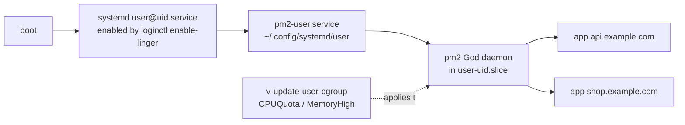

# 07 — Node Platform (nvm + pm2)

**Epics:** E13 (Node Manager), E14 (Node Apps) · **Status:** §4 implemented by the [E13 spec](../features/specs/2026-10-05-006-e13-node-manager-design.md), which wins where it differs (no `node.conf`, no `PM` key or corepack, no `npm audit`, background tasks instead of `node.pipe`); §5–§7 implemented by the [E14 spec](../features/specs/2026-10-05-007-e14-node-apps-design.md), which wins where it differs (authoritative record in `data/users/<user>/nodeapps.conf` with `app.conf` as a backup copy, `START` instead of `ENTRY`, `BACKEND_PORT` instead of `node_port`, no new upstream hooks but a 5-minute `v-check-sys-node`, polling instead of the WebSocket log stream, logrotate instead of `pm2-logrotate`, previous template restored on delete, Git deploy moved to E20) · **Depends on:** E1, E6 batch 1 (`nodejs-proxy*` templates, [09](./09-web-templates-metadata.md)), E12 ([04](./04-port-registry.md)), E11 for owner scoping · **Unblocks:** E20 (Git deploy for all domains), E5 is **not** required (Node is per-user)

---

## 1. Goal

A user installs Node.js versions and global packages from the UI, then deploys a Node app bound to a web domain — port, process manager, reverse proxy, HTTPS, logs and restart-on-reboot handled by the panel — in under five minutes. Everything the panel sets up survives `v-rebuild-user`, backup/restore and a server reboot.

Non-goals: system-wide Node (the installer's `nodejs` package is for the web terminal and tooling only), Python/Go/Ruby process managers (same design, later), Kubernetes.

---

## 2. Current state (verified in code)

- Per-user developer tools follow `bin/v-add-user-composer`: install under `$HOMEDIR/$user/...` with `user_exec`, `readlink -m … | egrep "^$HOMEDIR/$user/"` path-escape checks, a `.bash_aliases` line, `v-log-action` on success. `v-add-user-wp-cli` is the same shape.
- Users get a systemd slice `user-<uid>.slice` with `CPUQuota`, `MemoryHigh`, `MemorySwapMax` from the package (`v-update-user-cgroup`). Anything started as the user (SSH, `systemd --user`) lands in that slice.
- The SSH/SFTP jail (`install/common/bubblewrap/jailbash`) bind-mounts `${HOME}` read-write and `/usr`, `/bin`, `/lib` read-only, so binaries under `~/.nvm` run inside the jail.
- Web domain files live in `~/web/<domain>/` (`public_html`, `document_errors`, `stats`, …); `v-backup-user` archives the whole domain directory and `~/conf/web/<domain>/$WEB_SYSTEM.conf*`; `v-restore-user` re-renders templates with `rebuild_web_domain_conf`.
- User directories outside `conf web dns tmp mail` are backed up unless listed in `USER=` of `backup-excludes.conf` (`v-update-user-backup-exclusions`).
- The web terminal (`src/deb/web-terminal/server.js`) runs as root, validates the `ARCPANELSID` cookie through `web-terminal-session-auth.php`, checks the `Origin`, resolves the effective user (`look`), and spawns the user's shell with `node-pty` under the user's uid/gid. It refuses users with a `nologin` shell. Proxied at `/_shell/` by `hestia-nginx`.
- No linger / `systemd --user` usage exists in the codebase today.

---

## 3. Concepts

| Term                | Definition                                                                                                                                                                     |
| ------------------- | ------------------------------------------------------------------------------------------------------------------------------------------------------------------------------ |
| **Node runtime**    | one Node major/minor installed by nvm under `~/.nvm/versions/node/vX.Y.Z`                                                                                                      |
| **Default version** | the version `nvm alias default` points at; used by the shell and by apps without an explicit version                                                                           |
| **Global package**  | an npm/pnpm/yarn package installed with `-g` into one runtime (`~/.nvm/versions/node/vX/lib/node_modules`)                                                                     |
| **Node app**        | one process group managed by pm2, bound to exactly one web domain, listening on one registry port on `127.0.0.1`                                                               |
| **App directory**   | `~/web/<domain>/nodeapp/` — the panel's files (ecosystem, state, logs); the code itself is in `~/web/<domain>/public_html` (default `cwd`) or a sub-directory the user chooses |
| **pm2 daemon**      | one `pm2` God daemon per user, run by `systemd --user` so it survives logout and reboot                                                                                        |

---

## 4. Node Manager (E13)

### 4.1 Data

| Location                                                  | Content                                                                                                                                                      | Owner                |
| --------------------------------------------------------- | ------------------------------------------------------------------------------------------------------------------------------------------------------------ | -------------------- |
| `~/.nvm/`                                                 | nvm checkout (pinned release, verified sha256) and runtimes                                                                                                  | user                 |
| `/usr/local/hestia/data/cache/node/` (**new**)            | nvm tarball, Node tarballs `node-vX.Y.Z-linux-x64.tar.xz` + `SHASUMS256.txt`, `index.json` from nodejs.org (refreshed daily)                                 | root, world-readable |
| `/usr/local/hestia/data/users/<user>/node.conf` (**new**) | `VERSION='22.3.0' DEFAULT='yes' PM='npm' PACKAGES='pm2@5.4.2,yarn@1.22.22' SUSPENDED='no' TIME DATE` — one line per installed runtime (Hestia object format) | root:user 0640       |
| `~/.bash_aliases`, `~/.bashrc`                            | `export NVM_DIR="$HOME/.nvm"; [ -s "$NVM_DIR/nvm.sh" ] && . "$NVM_DIR/nvm.sh"` guarded block `# >>> arcpanel nvm >>> … <<<`                                  | user                 |

`node.conf` is derived from `~/.nvm` (the truth) and refreshed by every command; `v-rebuild-user` regenerates it (§7). Keeping it in `data/users` lets the Laravel side read it with one `v-list-*` call and lets the API expose it.

### 4.2 Package keys

| Key             | Values                                                 | Meaning                            |
| --------------- | ------------------------------------------------------ | ---------------------------------- |
| `NODE`          | `yes` · `no` (default for `default.pkg`)               | user may install runtimes and apps |
| `NODE_VERSIONS` | integer · `unlimited`                                  | max installed runtimes (disk)      |
| `NODE_ALLOWED`  | comma list of majors or `lts` or `*` (e.g. `18,20,22`) | installable majors                 |
| `NODE_APPS`     | integer · `unlimited`                                  | max Node apps (E14)                |

A new `install/common/packages/developer.pkg` ships with `NODE='yes' NODE_VERSIONS='3' NODE_ALLOWED='lts' NODE_APPS='5' PORTS='10' SHELL='bash' MEMORY_LIMIT='2G'` (+ sensible web/db limits). The upgrade script copies it to `data/packages/` if absent. `v-add-user-nvm` refuses with `E_DISABLED` when the user's package has `NODE='no'`.

### 4.3 Commands (**new**, library `func/node.sh`)

| Command                      | Arguments                                            | Behaviour                                                                                                                                                                                                                                                                                                                                                         |
| ---------------------------- | ---------------------------------------------------- | ----------------------------------------------------------------------------------------------------------------------------------------------------------------------------------------------------------------------------------------------------------------------------------------------------------------------------------------------------------------- |
| `v-add-user-nvm`             | `USER`                                               | installs nvm from the local cache (download once as root into the cache with checksum verification, then `user_exec` extract into `~/.nvm`), writes the guarded shell block, sets `NVM_DIR`, creates `node.conf`                                                                                                                                                  |
| `v-delete-user-nvm`          | `USER [force]`                                       | refuses if `nodeapps.conf` is non-empty unless `force` (then deletes apps first); removes `~/.nvm`, the shell block, `node.conf`                                                                                                                                                                                                                                  |
| `v-add-user-node-version`    | `USER VERSION` (`lts/*`, `lts/iron`, `22`, `22.3.0`) | resolves through the cached `index.json`, checks `NODE_ALLOWED` and `NODE_VERSIONS`, downloads the tarball to the cache if missing (root, sha verified), then `user_exec nvm install <ver>` with `NVM_NODEJS_ORG_MIRROR=file:///usr/local/hestia/data/cache/node/` so nvm never reaches the network as the user; first runtime becomes default; `corepack enable` |
| `v-delete-user-node-version` | `USER VERSION`                                       | refuses if an app uses it; `nvm uninstall`; re-points default if needed                                                                                                                                                                                                                                                                                           |
| `v-change-user-node-default` | `USER VERSION`                                       | `nvm alias default`                                                                                                                                                                                                                                                                                                                                               |
| `v-list-user-node-versions`  | `USER [FORMAT]`                                      | from `node.conf` + live `nvm ls --no-colors` reconciliation                                                                                                                                                                                                                                                                                                       |
| `v-list-sys-node-releases`   | `[FORMAT]`                                           | the cached `index.json` filtered to supported majors (≥ 18), with LTS codename and EOL date; refreshed by `v-update-sys-node-releases` (daily cron, additive line)                                                                                                                                                                                                |
| `v-change-user-node-pm`      | `USER VERSION PM` (PM = npm, pnpm or yarn)           | `corepack prepare <pm>@latest --activate` for that runtime; stored as `PM`                                                                                                                                                                                                                                                                                        |
| `v-add-user-npm-package`     | `USER VERSION PKG[@ver]`                             | `user_exec … npm i -g` (or the active PM) under that runtime; records `PACKAGES`; install runs with `nice -n 10 ionice -c3` and a 10-minute timeout                                                                                                                                                                                                               |
| `v-delete-user-npm-package`  | `USER VERSION PKG`                                   | uninstall; refuses to remove `pm2` while apps exist                                                                                                                                                                                                                                                                                                               |
| `v-list-user-npm-packages`   | `USER [VERSION] [FORMAT]`                            | `npm ls -g --json --depth=0` per runtime + `npm audit --json` summary (count by severity), cached 1 h in `~/.cache/arcpanel/npm-audit.json`                                                                                                                                                                                                                       |
| `v-update-user-npm-packages` | `USER [VERSION]`                                     | `npm update -g`                                                                                                                                                                                                                                                                                                                                                   |
| `v-rebuild-user-node`        | `USER`                                               | re-creates the shell block, `node.conf`, cache symlinks, pm2 unit (§5.5); called by the `v-rebuild-user` hook (§7)                                                                                                                                                                                                                                                |

All user-side work runs through `user_exec` (`setpriv`/`runuser` as in upstream) with `HOME`, `NVM_DIR`, `PATH` set explicitly and `umask 027`. Path-escape checks as in `v-add-user-composer` guard `~/.nvm`, `~/.cache`, `~/.npm`.

### 4.4 UI — "Node.js" page (Vue island, `/app/node`)

- Header: enabled/disabled by package; "Enable Node.js" calls `v-add-user-nvm`.
- Installed runtimes table: version, LTS codename, default badge, package manager, size, apps using it, actions (set default, change PM, uninstall).
- Install picker: list from `v-list-sys-node-releases` filtered by `NODE_ALLOWED`, grouped LTS / current, EOL warnings; disabled when `NODE_VERSIONS` reached.
- Global packages tab per runtime: table with version, latest, audit badge; add (name + optional version), remove, "Update all".
- "Open terminal here" link → Web Terminal with `cd ~` (terminal already sources `.bashrc`, so `node -v` matches the default).
- Resellers/admins reach the same page for a customer through the effective-user route ([03](./03-tenancy-and-authorization.md) §7.1).

---

## 5. Node Apps (E14)

### 5.1 Data

| Location                                                                                 | Content                                                                                                                                                                                                                                                                                                                                                                                                |
| ---------------------------------------------------------------------------------------- | ------------------------------------------------------------------------------------------------------------------------------------------------------------------------------------------------------------------------------------------------------------------------------------------------------------------------------------------------------------------------------------------------------ |
| `~/web/<domain>/nodeapp/app.conf` (**new**, root:user 0640)                              | **authoritative** app record: `NAME ENTRY CWD NODE_VERSION PORT INSTANCES MAX_MEMORY GIT_URL GIT_BRANCH BUILD_CMD INSTALL_CMD SUSPENDED TIME DATE`. Lives inside the domain directory so `v-backup-user` / `v-restore-user` carry it without changes                                                                                                                                                   |
| `~/web/<domain>/nodeapp/ecosystem.config.cjs` (user-owned, generated, never hand-edited) | pm2 ecosystem: `name`, `script`, `cwd`, `interpreter: ~/.nvm/versions/node/vX/bin/node`, `env: { NODE_ENV, PORT, HOST: '127.0.0.1' }` + `.env` passthrough, `instances`, `exec_mode`, `max_memory_restart`, `max_restarts: 10`, `min_uptime: '10s'`, `restart_delay: 2000`, `exp_backoff_restart_delay: 100`, `out_file`/`error_file` under `~/web/<domain>/nodeapp/logs/`, `merge_logs`, `time: true` |
| `~/web/<domain>/nodeapp/logs/`                                                           | pm2 out/err logs, rotated by `pm2-logrotate` (installed with pm2, 10 MB × 5)                                                                                                                                                                                                                                                                                                                           |
| `~/web/<domain>/nodeapp/.env`                                                            | user-managed environment (edited in File Manager v2 or the env editor), loaded by pm2 `env_file` semantics (read and merged by the ecosystem file at start)                                                                                                                                                                                                                                            |
| `/usr/local/hestia/data/users/<user>/nodeapps.conf` (**new**)                            | **index** for listing: one line per app `DOMAIN NAME ENTRY NODE_VERSION PORT INSTANCES MAX_MEMORY STATUS GIT_URL GIT_BRANCH SUSPENDED TIME DATE`; rebuilt from the `app.conf` files by `v-rebuild-user-node` and after restore                                                                                                                                                                         |
| `~/conf/web/<domain>/nginx.conf.tplvars`                                                 | `node_port='30001'` — written through `v-change-web-domain-tplvar` ([09](./09-web-templates-metadata.md) §5)                                                                                                                                                                                                                                                                                           |
| `~/.config/systemd/user/pm2-<user>.service` + `/var/lib/systemd/linger/<user>`           | per-user pm2 daemon (§5.5)                                                                                                                                                                                                                                                                                                                                                                             |
| `/usr/local/hestia/data/ports/<user>.conf`                                               | `APP='node:<domain>'` entries ([04](./04-port-registry.md) §4.1)                                                                                                                                                                                                                                                                                                                                       |

### 5.2 Commands (**new**, `func/node.sh`)

| Command                                                                             | Arguments                                                                                       | Behaviour                                                                                                                                                                                                                                                                                                                                                                                                                                                                                                                                                                                                                                                                                                              |
| ----------------------------------------------------------------------------------- | ----------------------------------------------------------------------------------------------- | ---------------------------------------------------------------------------------------------------------------------------------------------------------------------------------------------------------------------------------------------------------------------------------------------------------------------------------------------------------------------------------------------------------------------------------------------------------------------------------------------------------------------------------------------------------------------------------------------------------------------------------------------------------------------------------------------------------------------- |
| `v-add-node-app`                                                                    | `USER DOMAIN NAME [ENTRY=app.js] [NODE_VERSION=default] [PORT] [CWD=public_html] [INSTANCES=1]` | checks `NODE='yes'`, `NODE_APPS`, domain owned by user and not already a Node app, runtime installed (installs default if none and policy allows), `pm2` present for that runtime (installs it globally if missing). Port: `v-check-user-port USER PORT` if given, else `v-allocate-user-port USER node:DOMAIN`. Writes `app.conf`, ecosystem, `.env` skeleton; `v-change-web-domain-tplvar USER DOMAIN node_port PORT no`; switches the domain to `nodejs-proxy` (proxy template when `PROXY_SYSTEM` is set, else web template) with `RESTART=no`; ensures the pm2 unit (§5.5); `pm2 start ecosystem.config.cjs` as the user; `pm2 save`; `v-restart-proxy`/`-web` via queue; updates `nodeapps.conf`; `v-log-action` |
| `v-delete-node-app`                                                                 | `USER DOMAIN [keep-files]`                                                                      | `pm2 delete`, `pm2 save`; `v-release-user-port USER node:DOMAIN`; `v-delete-web-domain-tplvar`; template back to the package default (`v-change-web-domain-proxy-tpl USER DOMAIN default`); removes `nodeapp/` unless `keep-files`; stops the daemon if no apps remain                                                                                                                                                                                                                                                                                                                                                                                                                                                 |
| `v-list-node-apps`                                                                  | `USER [FORMAT]`                                                                                 | `nodeapps.conf` merged with `pm2 jlist` (status, pid, cpu, memory, restarts, uptime)                                                                                                                                                                                                                                                                                                                                                                                                                                                                                                                                                                                                                                   |
| `v-list-node-app`                                                                   | `USER DOMAIN [FORMAT]`                                                                          | one app with live stats and the proxied URL/SSL state from `v-list-web-domain`                                                                                                                                                                                                                                                                                                                                                                                                                                                                                                                                                                                                                                         |
| `v-start-node-app` / `v-stop-node-app` / `v-restart-node-app` / `v-reload-node-app` | `USER DOMAIN`                                                                                   | pm2 verbs as the user; `reload` is zero-downtime for `cluster` mode                                                                                                                                                                                                                                                                                                                                                                                                                                                                                                                                                                                                                                                    |
| `v-suspend-node-app` / `v-unsuspend-node-app`                                       | `USER DOMAIN`                                                                                   | stop + `SUSPENDED='yes'`; used by the user suspend hook                                                                                                                                                                                                                                                                                                                                                                                                                                                                                                                                                                                                                                                                |
| `v-change-node-app-entry`                                                           | `USER DOMAIN ENTRY [CWD]`                                                                       | validates the file exists under `~/web/DOMAIN/`; rewrites ecosystem; `pm2 reload`                                                                                                                                                                                                                                                                                                                                                                                                                                                                                                                                                                                                                                      |
| `v-change-node-app-version`                                                         | `USER DOMAIN NODE_VERSION`                                                                      | runtime must be installed; rewrites `interpreter`; restart                                                                                                                                                                                                                                                                                                                                                                                                                                                                                                                                                                                                                                                             |
| `v-change-node-app-env`                                                             | `USER DOMAIN FILE`                                                                              | replaces `.env` from a temp file (validated `KEY=value` lines, no `PORT`/`HOST` overrides); restart                                                                                                                                                                                                                                                                                                                                                                                                                                                                                                                                                                                                                    |
| `v-change-node-app-scale`                                                           | `USER DOMAIN INSTANCES [MAX_MEMORY]`                                                            | bounded by package (`INSTANCES ≤ nproc`, `MAX_MEMORY ≤ MEMORY_LIMIT`)                                                                                                                                                                                                                                                                                                                                                                                                                                                                                                                                                                                                                                                  |
| `v-list-node-app-logs`                                                              | `USER DOMAIN [LINES=200] [STREAM] [--follow]`                                                   | STREAM = out, err or all; `tail` of the pm2 log files as the user; `--follow` streams (used by §6.4)                                                                                                                                                                                                                                                                                                                                                                                                                                                                                                                                                                                                                   |
| `v-run-node-app-install`                                                            | `USER DOMAIN`                                                                                   | `npm ci` (or `pnpm i --frozen-lockfile` / `yarn install --immutable` per `PM`), as the user, `nice`/`ionice`, 15-minute timeout, output to `nodeapp/logs/install.log` (streamed by §6.4)                                                                                                                                                                                                                                                                                                                                                                                                                                                                                                                               |
| `v-run-node-app-build`                                                              | `USER DOMAIN [SCRIPT=build]`                                                                    | `npm run <script>`; same limits; then `v-reload-node-app`                                                                                                                                                                                                                                                                                                                                                                                                                                                                                                                                                                                                                                                              |
| `v-add-node-app-git`                                                                | `USER DOMAIN URL [BRANCH=main]`                                                                 | _nice_ milestone: generates a per-domain deploy key (`~/web/DOMAIN/nodeapp/deploy_key`, public part printed), clones into `CWD`; stores `GIT_URL/GIT_BRANCH`                                                                                                                                                                                                                                                                                                                                                                                                                                                                                                                                                           |
| `v-run-node-app-deploy`                                                             | `USER DOMAIN`                                                                                   | `git fetch && git reset --hard origin/BRANCH` → install → build → reload; log to `nodeapp/logs/deploy.log`. Becomes an E15 job and is generalised by E20                                                                                                                                                                                                                                                                                                                                                                                                                                                                                                                                                               |
| `v-rebuild-node-apps`                                                               | `USER`                                                                                          | re-generates ecosystem files, pm2 unit, tplvars and `nodeapps.conf` from the `app.conf` files; `pm2 resurrect`; used after restore and by `v-rebuild-user-node`                                                                                                                                                                                                                                                                                                                                                                                                                                                                                                                                                        |

### 5.3 Package and resource limits

- `max_memory_restart` defaults to `min(512M, MEMORY_LIMIT/NODE_APPS)` and may be raised up to `MEMORY_LIMIT`; the slice's `MemoryHigh` is the hard ceiling for the whole user.
- `instances` defaults to 1 (`fork` mode); `cluster` mode is allowed up to `nproc`, admins may cap it with a server-wide `NODE_MAX_INSTANCES` key in `hestia.conf`.
- `NODE_APPS` counted per user via `nodeapps.conf`; `v-add-node-app` enforces it with the existing `is_package_full`-style check in `func/node.sh`.

### 5.4 Template wiring (hand-off to 09)

`v-add-node-app` never edits a rendered NGINX file. It writes the port with `v-change-web-domain-tplvar USER DOMAIN node_port PORT no` into `~/conf/web/<domain>/nginx.conf.tplvars`, then calls the upstream `v-change-web-domain-proxy-tpl` (or `-tpl`) with `nodejs-proxy` / `nodejs-proxy-ws` / `nextjs` / `nuxt` / `strapi` / `ghost`. Upstream renders the template (leaving `%node_port%`), then runs the template's `.sh` hook, which calls `apply_template_vars` from `func/tplmeta.sh` to substitute the value ([09](./09-web-templates-metadata.md) §5–6).

Why not an `nginx.conf_nodeapp` include with `set $node_port` or an `upstream` block: `proxy_pass` with a variable disables keepalive to the backend and bypasses the static-file `try_files` ordering the Node templates rely on, Apache has no equivalent, and the include approach would need every Node template to special-case the include. Rendering the real port into the vhost through the hook upstream already runs keeps the generated config identical to a hand-written one, survives `rebuild_web_domain_conf`, and is shared with Docker apps.

Backup/restore: `nginx.conf.tplvars` matches upstream's `$WEB_SYSTEM.conf*` copy glob, so a restored domain re-renders with the right port; `v-rebuild-node-apps` then re-registers the port (`v-add-user-port USER PORT tcp no "restored"` if free, otherwise allocates a new one and rewrites the var).

### 5.5 Process persistence

- One daemon per user, created lazily by `v-add-node-app` when the first app is added: `loginctl enable-linger USER` (root), then `user_exec pm2 startup systemd -u USER --hp /home/USER` which writes `~/.config/systemd/user/pm2-USER.service`; `systemctl --user --machine=USER@ enable --now pm2-USER` run as root; `pm2 save` after every change so `pm2 resurrect` restores the app list.
- The unit is wrapped by ArcPanel (`ExecStartPre` that sources the nvm default runtime, `Restart=on-failure`, `RestartSec=5`), so it is regenerated by `v-rebuild-node-apps`, not edited by users.
- `v-suspend-user` → hook `post_suspend_user.sh` → `v-suspend-node-app` for each app and `systemctl --user … stop pm2-USER`; unsuspend reverses it. `v-delete-user` → hook deletes apps, ports, disables linger. Where upstream has no hook, the nightly `v-check-sys-ports` and a `v-check-sys-node` (**new**, nightly) converge: daemons of suspended/deleted users are stopped, lingers of users without apps are disabled.
- Why per-user daemons (ADR-0005 recommendation): processes run as the user with the user's slice limits and no shared pm2 state between tenants; a single system pm2 would run every app as root or need `uid` switching per app and one crash takes all tenants down. Cost: one God daemon (~40 MB) per user **with apps**, which the lazy creation and `developer` package gating keep bounded (§8).

---

## 6. Laravel side

### 6.1 Services and policies

- `NodeRuntimeService` (`v-*-user-nvm`, `-node-version`, `-npm-package`, releases cache) and `NodeAppService` (apps, lifecycle, env, deploy) in `web-app/app/Services/Node/`, all through `ArcCommand`.
- `NodePolicy`: `manageRuntimes` / `manageApps` = effective user is self (user), in tree (reseller), any (admin) **and** package `NODE='yes'`; `scale` additionally admin-only above package limits; `deploy` requires `GIT_URL`.
- Long operations (`install`, `build`, `deploy`, runtime install) are started through `ArcCommand::schedule()` into a new `node.pipe` processed by `v-update-sys-queue node` (additive cron line `*/1`), and the page polls `v-list-node-app` for `STATUS` while streaming the log (§6.4). E15 replaces the pipe with jobs; the UI contract (status + stream) stays.

### 6.2 Node Apps pages (Vue island)

- **List** `/app/node/apps`: table (domain, name, runtime, status pill, CPU, memory, restarts, uptime, HTTPS state), bulk start/stop/restart, "Create app".
- **Create wizard**: domain (owned, not yet a Node app, dropdown from `v-list-web-domains`) → entry file (file picker over `v-list-fs-directory` under `~/web/<domain>/`, default `app.js`/`server.js`/`package.json` `main`) → runtime (installed, default pre-selected; "install LTS now" shortcut) → port (auto; advanced: pick from "My ports") → template (`nodejs-proxy` default, `-ws`/`nextjs`/`nuxt` detected from `package.json` dependencies) → create; then offers "Install dependencies" and "Run build".
- **App page** `/app/node/apps/{domain}`: overview (URL with SSL badge from `v-list-web-domain`, port, runtime, pm2 stats), **Logs** tab (live, §6.4, out/err toggle, download via `v-list-node-app-logs`), **Environment** tab (key/value editor → temp file → `v-change-node-app-env`; secrets masked after save), **Settings** (entry, cwd, runtime, instances, memory, template variant), **Deploy** (Git URL/branch, deploy key display, "Deploy now", history from `deploy.log`), **Danger zone** (delete, keep files).
- Reseller "Customer detail → Node & Docker apps" tab reuses the list component with a fixed effective user ([03](./03-tenancy-and-authorization.md) §9.2).

### 6.3 Dashboard widgets

Per-user dashboard card "Node apps: 2 online · 1 errored" from `v-list-node-apps json`; admin Server → Services page gains a "User daemons" row counting pm2 daemons (`v-check-sys-node json`).

### 6.4 Log streaming over the web terminal WebSocket

The web terminal server is the panel's only authenticated WebSocket endpoint; it is extended rather than duplicated.

- **Protocol:** today the first bytes a client sends are pty input. New clients send a JSON **control frame** as the first text message: `{"type":"tail","target":"node:api.example.com","stream":"all","lines":200}`. If the first message is not valid JSON with a `type`, the connection behaves exactly as today (interactive shell) — zero change for existing clients. Targets: `node:<domain>` (this doc), `node-task:<domain>:<install|build|deploy>` (task logs), `docker:<app>` ([08](./08-app-store.md) §6.5), later `web:<domain>:access|error` (E18).
- **Auth:** unchanged — `ARCPANELSID` cookie validated by `web-terminal-session-auth.php`, `Origin` must match the panel host/IPs, effective user = `look` or `user`. Additionally, for `tail` the server **does not** require a login shell (`nologin` users may read their own logs; the shell check stays for `type: shell`/legacy).
- **Authorization:** the server resolves the target to a file set **owned by the effective user**: `node:<domain>` → `/home/<user>/web/<domain>/nodeapp/logs/*.log`, verified with `readlink -f` inside `/home/<user>/` and `stat` uid == effective uid; anything else is refused with close code 4403. Reseller/admin impersonation already yields the customer as effective user, so no role logic lives in the server.
- **Execution:** `spawn('/usr/local/hestia/bin/v-list-node-app-logs', [user, domain, lines, stream, '--follow'])` as root is avoided; instead the server spawns `tail -n <lines> -F <files>` **as the effective user** (uid/gid from `/etc/passwd`, same as the pty path) with `node-pty` disabled (plain `child_process.spawn`), forwards stdout lines as text frames, kills the child on socket close, and limits one `tail` per socket and 4 sockets per user. Output is rate-limited (max 1,000 lines/s, then dropped with a `{"type":"notice","dropped":n}` frame).
- **Client:** a small `useLogStream(target)` composable used by the Node Apps, Docker Apps and task panels; reconnects with backoff; renders into an xterm.js read-only instance (already bundled) for ANSI colours from pm2.
- **Packaging:** `src/deb/web-terminal/server.js` gains `tail.js` (~150 lines) and tests; the service unit is unchanged. The feature is available only when `--webterminal` was installed; the UI falls back to polling `v-list-node-app-logs` (last 200 lines every 3 s) otherwise.

---

## 7. Rebuild, backup and restore

| Flow                                      | Hook                                                                                                                                                                                                                                        | Behaviour                                                                                                                                                                                                                                                                                                                                                                                                                                                                            |
| ----------------------------------------- | ------------------------------------------------------------------------------------------------------------------------------------------------------------------------------------------------------------------------------------------- | ------------------------------------------------------------------------------------------------------------------------------------------------------------------------------------------------------------------------------------------------------------------------------------------------------------------------------------------------------------------------------------------------------------------------------------------------------------------------------------ |
| `v-rebuild-user USER`                     | `/etc/hestiacp/hooks/post_rebuild_user.sh` (ArcPanel-installed; if upstream exposes no hook, `v-rebuild-user-node` is called by the Laravel `UserService::rebuild()` and by an additive cron that compares `node.conf` mtime with `~/.nvm`) | re-adds the shell block, regenerates `node.conf`, pm2 unit, ecosystem files, tplvars; `pm2 resurrect`                                                                                                                                                                                                                                                                                                                                                                                |
| `v-backup-user`                           | none needed                                                                                                                                                                                                                                 | `~/web/<domain>/` (incl. `nodeapp/app.conf`, `.env`, ecosystem, code) and `~/conf/web/<domain>/nginx.conf.tplvars` are already archived. `~/.nvm` is in the "user directories" section; the Backup Exclusions UI gets a "Node.js runtimes (~/.nvm)" toggle writing `USER='.nvm'` into `backup-excludes.conf`, defaulting to **excluded** when `NODE='no'` and **included** when `NODE='yes'` (runtimes are re-installable, but including them makes restore faster and offline-safe) |
| `v-restore-user` / `v-restore-web-domain` | `/etc/hestiacp/hooks/post_restore_web_domain.sh` → `v-rebuild-node-apps USER`                                                                                                                                                               | after upstream re-renders the vhost, re-creates the registry entry (same port if free) and pm2 state; if `~/.nvm` was excluded, installs the `NODE_VERSION`s referenced by `app.conf` from the cache                                                                                                                                                                                                                                                                                 |
| `v-suspend-user` / `v-unsuspend-user`     | `post_suspend_user.sh` / `post_unsuspend_user.sh`                                                                                                                                                                                           | stop/start daemon and apps; ports stay allocated                                                                                                                                                                                                                                                                                                                                                                                                                                     |
| `v-delete-user`                           | `post_delete_user.sh`                                                                                                                                                                                                                       | delete apps, release ports, disable linger, remove unit                                                                                                                                                                                                                                                                                                                                                                                                                              |
| `v-change-user-package`                   | checked in `UserService` before the call                                                                                                                                                                                                    | if the new package has `NODE='no'` or lower `NODE_APPS`, refuse with a clear message (CLI users are warned in the nightly `v-check-sys-node` report)                                                                                                                                                                                                                                                                                                                                 |

---

## 8. Failure modes

| Failure                                                         | Mitigation                                                                                                                                                                                                                                                                                                                    |
| --------------------------------------------------------------- | ----------------------------------------------------------------------------------------------------------------------------------------------------------------------------------------------------------------------------------------------------------------------------------------------------------------------------- |
| nodejs.org unreachable or slow                                  | all downloads go to the root cache with sha verification; admins can pre-seed versions (`v-update-sys-node-cache VERSION`, **new**); fallback: `NODE_SOURCE='nodesource'` in `hestia.conf` makes `v-add-user-node-version` symlink the system NodeSource binary into `~/.nvm/versions/node/<ver>` for the matching major only |
| Many users with linger → many `user@uid` instances at boot      | daemons are created lazily (only users with ≥ 1 app), stopped on suspend, lingers disabled when the last app is deleted; `v-check-sys-node` reports daemon count and memory; `developer` package gating; documented limit (~100 app users per 4 GB)                                                                           |
| App crash loop                                                  | pm2 `max_restarts`/`min_uptime`/exponential backoff in the ecosystem; status `errored` surfaces in the list with the last 50 error lines; E16 alert later                                                                                                                                                                     |
| Memory blow-up                                                  | `max_memory_restart` per app; `MemoryHigh` per user slice throttles before the OOM killer; admin sees it in Services → User daemons                                                                                                                                                                                           |
| Port conflict (user ran something on the registry port by hand) | `v-check-user-port` before start; `v-start-node-app` fails with `E_INUSE` and the owner pid from `ss -p`; "My ports" shows the orphan ([04](./04-port-registry.md) §7)                                                                                                                                                        |
| App binds `0.0.0.0` ignoring `HOST`                             | nothing routes to it (no firewall rule), `v-check-sys-ports` flags the socket; docs tell users to honour `process.env.HOST`                                                                                                                                                                                                   |
| Runtime removed while app uses it                               | `v-delete-user-node-version` refuses; `v-check-sys-node` repairs a dangling `interpreter` by switching to default and marking the app `errored` with a reason                                                                                                                                                                 |
| Jail users (`jailbash`)                                         | `~/.nvm` is in `$HOME`, which the jail bind-mounts rw; `systemd --user` is outside the jail (root-launched), so apps run unjailed as the user — same trust level as cron jobs today; documented                                                                                                                               |
| `pm2 startup` output format changes across pm2 versions         | the unit is generated by ArcPanel's own template in `func/node.sh`, `pm2 startup` is not parsed                                                                                                                                                                                                                               |
| Deploy key / Git credentials                                    | key stored `0600` in `nodeapp/`, excluded from the "download site as zip" (`v-dump-site`) via its exclusion list; HTTPS tokens are stored root-only under `data/users/<user>/secrets/` (shared with E20/E28), never in `app.conf`                                                                                             |

---

## 9. Testing

- **BATS (`test/node.bats`):** `v-add-user-nvm` idempotent; install LTS from a pre-seeded cache offline; package limits (`NODE_VERSIONS`, `NODE_ALLOWED`, `NODE_APPS`) return `E_LIMIT`/`E_DISABLED`; `v-add-node-app` on a domain → `nginx -t` passes, `curl -H Host` through the proxy returns the app's response, `data/ports/<user>.conf` has `APP='node:<domain>'`; reboot simulation (`systemctl --user --machine … restart pm2-user`) → app back; backup → delete user → restore → app online on the same port; suspend stops the daemon; `v-rebuild-user` keeps everything.
- **Pest:** `NodeAppService` with the `ArcCommand` fake (argument order, temp-file env handling); `NodePolicy` matrix for admin/reseller/user and `NODE='no'`; `useLogStream` protocol parser unit tests (Vitest) for the control frame and fallback.
- **Web terminal (Vitest + integration on the VM):** legacy first-message still opens a shell; `tail` frame with a foreign domain is refused (4403); `nologin` user can tail but not shell.
- **Playwright (roadmap metric):** from an empty `developer`-package user, deploy an Express app and a Next.js app on two domains with Let's Encrypt staging in **< 5 minutes** wall-clock in the test; reboot the VM; both answer over HTTPS; logs visible live in the panel; reseller sees the customer's apps and cannot see another tree's.

---

## 10. Open questions

1. `pm2` vs `pm2` + `pm2-logrotate` default: logrotate module adds a second process per user. Alternative: `logrotate(8)` config per user generated by `v-add-node-app`. Recommendation: `logrotate` config (no extra daemon); revisit if users want pm2's module.
2. Cluster mode across package upgrades: when `MEMORY_LIMIT` shrinks, do we auto-lower `max_memory_restart`? Recommendation: yes, in `v-update-user-cgroup`'s hook, with a notification.
3. Should `v-add-node-app` support a non-domain "worker" app (queue consumer, bot) with no port? Likely yes in 2.1 (`PORT=none`, no template change); keep the data model ready (`PORT=''` allowed in `app.conf`).
4. pnpm/yarn via corepack needs network for `corepack prepare`; cache the PM tarballs in `data/cache/node/pm/` the same way as runtimes. Decide when implementing `v-change-user-node-pm`.
