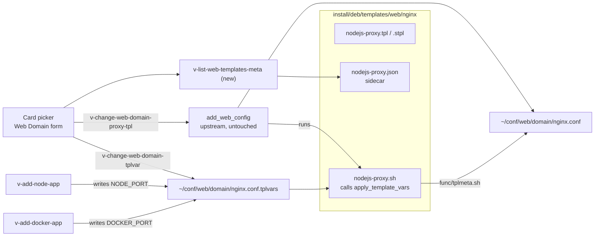

# 09 — Web Templates with Metadata

**Epic:** E6 · **Status:** Draft v1 · **Depends on:** nothing (batch 1 runs in Q1 parallel to E1) · **Unblocks:** E4 (`docker-proxy`), E14 (`nodejs-proxy`), E5 (runtime `requires`)

---

## 1. Goal

Make the template picker usable by people who do not read NGINX configs: every template gets a title, description, category, requirements and typed variables; new templates cover static sites, SPAs, Node, Python, Go, Ruby and Docker reverse proxies; and the per-domain variables those templates need (`%node_port%`, `%docker_port%`, `%backend_port%`) are supplied through one additive mechanism that `func/domain.sh` does not have to know about.

Non-goals: editing templates in the browser (custom templates stay files), changing how upstream renders templates.

---

## 2. Current state (verified in code)

- Templates live in `install/deb/templates/web/<web_system>/[<backend>/]<name>.tpl|.stpl` and are copied to `$WEBTPL` (`/usr/local/hestia/data/templates/web`) at install. Today: ~60 `nginx/php-fpm/*` app templates, `nginx/{default,hosting,caching,suspended}` proxy templates, `apache2/{default,hosting,phpcgi,phpfcgid,www-data}` and `apache2/php-fpm/default`.
- `func/domain.sh:add_web_config()` renders a template with one `sed` pass over a fixed variable list (`%ip% %domain% %domain_idn% %alias% %alias_idn% %alias_string% %email% %web_system% %web_port% %web_ssl_port% %backend_lsnr% %rgroups% %proxy_system% %proxy_port% %proxy_ssl_port% %proxy_extensions% %user% %group% %home% %docroot% %sdocroot% %ssl_crt% %ssl_key% %ssl_pem% %ssl_ca_str% %ssl_ca%`), writes `~/conf/web/<domain>/<web_system>[.ssl].conf`, symlinks it into `/etc/<web_system>/conf.d/domains/`, and **then runs `<name>.sh` if it exists** with `user domain ip homedir docroot` (`domain.sh:329-335`). `caching.sh`, `hosting.sh`, `phpcgi.sh`, `wordpress-*-http3.sh` use this hook today.
- `v-list-web-templates` is `ls $WEBTPL/$WEB_SYSTEM/$WEB_BACKEND | grep '\.tpl' | sed 's/\.tpl$//'`: file names only, no description. `v-list-web-templates-proxy` / `-backend` are the same for proxy and PHP-FPM pools.
- Every generated vhost includes `~/conf/web/<domain>/nginx.conf_*` (and `nginx.ssl.conf_*`), so extra directives per domain are drop-in files.
- `v-backup-user` copies `~/conf/web/<domain>/$WEB_SYSTEM.conf*` into the backup; `v-restore-user` copies them back and calls `rebuild_web_domain_conf`, which re-renders the template and re-runs the `.sh` hook.
- `v-update-web-templates` refreshes `$WEBTPL` from `install/deb/templates` on upgrade.

---

## 3. Design overview



Three additive pieces:

1. **Sidecar** `<name>.json` next to each template — metadata and variable declarations.
2. **Per-domain variables file** `~/conf/web/<domain>/<web_system>.conf.tplvars` — the values for that domain.
3. **Post-render hook** `func/tplmeta.sh:apply_template_vars`, called from each new template's `<name>.sh`, which substitutes the remaining `%var%` placeholders in the just-rendered config.

This is **the canonical mechanism** for template variables in ArcPanel. [07](./07-node-platform.md) §5.4 (Node apps) and [08](./08-app-store.md) §5.4 (Docker apps) write their ports through it; nothing else rewrites rendered configs.

---

## 4. Sidecar format

### 4.1 Location

`install/deb/templates/web/<web_system>/[<backend>/]<name>.json`, copied to `$WEBTPL` by the installer and `v-update-web-templates` (§8). `v-list-web-templates` is unaffected (it greps `\.tpl`). Custom templates in `$WEBTPL` may ship a sidecar too; without one they get a generated minimal entry (§5).

### 4.2 Schema (`docs/design/schemas/web-template.schema.json`, validated in CI)

```jsonc
{
  "$schema": "https://arcpanel.dev/schemas/web-template/v1",
  "name": "nodejs-proxy", // must equal the file name
  "title": "Node.js (reverse proxy)",
  "description": "Proxies the domain to a Node.js process listening on a private port. Static files are served by NGINX when present in public_html.",
  "category": "runtime", // php | cms | framework | runtime | static | proxy | docker | utility | hardened
  "stack": "nginx", // nginx | nginx-proxy | apache2 (which template family this file belongs to)
  "kind": "web", // web | proxy | backend — matches v-list-web-templates / -proxy / -backend
  "requires": {
    // optional; shown as badges, checked by the picker
    "runtime": ["node"], // node (E13 per-user) | python3 | go | java | ruby | redis | memcached | ffmpeg … (E5 system packages)
    "features": ["proxy"], // proxy | ssl | websocket | http3
    "min_version": {}, // e.g. { "nginx": "1.25" }
  },
  "variables": [
    {
      "name": "node_port", // placeholder %node_port%
      "label": "Application port",
      "type": "port", // port | string | int | bool | enum | path | url
      "source": "registry-port", // registry-port | literal | domain-conf-key
      "app_kind": "node", // for registry-port: APP prefix used in v-allocate-user-port (04 §5)
      "default": null,
      "required": true,
      "validation": "^[0-9]{2,5}$", // regex for literal input
      "help": "Allocated automatically from your port pool.",
    },
    {
      "name": "node_host",
      "label": "Bind address",
      "type": "string",
      "source": "literal",
      "default": "127.0.0.1",
      "required": false,
      "enum": ["127.0.0.1", "[::1]"],
    },
  ],
  "docs_url": "https://docs.arcpanel.dev/templates/nodejs-proxy",
  "since": "2.0",
  "deprecated": null, // or { "since": "2.1", "replaced_by": "nodejs-proxy-ws" }
  "hidden": false, // true for internal templates (suspended, proxy_ip)
  "icon": "fa-node-js",
}
```

Variable `source` semantics:

| `source`          | Value comes from                                                                                    | Set by                                                                         |
| ----------------- | --------------------------------------------------------------------------------------------------- | ------------------------------------------------------------------------------ |
| `registry-port`   | the port registry: `v-allocate-user-port USER <app_kind>:<domain>` ([04](./04-port-registry.md) §5) | the picker (on save) or the app command (`v-add-node-app`, `v-add-docker-app`) |
| `literal`         | user input in the picker, validated by `type`/`validation`/`enum`                                   | the picker → `v-change-web-domain-tplvar`                                      |
| `domain-conf-key` | an existing key of the domain object (`web.conf`), e.g. `BACKEND`                                   | resolved at render time, never stored                                          |

Templates **without** declared variables behave exactly as upstream: no `.sh`, no tplvars file, nothing new at render time.

---

## 5. Commands

| Command                                        | Arguments                                             | Behaviour                                                                                                                                                                                                                                                                                                                                                      |
| ---------------------------------------------- | ----------------------------------------------------- | -------------------------------------------------------------------------------------------------------------------------------------------------------------------------------------------------------------------------------------------------------------------------------------------------------------------------------------------------------------- |
| `v-list-web-templates-meta` (**new**)          | `[KIND] [FORMAT]` (KIND = web, proxy, backend or all) | lists the templates `v-list-web-templates` / `-proxy` / `-backend` would list, merged with their sidecars. Templates without a sidecar get `{name, title=name, category:"custom", variables:[], generated:true}`. JSON output is the picker's data source; cached 10 min by Laravel (`SysConfig`-style file cache) and invalidated by `v-update-web-templates` |
| `v-list-web-template-meta` (**new**)           | `NAME [KIND] [FORMAT]`                                | one sidecar; used by the variables form                                                                                                                                                                                                                                                                                                                        |
| `v-change-web-domain-tplvar` (**new**)         | `USER DOMAIN KEY VALUE [RESTART]`                     | validates `KEY` against the variables declared by the domain's current web/proxy templates (`^[a-z][a-z0-9_]*$`, declared, `type`/`validation`), writes `KEY='VALUE'` into `~/conf/web/DOMAIN/<web_system>.conf.tplvars` (root:user 0640, same as the rendered conf), re-renders via `rebuild_web_domain_conf` so the `.sh` hook applies it, schedules restart |
| `v-delete-web-domain-tplvar` (**new**)         | `USER DOMAIN KEY [RESTART]`                           | removes the key; render fails closed if a required variable is now missing (§9)                                                                                                                                                                                                                                                                                |
| `v-list-web-domain-tplvars` (**new**)          | `USER DOMAIN [FORMAT]`                                | current values, with `source`/`label` merged from the sidecar                                                                                                                                                                                                                                                                                                  |
| `v-check-web-template-meta` (**new**)          | `[PATH]`                                              | validates every sidecar against the schema and cross-checks placeholders: each `%var%` in the `.tpl/.stpl` is either an upstream variable or declared; each declared variable appears in the template. Run by CI and by `v-update-web-templates`                                                                                                               |
| `v-update-web-templates` (existing, unchanged) | —                                                     | already copies the whole `install/deb/templates/web` tree, so sidecars and `.sh` hooks ride along. The upgrade script calls `v-check-web-template-meta` afterwards and logs problems                                                                                                                                                                           |

Library `func/tplmeta.sh` (**new**):

```bash
# apply_template_vars USER DOMAIN
# Called by <template>.sh after add_web_config wrote the rendered conf.
# Reads ~/conf/web/DOMAIN/<web_system>.conf.tplvars, substitutes %key% in the
# freshly written <web_system>.conf and <web_system>.ssl.conf (whichever exist),
# resolves domain-conf-key sources from web.conf, and fails with E_INVALID when
# a required variable declared in the sidecar has no value — leaving the vhost
# pointing at the "maintenance" template rendering (see §9) instead of a broken
# config that would stop nginx -t.
apply_template_vars() { ...; }
read_template_vars() { ...; }   # KEY=VALUE pairs for a domain
template_declared_vars() { ...; } # from the sidecar(s) of the domain's templates
```

Why `.sh` + post-substitution rather than a `nginx.conf_*` include with `set $node_port`: `proxy_pass http://127.0.0.1:$node_port;` with a variable disables NGINX upstream keepalive and changes DNS resolution behaviour, and Apache has no equivalent. Rewriting the rendered file keeps the generated config identical to what an admin would write by hand, works for `.tpl` and `.stpl`, for NGINX and Apache, and uses a hook upstream already executes for its own templates.

Why the tplvars file is named `<web_system>.conf.tplvars`: upstream `v-backup-user` copies `~/conf/web/<domain>/$WEB_SYSTEM.conf*` and `v-restore-user` copies the files back before `rebuild_web_domain_conf`, so the variables survive backup/restore with **no backup changes**. The name does not match the `nginx.conf_*` include glob (underscore), so NGINX never reads it.

---

## 6. Rendering sequence

```mermaid
sequenceDiagram
  participant L as Laravel WebDomainService
  participant V as v-change-web-domain-tplvar
  participant P as v-change-web-domain-proxy-tpl (upstream)
  participant R as rebuild_web_domain_conf / add_web_config (upstream)
  participant S as nodejs-proxy.sh (template hook)
  participant T as func/tplmeta.sh

  L->>V: v-change-web-domain-tplvar user example.com node_port 30001 no
  V->>V: validate against sidecar; write nginx.conf.tplvars
  L->>P: v-change-web-domain-proxy-tpl user example.com nodejs-proxy
  P->>R: render nodejs-proxy.tpl → nginx.conf (still contains %node_port%)
  R->>S: nodejs-proxy.sh user example.com ip /home docroot
  S->>T: apply_template_vars user example.com
  T->>T: sed %node_port%→30001 in nginx.conf and nginx.ssl.conf
  T-->>S: ok (or E_INVALID → maintenance fallback)
  R-->>L: OK; restart queued
```

The order "set vars, then switch template" matters only for the first render; later re-renders (SSL added, rebuild, restore) always find the file.

---

## 7. Template catalogue

All new templates ship `.tpl`, `.stpl`, `.json`, and `.sh` (the `.sh` is a one-liner `source $HESTIA/func/tplmeta.sh; apply_template_vars "$1" "$2"` plus any template-specific step). `%var%` placeholders beyond the upstream list are declared in the sidecar. Variables shown in parentheses.

### 7.1 Batch 1 — Q1 (unblocks E4/E14)

| Template          | Family                 | Purpose                                                                                                                      |
| ----------------- | ---------------------- | ---------------------------------------------------------------------------------------------------------------------------- |
| `static`          | nginx/php-fpm (no PHP) | Plain files, aggressive caching, pre-compressed assets, no PHP handler                                                       |
| `spa`             | nginx/php-fpm          | History-mode fallback to `index.html`, hashed-asset caching, no-cache for `index.html`                                       |
| `nodejs-proxy`    | nginx (proxy)          | Proxy to `127.0.0.1:%node_port%`, static files from `public_html` first, buffering tuned for APIs (`node_port`, `node_host`) |
| `nodejs-proxy-ws` | nginx (proxy)          | Same plus `Upgrade`/`Connection` headers and long read timeouts for WebSockets (`node_port`)                                 |
| `python-gunicorn` | nginx (proxy)          | Proxy to a WSGI/ASGI server on `%backend_port%`, static `/static/` and `/media/` aliases (`backend_port`, `static_root`)     |
| `docker-proxy`    | nginx (proxy)          | Proxy to `127.0.0.1:%docker_port%`, `X-Forwarded-*`, `client_max_body_size 64m` (`docker_port`)                              |
| `nextjs` / `nuxt` | nginx (proxy)          | `nodejs-proxy` with `_next/static` / `_nuxt/` immutable caching and image optimisation pass-through (`node_port`)            |
| `strapi`, `ghost` | nginx (proxy)          | Node CMS presets: admin paths, upload size, websocket where needed (`node_port`)                                             |

### 7.2 Batch 2 — Q3

| Template                  | Purpose                                                                                                                                                               |
| ------------------------- | --------------------------------------------------------------------------------------------------------------------------------------------------------------------- |
| `django`, `flask-fastapi` | gunicorn/uvicorn variants with health-check path and static roots (`backend_port`)                                                                                    |
| `golang-proxy`            | minimal proxy, HTTP/2 to backend optional (`backend_port`)                                                                                                            |
| `rails`                   | puma proxy with `public/` static and `assets/` caching (`backend_port`)                                                                                               |
| `redirect-only`           | 301 to `%redirect_target%` preserving path (`redirect_target`, `redirect_code`)                                                                                       |
| `maintenance`             | 503 with `Retry-After`, serves `document_errors/maintenance.html`, allow-list by IP (`allow_ips`) — also the fail-closed fallback of §9                               |
| `wordpress-secure`        | WordPress with `xmlrpc.php` blocked, `wp-config.php`/`.git` denied, PHP execution disabled under `wp-content/uploads`, login rate limit zone, `wp-cron.php` throttled |
| `laravel-octane`          | proxy to Octane on `%backend_port%` with static fallback to `public/` (`backend_port`)                                                                                |

### 7.3 Batch 3 — Q4

| Template                          | Purpose                                                                                                |
| --------------------------------- | ------------------------------------------------------------------------------------------------------ |
| `docker-proxy-ws`                 | WebSocket upgrade variant (`docker_port`)                                                              |
| `docker-proxy-upload`             | `client_max_body_size 0`, request buffering off, long timeouts for Nextcloud/MinIO (`docker_port`)     |
| `docker-proxy-stream`             | `proxy_buffering off`, `chunked_transfer_encoding`, SSE/long-poll for n8n, Uptime Kuma (`docker_port`) |
| `minio`, `grafana`, `uptime-kuma` | thin presets over the `docker-proxy-*` variants with app-specific paths                                |

### 7.4 Apache2 set (Q4)

| Template           | Purpose                                                                                               |
| ------------------ | ----------------------------------------------------------------------------------------------------- |
| `hosting-hardened` | `hosting` plus `Options -Indexes -ExecCGI`, `FileETag None`, `.ht*`/`.git` denied, `LimitRequestBody` |
| `nodejs-proxy`     | `ProxyPass` to `%node_port%` with `RewriteCond` for `public_html` static files (`node_port`)          |
| `python-wsgi`      | `ProxyPass` to `%backend_port%` or `mod_wsgi` when installed (`backend_port`)                         |
| `static`           | no handlers, long `Expires`, `mod_deflate`                                                            |

Each ships matching `.stpl` SSL files. The `nginx/php-fpm` originals of `nodejs-proxy` etc. are not duplicated: when `WEB_SYSTEM=apache2` and `PROXY_SYSTEM=nginx`, the Node/Docker app commands set the **proxy** template (`v-change-web-domain-proxy-tpl`) and leave the Apache template on `default`.

---

## 8. Documentation generator and upgrades

- `src/hst_generate_tpldocs.sh` (**new**, next to `hst_generate_clidocs.sh`) renders `docs/docs/server-administration/web-templates/<name>.md` from each sidecar (title, description, category, requirements, variables table, rendered example for `example.com`) and an index page. Run in CI; output committed like the CLI docs.
- `v-update-web-templates` already copies the tree; the 2.0 upgrade script additionally runs `v-check-web-template-meta` and, for domains using a template that now declares a required variable without a value, logs them and leaves them untouched (existing rendered configs are not re-rendered on upgrade unless upstream does so).
- Custom templates (`$WEBTPL/.../custom/` or admin-added files) may add a `.json`; `v-check-web-template-meta` warns but does not fail for custom templates.

---

## 9. Failure modes

| Failure                                                                                                                      | Mitigation                                                                                                                                                                                                                                                                                                   |
| ---------------------------------------------------------------------------------------------------------------------------- | ------------------------------------------------------------------------------------------------------------------------------------------------------------------------------------------------------------------------------------------------------------------------------------------------------------ |
| Sidecar and template drift (placeholder declared but absent, or used but undeclared)                                         | `v-check-web-template-meta` in CI (`lint.yml`) and on upgrade; CI fails for shipped templates                                                                                                                                                                                                                |
| Required variable missing at render (e.g. tplvars file deleted by hand, template switched from the CLI without setting vars) | `apply_template_vars` returns `E_INVALID`; the hook then renders the `maintenance` template into the same conf path so `nginx -t` passes and the site shows 503 instead of nginx failing to reload; `v-list-web-domain` (unchanged) still shows the chosen template, and the picker shows "variable missing" |
| Template requires a runtime that is not installed (`requires.runtime`)                                                       | Picker shows the badge red with "Install from App Store → System" (admin) or "ask your provider" (user/reseller); selection is allowed (configs render fine), the app will not start — this is a hint, not a gate                                                                                            |
| Upstream renames or removes a `%var%`                                                                                        | Upstream variables are substituted by `add_web_config` first; ours only touch what is left; `v-check-web-template-meta` detects a leftover upstream placeholder in the shipped templates                                                                                                                     |
| `.sh` hook not executable after copy                                                                                         | installer/`v-update-web-templates` keep modes; `v-check-web-template-meta` verifies `+x` for templates with variables                                                                                                                                                                                        |
| `sed` substitution with special characters in a literal value                                                                | values are validated by `type`/`validation`/`enum`; `apply_template_vars` escapes `&`, `\|`, `\` before `sed`                                                                                                                                                                                                |

---

## 10. User interface

Blade + Alpine (no Vue): the picker is a filterable card grid inside the Web Domain add/edit forms ([10](./10-page-migration-and-retirement.md)).

- Data: `v-list-web-templates-meta web json` (and `proxy`, `backend` when the server has a proxy / multiple PHP versions), cached.
- Cards: icon, title, one-line description, category chip, `requires` badges (green installed / red missing, from `v-list-sys-packages` (E5) and the user's `node.conf` (E13)); search box; category tabs; "Advanced: show file names" toggle for admins who know templates by name.
- Selecting a template with `literal` variables reveals a small form generated from `variables[]` (label, help, default, validation client-side mirrored server-side in the FormRequest). `registry-port` variables show "allocated automatically" and the current value when editing. `domain-conf-key` variables are not shown.
- Save: `WebDomainService::setTemplate()` calls `v-change-web-domain-tplvar` for each literal value (and `v-allocate-user-port` for registry ports not yet allocated), then `v-change-web-domain-tpl` / `-proxy-tpl` with `RESTART=no`, then one `v-restart-web`/`v-restart-proxy` via the restart queue (existing `restart.pipe`).
- Edit page shows the current template card and a "Template variables" section (`v-list-web-domain-tplvars`).
- Policies: `WebDomainPolicy::changeTemplate` honours the existing `POLICY_USER_CHANGE_THEME`-style policy `POLICY_USER_EDIT_WEB_TEMPLATES` (already in `hestia.conf`); resellers follow their tree ([03](./03-tenancy-and-authorization.md) §6).

---

## 11. Testing

- **CI:** `v-check-web-template-meta` over `install/deb/templates/web`; JSON schema validation; `nginx -t` / `apachectl -t` of every template rendered for a fixture domain with every declared variable set (Docker job in `pr-docker-bats.yml`).
- **BATS:** `v-change-web-domain-tplvar` round-trip; render `nodejs-proxy` for a domain → `nginx.conf` has no `%` placeholders and contains the port; delete the var → `maintenance` fallback and `nginx -t` passes; backup → restore keeps the variables; `v-update-web-templates` keeps sidecars and `+x`.
- **Pest:** `TemplateCatalog` service parses the meta JSON; FormRequest validation generated from `variables[]`; picker Blade component renders badges from fixtures.
- **Playwright:** add a web domain choosing `static` from the card picker (roadmap Q1 exit criterion); switch a domain to `nodejs-proxy` with a literal port and see the proxied response.

---

## 12. Open questions

1. Should `registry-port` variables be allocatable directly from the picker (manual Node process managed by the user over SSH), or only through Node/Docker app commands? Recommendation: yes from the picker, via `v-add-user-port … APP=manual` ([04](./04-port-registry.md) §12.2) — it is the SSH-user story.
2. Backend (PHP-FPM pool) templates: variables are useful there too (E19 per-domain PHP settings), but pools are rendered by `prepare_web_backend`, not `add_web_config`, and have no `.sh` hook. Keep backend sidecars metadata-only in 2.0; revisit with E19.
3. Per-template documentation language: generated pages are English only; Crowdin coverage of sidecar `title`/`description` through `web/locale` keys is possible (`__()` on the strings) but doubles translation volume — decide at the Q2 review.
