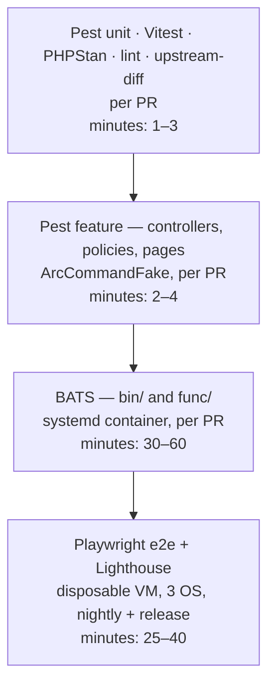

# 11 — Testing and CI

**Epic:** E10 (continuous) · **Status:** Draft v1 · **Depends on:** E1 for the Pest layer · **Supports:** every epic

---

## 1. Goal

Make every change to ArcPanel verifiable without a hand-installed server: shell commands by BATS, the panel app by Pest and Vitest, the whole system by Playwright against a throw-away VM, and the upstream-compatibility rule by a diff check — all in GitHub Actions, green on Debian 12/13 and Ubuntu 24.04, from Q1 onward.

Non-goals: performance benchmarking in CI (measured manually per release), fuzzing.

---

## 2. Current state (verified in code)

- `.github/workflows/lint.yml`: markdownlint (`*.md`, `docs/**/*.md`), ShellCheck (severity `error`), Prettier (`npx prettier --check .`), Biome (`biome lint .`).
- `.github/workflows/test.yml`: Vitest for the docs site only (`npm run docs:test`).
- `.github/workflows/pr-docker-bats.yml`: builds a privileged systemd Ubuntu container from `.github/docker/hestia-ci.Dockerfile`, compiles the `hestia` deb from the working tree (`src/hst_autocompile.sh --hestia --noinstall --keepbuild "~localsrc"`), installs with `install/hst-install-ubuntu.sh --with-debs … --clamav no --spamassassin no`, runs `bats test/test.bats`, collects `journalctl` and the install log on failure. Timeout 120 min.
- `test/`: `test.bats` (main CLI suite), `api.bats`, `restore.bats`, `letsencrypt.bats`, `wildcard.bats`, `checks.bats`, `config-tests.bats`; helpers as submodules (`bats-core`, `bats-assert`, `bats-support`, `bats-file`); `shellcheck.sh` (every `#!/bin/(ba)sh` file, severity error); `lint_script.sh` (dev-mode single-script lint).
- `renovate.json`: weekly grouped dependency updates, linters auto-merged.
- `src/hst_autocompile.sh` flags: `--all | --nginx | --php | --hestia`, `--noinstall`, `--keepbuild`, `--release`, `--pkgrev`, `--cross`, `--dontinstalldeps`.
- No PHP tests, no e2e, no accessibility check, no build of `hestia-nginx` / `hestia-php` in CI.

---

## 3. Test pyramid



| Layer          | What it proves                                                                                                                                                                        | Runs                                                                | Owner of fixtures         |
| -------------- | ------------------------------------------------------------------------------------------------------------------------------------------------------------------------------------- | ------------------------------------------------------------------- | ------------------------- |
| Lint + static  | formatting, ShellCheck errors, PHPStan level 6 on `web-app/`, Biome on JS/Vue, markdownlint, `composer audit`, `npm audit --audit-level=high`                                         | every PR, every push                                                | —                         |
| Pest unit      | `ArcCommand` escaping / allow-list / error mapping / `Secret` masking, `LegacySession`, `Principal`, `Capabilities`, `OwnerScope`, services with the fake                          | every PR                                                            | `web-app/tests/Fixtures/` |
| Pest feature   | every Laravel route with each principal (admin, reseller A, reseller B, user) using `ArcCommandFake`; asserts rendered data, redirects, flash messages, 404 on cross-tenant access | every PR                                                            | recorded fixtures         |
| Vitest         | Vue islands (File Manager, App Store, Node Apps) and Alpine component logic; jsdom; snapshot-free, behaviour tests with `@testing-library/vue` (already a devDependency)              | every PR                                                            | component fixtures        |
| BATS           | each `v-*` command: arguments, exit codes, side effects on `data/`, generated configs, idempotency; additive hooks; patches applied                                                   | every PR touching `bin/`, `func/`, `install/`, `src/`; nightly full | the running container     |
| Playwright e2e | real login, session bridge across legacy and Laravel, role matrix in UI + API, flagship flows (File Manager, Node app, Docker app, reseller onboarding), Lighthouse a11y              | nightly, release, label `e2e` on PR                                 | `test/e2e/seed.sh`        |

---

## 4. Role e2e suite

Referenced by [03](./03-tenancy-and-authorization.md) §12 and §11.

### 4.1 Seed

`test/e2e/seed.sh` (**new**) runs as root on the VM after install and is idempotent:

```text
admin                                   (ROOT_USER, exists)
reseller-a  ROLE=reseller  PACKAGE=reseller   v-change-user-role + package with USERS=5 PORTS=20
reseller-b  ROLE=reseller  PACKAGE=reseller
cust-a1, cust-a2   OWNER=reseller-a   v-add-reseller-user … ; one web domain, one mail domain, one DB, one cron each
cust-b1            OWNER=reseller-b   same objects
plain-user         OWNER=admin        same objects + Node enabled (developer package)
```

Ports: a block of 10 to each reseller (`v-add-user-port RESELLER 30100-30109`), two sub-allocated to `cust-a1`. Access keys: one `billing` key for admin, one `reseller-billing` key for each reseller, one `purge-nginx-cache` key for `plain-user`. Passwords are generated and written to `/tmp/arcpanel-e2e-env.sh` (never committed), mirroring `test/api.bats`'s `/tmp/hestia-api-env.sh`.

### 4.2 Matrix

`test/e2e/roles/*.spec.ts` logs in as each principal (Playwright storage state per role, created once per run) and executes the same table of probes:

| Probe                                                              | admin                   | reseller-a       | reseller-b           | plain-user        |
| ------------------------------------------------------------------ | ----------------------- | ---------------- | -------------------- | ----------------- |
| `GET /app/customers` lists cust-a1                                 | 200 + row               | 200 + row        | 200, row absent      | 404               |
| `GET /app/customers/cust-a1`                                       | 200                     | 200              | **404**              | **404**           |
| `GET /app/web/domains?user=cust-a1`                                | 200                     | 200              | **404**              | **404**           |
| `POST /app/impersonate/cust-a1`                                    | 303 → acting as cust-a1 | 303              | **404**              | **403**           |
| `POST /app/impersonate/admin`                                      | n/a                     | **403**          | **403**              | **403**           |
| `GET /app/server/settings`                                         | 200                     | **404**          | **404**              | **404**           |
| `GET /app/ports` shows block 30100-30109 of reseller-a             | 200 (all)               | 200              | 200 (own block only) | own ports only    |
| API `v-list-user cust-a1` with reseller-b's `reseller-billing` key | —                       | —                | `E_FORBIDEN`         | —                 |
| API `v-add-reseller-user reseller-a x …` with reseller-b's key     | —                       | —                | `E_FORBIDEN`         | —                 |
| API `v-list-users` with `plain-user` key                           | —                       | —                | —                    | permission denied |
| Legacy page `/list/dns/?user=cust-b1` (until E7)                   | 200                     | **404/redirect** | 200                  | **404/redirect**  |

Every probe asserts **both** the HTTP status and that the response body does not contain any username, domain or email of another tree (a shared `assertNoForeignTenant(body, tree)` helper with the seed's object lists). The suite fails on any new route under `/app/` that is not in the matrix: a Pest test enumerates `route:list` and compares with `test/e2e/roles/matrix.json`, so adding a page forces adding its row.

### 4.3 Reseller onboarding flow

One long spec: reseller-a logs in → Customers → create-customer wizard (user, package, first domain + mail + DB) → customer detail shows the objects → "open as customer" → add a cron job → stop impersonation → Statistics aggregate includes the new customer → admin sees the customer under reseller-a in the tree view → `v-list-reseller-users reseller-a` on the VM contains it. Roadmap E11 metric.

---

## 5. Upstream-diff check

Referenced by [01](./01-architecture-overview.md) §3.2, [02](./02-laravel-foundation.md) §9 and [10](./10-page-migration-and-retirement.md).

### 5.1 Rule

`bin/`, `func/`, `install/` may only **add** files relative to the pinned upstream HestiaCP release. An existing upstream file may differ only if it is listed in `install/upgrade/patch/ALLOWLIST`, and then only by the patch stored next to it. `web/` is exempt (ArcPanel replaces it), as are `src/deb/nginx/nginx.conf` (one Laravel `location`, see [02](./02-laravel-foundation.md) §3.1) and `src/deb/hestia/control` (dependencies), both listed in the allow-list with their patches.

### 5.2 Files

```text
install/upstream.version            # e.g. "1.10.5" — the tag of hestiacp/hestiacp this tree is based on
install/upgrade/patch/ALLOWLIST     # one path per line; comments with '#'
install/upgrade/patch/<path-with-dashes>.patch   # unified diff applied by the upgrade script and verified by CI
```

Initial `ALLOWLIST`:

```text
bin/v-change-user-role                 # accept 'reseller' (upstream PR #TBD)
src/deb/nginx/nginx.conf               # /app/ location for the Laravel app
src/deb/hestia/control                 # Depends: adds nothing new today; placeholder for php extensions if needed
```

### 5.3 Script `test/upstream-diff.sh` (**new**)

1. Read `install/upstream.version`; `git fetch --depth 1 https://github.com/hestiacp/hestiacp.git refs/tags/<version>` into `UPSTREAM_SHA` (cached by the action key `upstream-<version>`).
2. For each of `bin func install src/deb`: `git diff --name-status UPSTREAM_SHA HEAD -- <dir>`.
3. Status `A` (added) → allowed. Status `D` (deleted) → **fail** (upstream files are never removed; obsolete ones are left in place). Status `M`/`R` → allowed only if the path is in `ALLOWLIST` **and** `git diff UPSTREAM_SHA HEAD -- <path>` equals the stored `.patch` (after normalising hunk headers), so the patch file is always the truth the upgrade script applies.
4. Print a table of additions (for the release notes) and exit non-zero on any violation. Runs in `lint.yml` as job `upstream-diff`, required on every PR.

### 5.4 Upstream merge procedure

1. On an upstream release, within two weeks (roadmap §9): branch `upstream-sync/<version>` from `master`; `git merge <upstream-tag>`.
2. Conflicts are expected only in allow-listed files and in `web/` (resolve by taking **ours** for `web/` paths already migrated and deleted, **theirs** otherwise), `CHANGELOG.md`, `package.json` version.
3. Re-generate each `.patch` against the new base (`git diff <tag> HEAD -- <path> > install/upgrade/patch/<file>.patch`), bump `install/upstream.version`, run `test/upstream-diff.sh` locally.
4. Open the PR; required checks plus the `e2e` label (full Playwright matrix). Merge; tag an ArcPanel release if upstream shipped security fixes.
5. If an upstream change touches a command that an ArcPanel command wraps (e.g. `v-add-user`), the BATS suite for the wrapper (`v-add-reseller-user`) is the guard; the merge PR must list such wrappers in its description (the script prints "wrapped commands changed upstream" by grepping `bin/v-*` for `$BIN/<changed-command>` calls).

---

## 6. Layers in detail

### 6.1 BATS for `bin/` and `func/`

- One file per ArcPanel area, next to the upstream files: `test/arcpanel-reseller.bats`, `test/arcpanel-ports.bats`, `test/arcpanel-node.bats`, `test/arcpanel-docker.bats`, `test/arcpanel-templates.bats`, `test/arcpanel-fs.bats`, `test/arcpanel-upgrade.bats` (patch application, `v-add-sys-arcpanel` idempotency, `nginx -t`).
- Convention per command: happy path; each `is_format_valid` refusal (`E_INVALID`); object-not-found (`E_NOTEXIST`); limit (`E_LIMIT`); suspended (`E_SUSPENDED`); demo mode (`E_FORBIDEN`); `json` output parses with `jq`; `v-log-action` entry written; idempotent re-run behaviour stated in the test name.
- Teardown always deletes created users (`v-delete-user`) so the suite can run twice in one container; `test/test.bats` already follows this pattern.
- `pr-docker-bats.yml` becomes a matrix: `{ubuntu-24.04, debian-12, debian-13}` images (three Dockerfiles under `.github/docker/`), `--all` build (nginx, php, hestia) once per PR touching `src/deb/nginx|php`, otherwise `--hestia` only; built debs uploaded as artifacts and reused by the e2e job. Path filters: BATS runs on changes to `bin/`, `func/`, `install/`, `src/`, `test/`, `web-app/` (Laravel ships in the deb) — but not on `docs/`-only PRs.
- Docker-in-Docker for E4 tests: the CI container is already `--privileged` with host cgroups, so `v-add-sys-docker` can start the daemon inside it; E4 BATS tests are tagged `# bats test_tags=docker` and skipped where the runner lacks nested virtualisation.

### 6.2 Pest for `web-app/`

- `ArcCommandFake` (see [02](./02-laravel-foundation.md) §4.5) is bound in `tests/TestCase.php`; any unexpected command fails the test with the full argument list.
- Fixtures: `web-app/tests/Fixtures/commands/<command>/<case>.json` plus `<case>.meta.json` (`exit`, `args`, `recorded_at`, `upstream_version`). Recorded by `php artisan arcpanel:record-fixtures --from tests/Fixtures/record-plan.yaml` on the e2e VM after `seed.sh`; the plan lists command + args + case name. A nightly job re-records and opens a PR when output shape changes (new keys, renamed fields) so the panel notices upstream format drift.
- Session fixtures: `tests/Fixtures/sessions/<state>.sess` (PHP-serialized) for every state in [02](./02-laravel-foundation.md) §5.4; `LegacySession` is pointed at a temp dir in tests.
- Architecture tests (Pest `arch()`): controllers call no `exec`/`shell_exec`/`proc_open`; only `App\Arc\*` uses Symfony Process; Blade files contain no `ROOT_USER`/`look`/`OWNER` string comparisons; every policy method calls `Capabilities::allows`.
- Coverage gate: 80 % lines on `app/Arc`, `app/Auth`, `app/Policies`, `app/Services`; reported, not gated, elsewhere.
- PHPStan level 6 with `larastan`; baseline file committed and shrinking.

### 6.3 Vitest for the frontend

- Config: `web-app/vitest.config.js` (jsdom, `@vitejs/plugin-vue` already present). Tests next to components: `resources/js/islands/file-manager/__tests__/*.test.js`.
- What is tested: tree/list state machine, selection and keyboard shortcuts, upload queue chunking and retry, editor dirty-state guard, App Store variables form validation, Node Apps log viewer buffering. Network calls are mocked at the `api/*.js` module boundary; the JSON shapes come from the same recorded fixtures as Pest (shared `tests/Fixtures/commands`), so UI and backend tests cannot drift apart.
- Alpine components: logic lives in plain modules under `resources/js/alpine/*.js` and is tested without a DOM where possible.

### 6.4 Playwright e2e

#### VM build in GitHub Actions

1. Job `build-debs` (matrix OS): `src/hst_autocompile.sh --all --noinstall --keepbuild '~localsrc'` (+ `composer install --no-dev` and the esbuild step for `web-app/` before packaging; see [02](./02-laravel-foundation.md) §9). Cache key: hash of `src/`, `web-app/composer.lock`, `package-lock.json`; `hestia-nginx`/`hestia-php` debs are cached across PRs because they change rarely; `hestia` is rebuilt each time (≈ 3 min).
2. Job `e2e` (matrix OS): start the same systemd container image as BATS (LXC/`incus` is used on the nightly self-hosted runner for a real kernel when Docker-in-Docker tests are required; GitHub-hosted runners use the privileged container). Install with `install/hst-install-<os>.sh --with-debs <artifacts> --interactive no --force --port 8083 --clamav no --spamassassin no --webterminal yes`, then `test/e2e/seed.sh`.
3. Run `npx playwright test` from `test/e2e/` against `https://127.0.0.1:8083` (`ignoreHTTPSErrors`), Chromium only on PRs, Chromium + Firefox + WebKit nightly. Traces, screenshots and videos kept on failure; the install log and `journalctl` collected as today.
4. Lighthouse: `@playwright/test` fixture runs `lighthouse` (Chromium) on every route in `matrix.json` as admin, reseller and user; asserts `accessibility ≥ 90` (roadmap O1 metric); results published as a job summary table. Performance scores are recorded but not gated.

#### Spec groups

| Group      | Specs                                                                                                                                                                                                                  |
| ---------- | ---------------------------------------------------------------------------------------------------------------------------------------------------------------------------------------------------------------------- |
| `session/` | Laravel login → legacy page → Laravel page without re-login; login-as from Laravel visible in legacy; inactivity logout; IP-binding logout; 2FA happy path and three failures; logout from legacy ends Laravel session |
| `roles/`   | §4                                                                                                                                                                                                                     |
| `web/`     | add domain with template picker (E6), edit, SSL self-signed, delete; legacy stub redirects                                                                                                                             |
| `files/`   | upload-and-edit timing (E3 metric: measured and reported), chunked upload of a 200 MB file, zip/extract, permissions, path escape attempts return 404                                                                  |
| `node/`    | install Node 22 + pm2 from UI, deploy Express sample on a domain, HTTPS, `node -v` in web terminal, reboot the container (`systemctl soft-reboot` or restart container), app is back (E14 metric)                      |
| `apps/`    | install Uptime Kuma from catalog on a domain, logs stream, update, remove cleanly (E4 metric); tagged `docker`                                                                                                         |
| `ports/`   | 5 users × 4 apps, zero conflicts; every public high port has an owner (E12 metric)                                                                                                                                     |
| `a11y/`    | Lighthouse on every route per role                                                                                                                                                                                     |
| `upgrade/` | separate job: install upstream 1.10.5 release debs, then upgrade to the built ArcPanel debs, then run `session/` + `roles/` (E8 metric)                                                                                |

### 6.5 Static and supply chain

- `npm audit --audit-level=high` and `composer audit` in `lint.yml`; failures block unless an `audit-exceptions.json` entry with an expiry date exists.
- Renovate stays weekly; `web-app/composer.json` added to its managers; Playwright and Lighthouse versions pinned and grouped.
- `deb` build artifacts are signed in the release pipeline only (key in GitHub secrets, never in PR jobs).

---

## 7. Pipelines

### 7.1 Per pull request (required checks)

| Check                                                           | Job                                                                    | Budget |
| --------------------------------------------------------------- | ---------------------------------------------------------------------- | ------ |
| Lint (Prettier, Biome, markdownlint, ShellCheck)                | `lint.yml`                                                             | 3 min  |
| `upstream-diff`                                                 | `lint.yml`                                                             | 1 min  |
| PHPStan + Pest (unit + feature) + coverage gate                 | `test.yml` / `php`                                                     | 4 min  |
| Vitest (docs + web-app)                                         | `test.yml` / `js`                                                      | 2 min  |
| Deb build (`--hestia`, cached nginx/php)                        | `build.yml`                                                            | 5 min  |
| BATS (path-filtered, Ubuntu 24.04 only on PR)                   | `pr-docker-bats.yml`                                                   | 45 min |
| Playwright smoke (`session/`, `roles/`, Chromium, Ubuntu 24.04) | `e2e.yml` with `if: label e2e OR paths web-app/** OR src/deb/nginx/**` | 25 min |

Total wall clock for a typical `web-app/` PR: ≈ 15 min (BATS skipped), ≈ 50 min when `bin/` changes.

### 7.2 Nightly (`schedule:`)

Full matrix: BATS on three OS, Playwright full groups on three browsers, Lighthouse, fixture re-recording PR, `upgrade/` job from the last upstream release and from the last ArcPanel release.

### 7.3 Release (`push: tags: v*`)

1. All PR checks + nightly groups on the tag.
2. `hst_autocompile.sh --all --release` for each OS; sign debs; smoke-install on each OS from the produced apt repo layout (`install/hst-install.sh` default path, no `--with-debs`), then `session/` specs.
3. Publish to the ArcPanel apt repository and GitHub Release with the upstream-diff "additions" table and `CHANGELOG.md` section.
4. Docs site build (`npm run docs:build`) and deploy.

---

## 8. Policies

- **Flakiness:** a spec that fails and passes on retry twice in 14 days is quarantined (`test.fixme` with an issue link) within one working day; quarantined specs run nightly only and block the release if still quarantined after 30 days. Playwright `retries: 1` on PRs, `0` nightly, so flakiness is visible.
- **Required for merge:** every job in §7.1; `e2e` label mandatory for PRs touching `web-app/app/Auth`, `web-app/app/Policies`, `src/deb/nginx/nginx.conf`, `install/`.
- **Test-first for commands:** a new `v-*` lands with its BATS file in the same PR; a new route lands with its matrix row and Pest feature test.
- **Fixture freshness:** fixtures older than the pinned upstream version fail Pest with a hint to re-record.
- **Secrets in CI:** none in PR jobs; release signing key and apt repo credentials only in the protected `release` environment.

---

## 9. Failure modes

| Failure                                                   | Mitigation                                                                                                                  |
| --------------------------------------------------------- | --------------------------------------------------------------------------------------------------------------------------- |
| Privileged container unavailable on GitHub-hosted runners | Nightly on a self-hosted runner with `incus`; PR BATS keeps the current working approach                                    |
| Docker-in-Docker flaky                                    | `docker`-tagged tests skipped on hosted runners, mandatory nightly                                                          |
| Playwright timing on slow runners                         | Explicit waits on network idle and `data-testid` readiness; no fixed sleeps; File Manager timing metric reported, not gated |
| Upstream tag fetch blocked                                | Cached tarball keyed by version; the check fails closed (cannot verify → fail) with a clear message                         |
| Fixture re-record PR floods                               | One PR per night, auto-closed if superseded                                                                                 |

---

## 10. Open questions

1. Self-hosted runner budget for nightly LXC jobs (needed for reboot and Docker specs) — one small bare-metal host is enough; decide in Q1.
2. Whether to gate Lighthouse **performance** as well as accessibility once baseline numbers exist (candidate for Q3).
3. PHPStan level 6 vs 8 for new code: start at 6 with a baseline, raise per directory as `app/Arc` and `app/Policies` reach 8.
