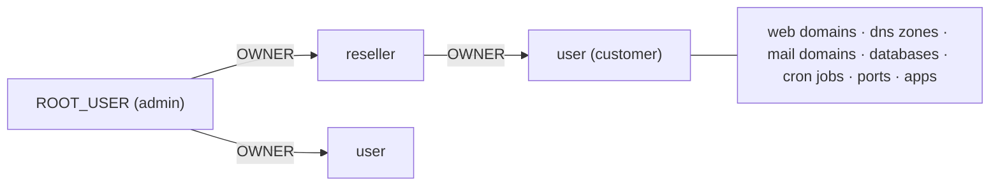
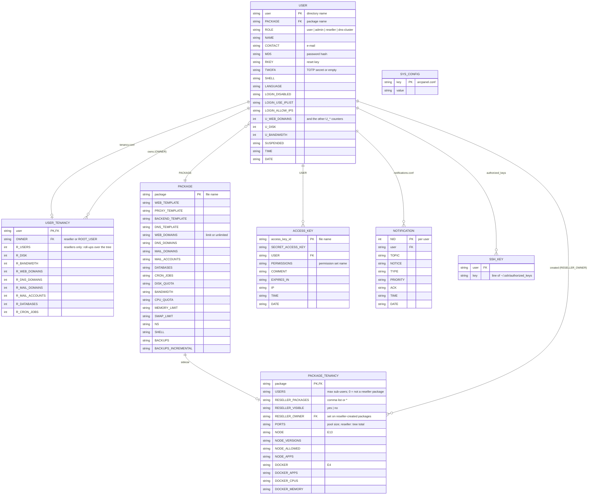
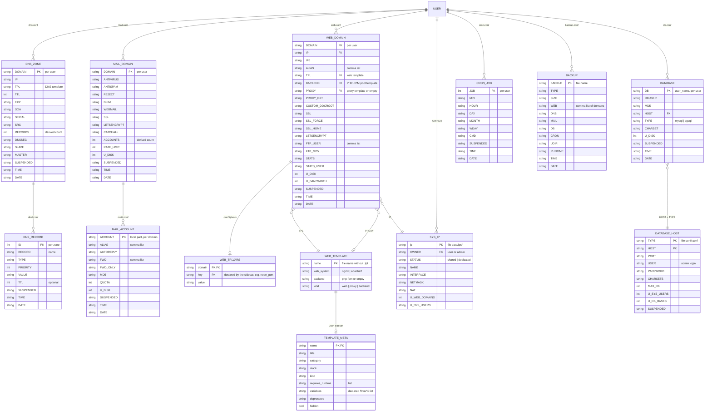
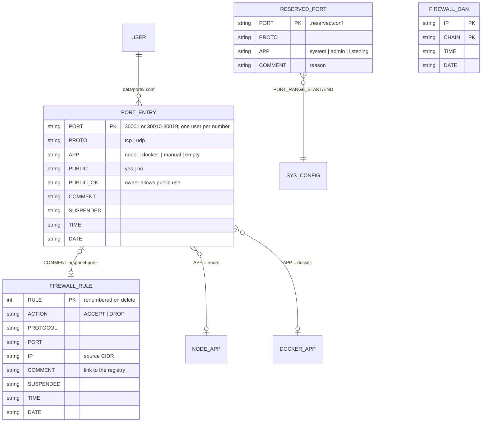
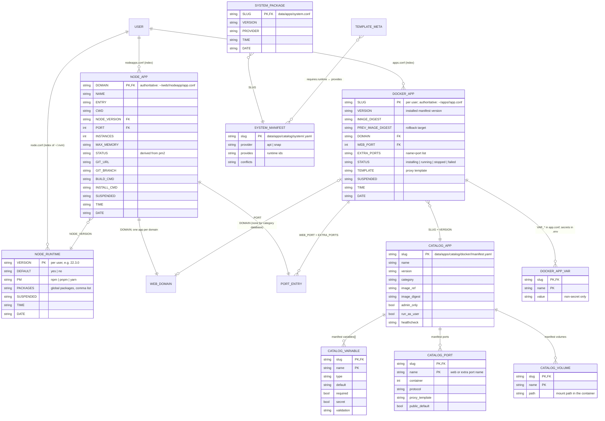
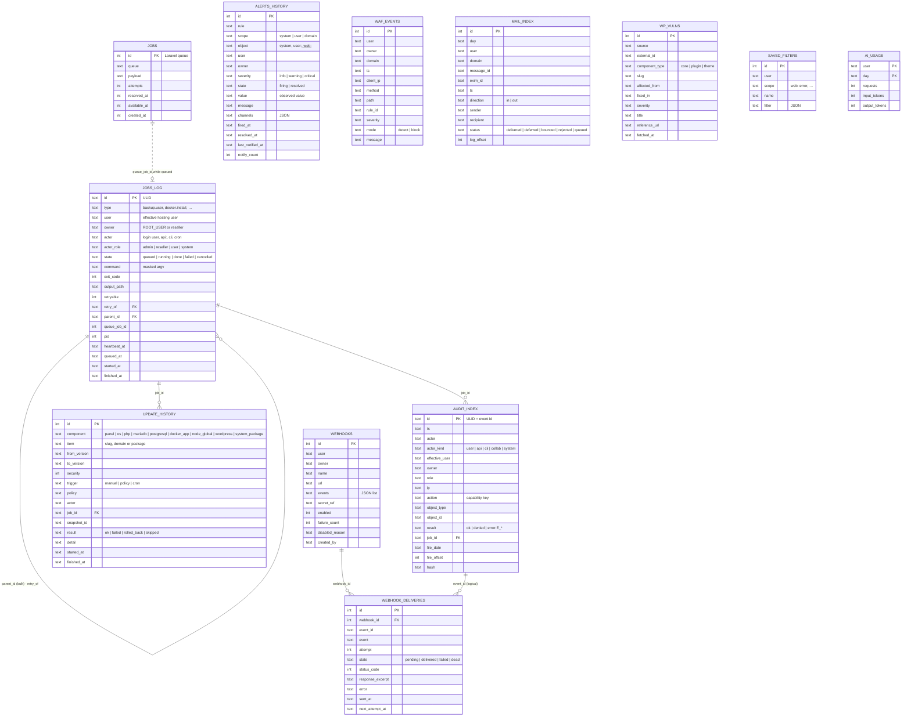

# 15 — Database Schema and ERD

**Epics:** all (logical model) · E15, E16, E18, E21, E23, E24, E27, E29, E32, E33 (SQLite) · **Status:** Draft v1 (2026-10-05) · **Companion to:** [13 Data model reference](./13-data-model-reference.md) (where every key lives) and [14 Later backlog](./14-later-backlog.md) §0.1 (why SQLite)

This document is the entity–relationship view of ArcPanel's data and the physical schema of the one database the panel owns. Document 13 answers "where does key X live and who writes it"; this one answers "what are the entities, how do they relate, and what does the SQLite file look like". The DDL is in [`schemas/arcpanel-sqlite.sql`](./schemas/arcpanel-sqlite.sql).

---

## 1. Two storage tiers

ArcPanel has no relational database for hosting state and will not get one (roadmap §1, [01](./01-architecture-overview.md) §3.1). The data model therefore has two tiers with different rules:

| Tier                                | Storage                                                                                                         | Owner / writer                                  | Read by the panel through | Backed up by                                              |
| ----------------------------------- | --------------------------------------------------------------------------------------------------------------- | ----------------------------------------------- | ------------------------- | --------------------------------------------------------- |
| **Hosting state** (tier 1)          | Hestia flat files: one object per line, `KEY='value'` pairs, under `$ARCPANEL/data/`, `$ARCPANEL/conf/` and `~` | root, only through `v-*` commands               | `v-list-* … json`         | `v-backup-user` (per user), config snapshot (E33, server) |
| **Panel operational data** (tier 2) | SQLite `$ARCPANEL/data/arcpanel/arcpanel.sqlite` (`arcpanelweb:arcpanelweb 0640`, WAL)                          | `arcpanelweb` (Laravel migrations, worker, web) | Eloquent / query builder  | config snapshot (E33); never part of a user backup        |

Rules that follow from the split:

1. **Tier 2 never duplicates tier 1.** A SQLite row refers to a user, domain or package by its natural key (`user`, `domain`, `package`) and never stores the object's attributes. The panel re-reads tier 1 for display.
2. **No foreign keys across tiers.** SQLite cannot reference `user.conf`. Every tier-2 table that names a user carries `user` and `owner` columns for scoping, and a nightly prune (`php artisan arcpanel:prune`, §7.4) deletes rows of users that no longer exist (`v-list-users json`).
3. **Tier 2 is disposable.** Losing `arcpanel.sqlite` loses job history, alert history, the audit _index_ (not the audit files), webhook delivery logs and update history. Nothing a hosting user owns. The file is recreated empty by `php artisan migrate` and the audit index is rebuilt from `data/audit/*.jsonl` by `arcpanel:audit-reindex`.
4. **Tier 1 keeps the Hestia conventions** ([13](./13-data-model-reference.md) §1): upper-case keys, `SUSPENDED`, `TIME`, `DATE` on objects with a lifecycle, authoritative record in the user's tree, derived index under `data/users/<user>/`.

---

## 2. Identity, ownership and the tenancy tree

Every entity in both tiers resolves to one **hosting user** (`data/users/<user>/`), and every user resolves to one **owner**:



| Identity            | Natural key                                   | Where it is defined                                          | Notes                                                                                                                        |
| ------------------- | --------------------------------------------- | ------------------------------------------------------------ | ---------------------------------------------------------------------------------------------------------------------------- |
| User                | `user` (`[[:alnum:]][-.\w]{0,28}[[:alnum:]]`) | `data/users/<user>/user.conf`                                | Also a Linux account and a systemd slice                                                                                     |
| Owner               | `OWNER` in `data/users/<user>/tenancy.conf`   | E11 spec D2                                                  | Absent = `ROOT_USER`. One level only (D9): an owner's own owner is always `ROOT_USER`                                        |
| Package             | `package` name                                | `data/packages/<package>.pkg` + `<package>.tenancy`          | Reseller-created packages are stored as `<reseller>_<name>` (D8)                                                             |
| Domain              | `domain` (IDN-normalised)                     | `web.conf`, `dns.conf`, `mail.conf` of the owning user       | The same name may exist as web, DNS and mail object; `v-search-domain-owner` resolves the user                               |
| Port                | `PORT` number (one user for both protocols)   | `data/ports/<user>.conf`                                     | Ranges `a-b` are blocks of the same user                                                                                     |
| App                 | `node:<domain>` · `docker:<slug>` · `manual`  | `~/web/<domain>/nodeapp/app.conf` · `~/apps/<slug>/app.conf` | The `APP` value of a port entry and the `target` of a log stream use the same string ([13](./13-data-model-reference.md) §8) |
| Job / audit event   | ULID (26 chars)                               | SQLite `jobs_log.id`, `audit_index.id`                       | Time-sortable, generated by the panel                                                                                        |
| Capability / action | `<module>.<object>.<action>`                  | `web-app/app/Policies/Capabilities.php`                      | The `action` of an audit row is a capability key                                                                             |

Scoping columns in tier 2 are always the pair **`user`** (effective hosting user) and **`owner`** (its owner at write time). A reseller's queries filter `owner = <reseller> OR user = <reseller>`; an admin filters nothing; a user filters `user = self`. This mirrors `OwnerScope::visibleUsers()` ([03](./03-tenancy-and-authorization.md) §7.1) without a join.

---

## 3. Logical ERD — tier 1 (hosting state)

The diagrams show entities as they exist in the flat files. Attribute lists name the keys that matter for relationships and lifecycle; the full key lists are in the writers named in the "File" column of §3.6 and in [13](./13-data-model-reference.md).

### 3.1 Accounts, packages and tenancy



Reading notes:

- `USER ||--o{ USER_TENANCY : owns` is the reseller tree: the `OWNER` of a customer's sidecar names a reseller `USER`. A reseller is itself a `USER` with `ROLE='reseller'`.
- `R_*` and `U_*` are **derived** counters (recomputed by `v-update-reseller-counters` and `v-update-user-counters`); they are not sources of truth and quota checks recompute from the objects (E11 spec D7).
- The sidecar split (`tenancy.conf`, `.tenancy`) exists because upstream commands rewrite `user.conf` and `.pkg` with a fixed key list (E11 spec D2). Logically they are one entity each; physically they are two files.

### 3.2 Hosting objects



Reading notes:

- Object identity is **scoped by user**: `DOMAIN` is unique per `web.conf`, and the panel never addresses a domain without its user (`effective-user` middleware). Server-wide uniqueness of a domain name is enforced by `v-add-web-domain` through `is_domain_new`, not by the file format.
- Several attributes are comma lists (`ALIAS`, `FTP_USER`, `FWD`, `WEB` in backups): a deliberate 1NF trade-off of the upstream format. The panel splits them in DTOs; it never writes them.
- `WEB_TPLVARS` ([09](./09-web-templates-metadata.md) §5) is the only ArcPanel-added per-domain record; it is keyed by the variable names the template sidecar declares.
- `DATABASE_HOST` and `SYS_IP` are server entities that users reference; they live in `$ARCPANEL/conf/` and `data/ips/`, written by admin commands only.

### 3.3 Ports and firewall (E12, implemented)



Reading notes:

- A port **belongs to exactly one user** (physical pool, E12 spec D2). Sub-allocation moves entries between files; it never creates a second owner.
- The link from a public port to its firewall rule is the rule's `COMMENT`, not a stored id, because `v-delete-firewall-rule` renumbers rules (E12 spec §13). `FW_RULE` in `v-list-user-ports json` is looked up at read time.
- Totals (`ALLOCATED`, `ASSIGNED`, `PUBLIC`, `LIMIT`) are computed by `v-list-user-ports`; nothing is stored in `user.conf` (D5).

### 3.4 Runtimes, apps and the catalogs (E13, E14, E4, E5)



Reading notes:

- Node and Docker apps follow rule 2 of [13](./13-data-model-reference.md) §1: the **authoritative** record sits inside the user's home (so `v-backup-user` carries it) and `data/users/<user>/{nodeapps,apps}.conf` is a derived index rebuilt by `v-rebuild-*`.
- Catalog entities (`CATALOG_*`, `SYSTEM_MANIFEST`) are read-only on the server: they come from signed manifests validated by `v-check-docker-catalog` / `v-check-sys-packages` against the JSON schemas in `docs/design/schemas/`.
- Secrets of a Docker app are in `~/apps/<slug>/.env`, never in `app.conf`; `DOCKER_APP_VAR` therefore holds non-secret variables only.

### 3.5 Later-backlog file entities (E16–E33)

These entities are sketched in [14](./14-later-backlog.md) and stay in tier 1 because root writes them or users may read them over SFTP. They are listed here so the ERD is complete; their SQLite companions are in §4.

```mermaid
erDiagram
  USER ||--o{ COLLABORATOR : "collaborators.conf (E30)"
  USER ||--o{ PASSKEY : "passkeys.conf (E26)"
  USER ||--o{ SECRET : "data/secrets/<user>/<kind>/<name>"
  USER ||--o{ PHP_SETTING : "php/<domain>.conf (E19)"
  WEB_DOMAIN ||--o{ PHP_SETTING : "domain"
  WEB_DOMAIN ||--o| GIT_DEPLOY : "releases/, shared/, current (E20)"
  WEB_DOMAIN ||--o| WAF_CONFIG : "nginx.conf_waf + waf/<domain>.conf (E24)"
  WEB_DOMAIN |o--o| STAGING_LINK : "staging.conf (E22)"
  DNS_ZONE |o--o| DNS_PROVIDER_BINDING : "dns/<domain>.provider.conf (E28)"
  USER ||--o{ DNS_PROVIDER : "data/secrets/<user>/dns/<name>"
  ALERT_RULE }o--o{ ALERT_CHANNEL : "CHANNELS list (E16)"
  ALERT_RULE ||--o{ ALERT_STATE : "state/<rule>-<object>.json"
  AUDIT_EVENT }o--|| AUDIT_DAY : "YYYY-MM-DD.jsonl + .anchor (E23)"
  UPDATE_POLICY }o--|| SYS_CONFIG : "policy.conf (E33)"

  COLLABORATOR {
    string LOGIN PK "per host user"
    string HOST_USER FK
    string SCOPES "module:rw:object list"
    string EXPIRES
    string SUSPENDED
  }
  PASSKEY {
    string id PK
    string user FK
    string public_key
    string label
  }
  SECRET {
    string user PK "or system"
    string kind PK
    string name PK
    string path "0600, never read by the panel"
  }
  ALERT_RULE {
    string RULE PK
    string SCOPE "system | user | domain"
    string THRESHOLD
    string SEVERITY
    int COOLDOWN
    string CHANNELS
    string SUSPENDED
  }
  ALERT_CHANNEL {
    string NAME PK
    string TYPE "email | telegram | slack | webhook | panel"
    string TARGET
    string secret_ref "data/secrets/system/alerts/<name>"
  }
  ALERT_STATE {
    string rule PK,FK
    string object PK
    string firing_since
    string last_sent
    string resolved
  }
  AUDIT_EVENT {
    string id PK "ULID"
    string ts
    string actor
    string effective_user
    string role
    string action
    string object
    string result
    string prev_hash
    string hash
  }
  AUDIT_DAY {
    string date PK
    string anchor_hash
  }
  UPDATE_POLICY {
    string COMPONENT PK
    string POLICY
    string WINDOW
    int DELAY
    string HELD
  }
```



### 3.6 Entity → file map

| Entity               | File (tier 1)                                             | Key(s)                      | Writer                                        | Lifecycle keys         |
| -------------------- | --------------------------------------------------------- | --------------------------- | --------------------------------------------- | ---------------------- |
| `USER`               | `data/users/<user>/user.conf`                             | `user`                      | `v-add-user`, `v-change-user-*`               | `SUSPENDED TIME DATE`  |
| `USER_TENANCY`       | `data/users/<user>/tenancy.conf`                          | `user`                      | `func/tenancy.sh`                             | —                      |
| `PACKAGE`            | `data/packages/<package>.pkg`                             | `package`                   | `v-add-user-package`, `v-update-user-package` | `TIME DATE`            |
| `PACKAGE_TENANCY`    | `data/packages/<package>.tenancy`                         | `package`                   | `v-change-package-tenancy`                    | —                      |
| `ACCESS_KEY`         | `data/access-keys/<id>`                                   | `id`                        | `v-add-access-key`                            | `TIME DATE EXPIRES_IN` |
| `NOTIFICATION`       | `data/users/<user>/notifications.conf`                    | `user`, `NID`               | `v-add-user-notification`                     | `ACK TIME DATE`        |
| `WEB_DOMAIN`         | `data/users/<user>/web.conf`                              | `user`, `DOMAIN`            | `v-add-web-domain`, `v-change-web-domain-*`   | `SUSPENDED TIME DATE`  |
| `WEB_TPLVARS`        | `~/conf/web/<domain>/<web_system>.conf.tplvars`           | `user`, `domain`, `key`     | `v-change-web-domain-tplvar`                  | —                      |
| `DNS_ZONE`           | `data/users/<user>/dns.conf`                              | `user`, `DOMAIN`            | `v-add-dns-domain`                            | `SUSPENDED TIME DATE`  |
| `DNS_RECORD`         | `data/users/<user>/dns/<domain>.conf`                     | `user`, `domain`, `ID`      | `v-add-dns-record`                            | `SUSPENDED TIME DATE`  |
| `MAIL_DOMAIN`        | `data/users/<user>/mail.conf`                             | `user`, `DOMAIN`            | `v-add-mail-domain`                           | `SUSPENDED TIME DATE`  |
| `MAIL_ACCOUNT`       | `data/users/<user>/mail/<domain>.conf`                    | `user`, `domain`, `ACCOUNT` | `v-add-mail-account`                          | `SUSPENDED TIME DATE`  |
| `DATABASE`           | `data/users/<user>/db.conf`                               | `user`, `DB`                | `v-add-database`                              | `SUSPENDED TIME DATE`  |
| `DATABASE_HOST`      | `conf/<type>.conf`                                        | `TYPE`, `HOST`              | `v-add-database-host`                         | `SUSPENDED`            |
| `CRON_JOB`           | `data/users/<user>/cron.conf`                             | `user`, `JOB`               | `v-add-cron-job`                              | `SUSPENDED TIME DATE`  |
| `BACKUP`             | `data/users/<user>/backup.conf`                           | `user`, `BACKUP`            | `v-backup-user`                               | `TIME DATE`            |
| `SYS_IP`             | `data/ips/<ip>`                                           | `ip`                        | `v-add-sys-ip`                                | `TIME DATE`            |
| `SYS_CONFIG`         | `conf/arcpanel.conf`                                      | `key`                       | `v-change-sys-config-value`, installers       | —                      |
| `WEB_TEMPLATE`       | `data/templates/web/<system>/[<backend>/]<name>.tpl`      | `system`, `backend`, `name` | `v-update-web-templates`                      | —                      |
| `TEMPLATE_META`      | `… /<name>.json`                                          | same                        | shipped with templates                        | `deprecated`           |
| `PORT_ENTRY`         | `data/ports/<user>.conf`                                  | `PORT` (server-wide)        | `func/ports.sh`                               | `SUSPENDED TIME DATE`  |
| `RESERVED_PORT`      | `data/ports/.reserved.conf`                               | `PORT`                      | `v-update-sys-ports-reserved`                 | —                      |
| `FIREWALL_RULE`      | `data/firewall/rules.conf`                                | `RULE`                      | `v-add-firewall-rule`                         | `SUSPENDED TIME DATE`  |
| `FIREWALL_BAN`       | `data/firewall/banlist.conf`                              | `IP`, `CHAIN`               | `v-add-firewall-ban`                          | `TIME DATE`            |
| `NODE_RUNTIME`       | `data/users/<user>/node.conf` (index of `~/.nvm`)         | `user`, `VERSION`           | `func/node.sh`                                | `SUSPENDED TIME DATE`  |
| `NODE_APP`           | `~/web/<domain>/nodeapp/app.conf` + `nodeapps.conf` index | `user`, `DOMAIN`            | `v-add-node-app`                              | `SUSPENDED TIME DATE`  |
| `DOCKER_APP`         | `~/apps/<slug>/app.conf` + `apps.conf` index              | `user`, `SLUG`              | `v-add-docker-app`                            | `STATUS SUSPENDED`     |
| `CATALOG_APP`        | `data/apps/catalog/docker/<slug>/manifest.yaml`           | `slug`                      | `v-update-docker-catalog`                     | `deprecated`           |
| `SYSTEM_MANIFEST`    | `data/apps/catalog/system/<slug>.yaml`                    | `slug`                      | catalog refresh                               | —                      |
| `SYSTEM_PACKAGE`     | `data/apps/system.conf`                                   | `SLUG`                      | `v-add-sys-package`                           | `TIME DATE`            |
| `AUDIT_EVENT`        | `data/audit/YYYY-MM-DD.jsonl`                             | `id`                        | `v-add-sys-audit-event`                       | append-only            |
| `ALERT_RULE/CHANNEL` | `data/alerts/rules.conf`, `channels.conf`                 | `RULE`, `NAME`              | `v-*-sys-alert-*`                             | `SUSPENDED`            |

---

## 4. Physical schema — tier 2 (SQLite)

### 4.1 Connection and conventions

| Item            | Decision                                                                                                                                                                                                   |
| --------------- | ---------------------------------------------------------------------------------------------------------------------------------------------------------------------------------------------------------- |
| File            | `$ARCPANEL/data/arcpanel/arcpanel.sqlite`, `arcpanelweb:arcpanelweb 0640`; directory `0750`; created by `v-add-sys-arcpanel` (E15 step), migrated by `php artisan migrate --force` from the upgrade script |
| Pragmas         | `journal_mode=WAL`, `synchronous=NORMAL`, `foreign_keys=ON`, `busy_timeout=5000`; set by the Laravel `sqlite` connection options                                                                           |
| Writers         | web requests (FPM, `arcpanelweb`), the queue worker (`arcpanel-worker.service`, `arcpanelweb`) and artisan maintenance commands. Root never writes; `v-*` commands never open the file                     |
| Primary keys    | `INTEGER PRIMARY KEY` (rowid) for high-volume append tables; `TEXT` ULID for `jobs_log` and `audit_index` so the id is the same in logs, URLs and the audit files                                          |
| Timestamps      | `TEXT` in `YYYY-MM-DD HH:MM:SS` UTC (Laravel default); every mutable table has `created_at` and `updated_at`; append-only tables have `created_at` only                                                    |
| Tenancy columns | `user TEXT NOT NULL` and `owner TEXT NOT NULL` on every table that belongs to a hosting user (§2); `owner` is denormalised at write time so reseller queries need no join and no tier-1 lookup             |
| Booleans        | `INTEGER NOT NULL CHECK (x IN (0, 1))`                                                                                                                                                                     |
| Enumerations    | `TEXT` with a `CHECK (… IN (…))`; the PHP enum is the source of the list, the CHECK is the safety net                                                                                                      |
| JSON            | `TEXT` with `CHECK (json_valid(col))`; used only for lists that are never filtered on (`events`, `channels`, `filter`)                                                                                     |
| Secrets         | never stored. Tables hold a `secret_ref` path under `data/secrets/` ([12](./12-security-model.md) §6.2); command lines and arguments are stored **masked** by `ArcCommand`                                 |
| Naming          | snake_case tables and columns; indexes `idx_<table>_<cols>`; unique indexes `uq_<table>_<cols>`                                                                                                            |

### 4.2 Tables by epic



| Table                | Epic | Purpose                                                                       | Growth / retention                                                                                                                                 | Scoping                           |
| -------------------- | ---- | ----------------------------------------------------------------------------- | -------------------------------------------------------------------------------------------------------------------------------------------------- | --------------------------------- |
| `migrations`         | E15  | Laravel migration ledger                                                      | tiny                                                                                                                                               | —                                 |
| `jobs`               | E15  | Laravel queue (`database` driver); rows live only while queued                | transient                                                                                                                                          | payload carries the principal     |
| `job_batches`        | E15  | Laravel batch bookkeeping for bulk jobs (E21 bulk updates)                    | transient                                                                                                                                          | —                                 |
| `failed_jobs`        | E15  | Laravel failed-job store; mirrors `jobs_log.state='failed'` for `queue:retry` | pruned with `jobs_log`                                                                                                                             | —                                 |
| `jobs_log`           | E15  | one row per job the panel ran: who, what, state, exit code, log path          | ~100 rows/day on a busy server; `arcpanel:prune --jobs=30` deletes done/failed rows older than 30 days together with `data/arcpanel/jobs/<id>.log` | `user`, `owner`                   |
| `alerts_history`     | E16  | fired and resolved alerts for the Alerts page                                 | one row per firing; pruned after 90 days                                                                                                           | `user`, `owner` (null = system)   |
| `audit_index`        | E23  | query index into the append-only `data/audit/*.jsonl`                         | one row per event; pruned with `AUDIT_RETENTION_DAYS`; rebuildable from the files                                                                  | `effective_user`, `owner`         |
| `update_history`     | E33  | what was updated, when, by which policy, with which result                    | small; never pruned automatically                                                                                                                  | admin only (`item` for user rows) |
| `webhooks`           | E29  | outgoing webhook subscriptions                                                | tens of rows                                                                                                                                       | `user`, `owner`                   |
| `webhook_deliveries` | E29  | every delivery attempt with response code                                     | pruned after 30 days                                                                                                                               | through `webhooks`                |
| `waf_events`         | E24  | last blocked/detected requests per domain                                     | trimmed to the newest 100 per domain                                                                                                               | `user`, `owner`, `domain`         |
| `mail_index`         | E27  | message-id index per day for log search                                       | one row per delivery line; pruned after 30 days                                                                                                    | `user`, `domain`                  |
| `wp_vulns`           | E21  | cached vulnerability feed                                                     | replaced on each refresh                                                                                                                           | server-wide                       |
| `saved_filters`      | E18  | per-user saved log filters                                                    | tiny                                                                                                                                               | `user`                            |
| `ai_usage`           | E32  | per-user daily request and token counters for the quota                       | one row per user and day; pruned after 90 days                                                                                                     | `user`                            |

The full DDL with constraints, indexes and the reverse migration is in [`schemas/arcpanel-sqlite.sql`](./schemas/arcpanel-sqlite.sql).

### 4.3 Key tables in detail

**`jobs_log`** (E15) — the Job Center record. `id` is the ULID shown in the UI and used as the log file name. `state` moves `queued → running → done | failed | cancelled`; `heartbeat_at` is refreshed every 30 s by the running job so `v-check-sys-jobs` / `arcpanel:jobs-reap` can mark a job whose worker died as `failed` (stale heartbeat > 5 min). `parent_id` groups the children of a bulk action (E21: one parent, one child per site; cascade delete). `retry_of` points at the job this one retried (set null when the original is pruned). `queue_job_id` links to the transient `jobs` row for cancellation while still queued; it is not a foreign key because the queue row is deleted when the job starts. `command` holds the masked argv as `ArcCommand` logs it; arguments flagged secret appear as `***`.

**`audit_index`** (E23) — a projection of each audit event's filter fields plus its position (`file_date`, `file_offset`) in the JSONL file, which stays the record of truth. `id` equals the event's ULID so a row can be verified against its line. `(file_date, file_offset)` is unique; the reindex command deletes and rebuilds by day. `hash` is stored so the Audit page can show the chain state without reopening the file.

**`alerts_history`** (E16) — one row per firing. A partial unique index `(rule, object) WHERE state = 'firing'` guarantees a single open row per rule and object, which is what the engine updates when the condition persists (`notify_count`, `last_notified_at`) and resolves when it clears. The flat-file `data/alerts/state/` stays the engine's own state; the table is for the UI and history.

**`webhooks` / `webhook_deliveries`** (E29) — a subscription belongs to a user (reseller subscriptions use `owner = user`, events of the whole tree). `secret_ref` is the path under `data/secrets/<user>/webhooks/<id>`; the panel passes it to `v-send-sys-alert`-style senders that read it as root. Deliveries record each attempt; `(state, next_attempt_at)` drives the retry scan; `webhook_id` cascades on delete so removing a subscription removes its log.

**`mail_index`** (E27) — written by the nightly parser of `/var/log/exim4/mainlog` (an E15 job running `v-list-mail-domain-log … --index`, which prints JSON the panel inserts). `(day, log_offset)` is unique so a re-run of the same day is idempotent. Queries are by `(domain, ts)`, `message_id`, `sender`, `recipient`.

### 4.4 Access patterns and indexes

| Query (page)                                                          | Table                | Index used                                                                           |
| --------------------------------------------------------------------- | -------------------- | ------------------------------------------------------------------------------------ |
| Job drawer: my latest jobs, any state                                 | `jobs_log`           | `idx_jobs_log_user_created (user, created_at DESC)`                                  |
| Reseller job list: tree                                               | `jobs_log`           | `idx_jobs_log_owner_created (owner, created_at DESC)`                                |
| Reaper: running jobs with an old heartbeat                            | `jobs_log`           | `idx_jobs_log_state_heartbeat (state, heartbeat_at)`                                 |
| Bulk job detail: children of a parent                                 | `jobs_log`           | `idx_jobs_log_parent (parent_id)`                                                    |
| Alerts page: open alerts, then history by time                        | `alerts_history`     | `idx_alerts_state_fired (state, fired_at DESC)`                                      |
| Engine: the open row for a rule and object                            | `alerts_history`     | `uq_alerts_open (rule, object) WHERE state='firing'`                                 |
| Audit page: by user, by owner tree, by action, by object, time window | `audit_index`        | one composite index per filter, `ts` last                                            |
| Webhook retry scan                                                    | `webhook_deliveries` | `idx_whd_state_next (state, next_attempt_at)`                                        |
| Security tab: last 100 blocks of a domain                             | `waf_events`         | `idx_waf_domain_ts (domain, ts DESC)`                                                |
| Mail search: domain + time window; by message id; by address          | `mail_index`         | `idx_mail_domain_ts`, `idx_mail_message_id`, `idx_mail_sender`, `idx_mail_recipient` |
| Update Center history                                                 | `update_history`     | `idx_update_component_started (component, started_at DESC)`                          |

Every foreign key column is indexed (`parent_id`, `retry_of`, `job_id`, `webhook_id`). No index is created on columns the UI never filters on (`message`, `payload`, `detail`).

---

## 5. Normalisation notes

Tier 1 is as normalised as the upstream format allows and is not changed by ArcPanel:

| Observation                                                                              | Form           | Why it stays                                                                                                                    |
| ---------------------------------------------------------------------------------------- | -------------- | ------------------------------------------------------------------------------------------------------------------------------- |
| Comma lists (`ALIAS`, `FTP_USER`, `FWD`, `PACKAGES`, `EXTRA_PORTS`, `RESELLER_PACKAGES`) | breaks 1NF     | upstream format; `func/main.sh` helpers and backups depend on it; the panel splits them in DTOs                                 |
| Derived counters (`U_*`, `R_*`, `RECORDS`, `ACCOUNTS`, `U_WEB_DOMAINS` on IPs)           | denormalised   | cheap list pages without scanning every file; recomputed by `v-update-*-counters`; never used for enforcement                   |
| Index files (`nodeapps.conf`, `apps.conf`, `node.conf`)                                  | denormalised   | one `v-list-*` call per page; rebuilt from the authoritative records by `v-rebuild-*`                                           |
| Sidecars (`tenancy.conf`, `.tenancy`, `.tplvars`, `.json`)                               | vertical split | upstream rewrites the main file with a fixed key list; the sidecar is the only safe place for new keys                          |
| Per-user files instead of one registry (`data/ports/<user>.conf`)                        | partition      | matches ownership and `flock` granularity; the server-wide uniqueness of a port is checked by scanning all files under the lock |

Tier 2 is in 3NF with two deliberate denormalisations: `owner` on every tenant table (§4.1) and `hash` / `ts` copied into `audit_index` from the event line, both to avoid tier-1 lookups on list pages.

---

## 6. Data lifecycle and integrity across tiers

| Event (tier 1)             | Tier-2 effect                                                                                                                                                                                                                          | Mechanism                                                                                                                                                                |
| -------------------------- | -------------------------------------------------------------------------------------------------------------------------------------------------------------------------------------------------------------------------------------- | ------------------------------------------------------------------------------------------------------------------------------------------------------------------------ |
| `v-delete-user`            | rows with `user = <u>` in `jobs_log`, `alerts_history`, `webhooks` (+ deliveries), `waf_events`, `mail_index`, `saved_filters`, `ai_usage` are deleted; `audit_index` rows are **kept** (history of a deleted tenant is still history) | `pre_delete_user` hook calls `v-run-arcpanel-prune USER` → `php artisan arcpanel:prune --user=<u>` as `arcpanelweb`; nightly prune catches CLI deletions the hook missed |
| `v-change-user-owner`      | `owner` is rewritten on the user's rows                                                                                                                                                                                                | same hook path (`post_change_user_owner`, E15)                                                                                                                           |
| `v-delete-web-domain`      | `waf_events`, `mail_index` rows for the domain are deleted                                                                                                                                                                             | nightly prune compares with `v-list-web-domains` / `v-list-mail-domains`                                                                                                 |
| Reseller demoted / deleted | its customers' `owner` becomes `ROOT_USER` (`v-update-reseller-counters all` reports orphans)                                                                                                                                          | nightly prune rewrites `owner` from `v-list-user-owners json`                                                                                                            |
| Panel package downgrade    | `php artisan migrate:rollback --step=N` from the upgrade script (each migration has `down()`)                                                                                                                                          | [02](./02-laravel-foundation.md) §9                                                                                                                                      |
| Config snapshot (E33)      | `arcpanel.sqlite` is included (`sqlite3 .backup` into the snapshot, consistent under WAL); `jobs/*.log` excluded                                                                                                                       | `v-add-sys-snapshot config`                                                                                                                                              |

Rules:

- Tier 2 never blocks a tier-1 operation. A failing prune is logged; it never fails `v-delete-user`.
- Tier 2 rows are never the reason to refuse a user action (no "cannot delete user: jobs exist"). The reverse holds: the panel refuses to delete a user whose **running** job is not finished, by asking `jobs_log` first and showing the job.

---

## 7. Migrations

### 7.1 Files

Laravel migrations in `web-app/database/migrations/`, one per table, named with the epic for traceability:

```text
2027_01_01_000000_e15_create_queue_tables.php        jobs, job_batches, failed_jobs
2027_01_01_000001_e15_create_jobs_log_table.php
2027_02_01_000000_e16_create_alerts_history_table.php
2027_03_01_000000_e23_create_audit_index_table.php
2027_04_01_000000_e33_create_update_history_table.php
2027_05_01_000000_e29_create_webhooks_tables.php     webhooks, webhook_deliveries
2027_05_01_000001_e24_create_waf_events_table.php
2027_06_01_000000_e27_create_mail_index_table.php
2027_07_01_000000_e21_create_wp_vulns_table.php
2027_07_01_000001_e18_create_saved_filters_table.php
2027_08_01_000000_e32_create_ai_usage_table.php
```

The DDL file [`schemas/arcpanel-sqlite.sql`](./schemas/arcpanel-sqlite.sql) is the reviewed reference; each migration's `up()` must produce the same schema (checked by a Pest test that diffs `sqlite_master` against the file after `migrate:fresh`), and `down()` drops exactly what `up()` created.

### 7.2 Rules

1. **Every migration is reversible.** `down()` drops the table or index; data-changing migrations keep a copy table until the next release.
2. **Additive first.** New columns are added nullable or with a default; a `NOT NULL` without default is never added to an existing table (SQLite would need a table rebuild). Renames go through add → backfill → switch readers → switch writers → drop, across two releases.
3. **Run from the upgrade script**, not on web requests: `install/upgrade/versions/<ver>.sh` runs `runuser -u arcpanelweb -- php artisan migrate --force` after the package files are in place and before `arcpanel-php` is restarted. A failed migration aborts the upgrade step with the message on the console; the panel keeps serving the previous schema because the code is only switched after migration success (`optimize` runs last).
4. **The worker is stopped during migration** (`systemctl stop arcpanel-worker` → migrate → start) so no job writes under a changing schema.
5. **No migration touches tier 1.** Seeding example data is a test concern (`test/e2e/prepare.sh`), never a migration.

### 7.3 First migration (E15) — creating the file

`v-add-sys-arcpanel` (E15 step) creates `data/arcpanel/` (`arcpanelweb:arcpanelweb 0750`) and `jobs/`; `php artisan migrate --force` creates the file with the pragmas of §4.1. Fresh installs and upgrades use the same path. The health route `/_health` reports `db: ok | missing | locked` from a one-row read so E33 and the e2e suite can detect a broken file.

### 7.4 Maintenance commands (artisan, `arcpanelweb`)

| Command                                  | Schedule                                              | Effect                                                                                               |
| ---------------------------------------- | ----------------------------------------------------- | ---------------------------------------------------------------------------------------------------- |
| `arcpanel:prune [--user=] [--jobs=30] …` | nightly (cron line installed by `v-add-sys-arcpanel`) | retention of §4.2; rows of deleted users and domains; `owner` refresh from `v-list-user-owners json` |
| `arcpanel:jobs-reap`                     | every 5 min                                           | marks stale `running` jobs `failed`, raises the E16 alert                                            |
| `arcpanel:audit-reindex [--from=DATE]`   | on demand                                             | rebuilds `audit_index` from `data/audit/*.jsonl` (also run by `v-verify-sys-audit` after a repair)   |
| `arcpanel:db-check`                      | weekly, Doctor                                        | `PRAGMA integrity_check`, file mode and owner, WAL size; result surfaced by E17                      |

---

## 8. Verification checklist

Applied to [`schemas/arcpanel-sqlite.sql`](./schemas/arcpanel-sqlite.sql) and to every migration PR:

- [x] Every table has a primary key
- [x] All intra-tier relationships have foreign key constraints with an `ON DELETE` strategy (`CASCADE` for dependents, `SET NULL` for references)
- [x] Cross-tier references (`user`, `owner`, `domain`) are documented as natural keys with a reconciliation path (§6), not foreign keys
- [x] Every foreign key and every filtered column is indexed; composite indexes match the access patterns of §4.4
- [x] Types: `TEXT` enums with `CHECK`, `INTEGER` booleans with `CHECK`, UTC `TEXT` timestamps, `json_valid` on JSON columns
- [x] `NOT NULL` on required fields; `UNIQUE` where identity requires it (`uq_audit_file_pos`, `uq_webhooks_user_name`, `uq_mail_day_offset`, `uq_alerts_open`)
- [x] `created_at` and `updated_at` on mutable tables
- [x] Migrations reversible; additive rules of §7.2
- [x] No secrets, no customer data bodies (mail bodies, file contents) in any column
- [ ] Tested on `arcpanel-test` with a generated load (10k jobs, 100k audit rows) — when E15 starts

---

## 9. Open questions

1. **`failed_jobs` vs `jobs_log`.** Laravel's `queue:retry` needs `failed_jobs`; the Job Center UI needs `jobs_log`. Keeping both means two rows per failure. Alternative: a custom `FailedJobProvider` that writes into `jobs_log`. Recommendation: keep Laravel's table for 2.1 (zero custom code), revisit if the duplication confuses support.
2. **Audit index for API/CLI events.** E23 tails `history.log` nightly into the audit stream; those rows get `actor_kind = cli | api`. Should they also be indexed per `object`? Yes, same columns; the cost is one row per `v-log-action` line, which is bounded by the retention.
3. **Per-tenant databases.** One SQLite file for all tenants is simpler and the scoping columns suffice because the panel is the only reader. If a future feature exposes SQL to resellers (not planned), per-tenant files would be the answer.
4. **Should `mail_index` store the SMTP response text?** Useful on the deliverability page, but it is free text from remote servers; keep it in the log and store only `status`. Revisit with E27.
