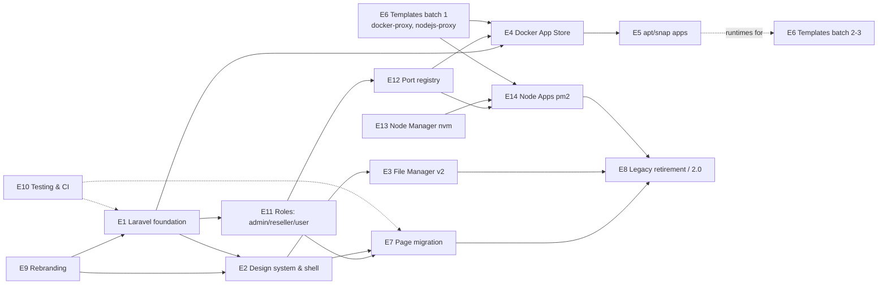
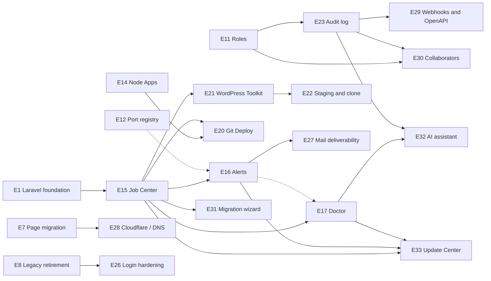

# ArcPanel Roadmap (12 months)

**Status:** Draft v1.1 (2026-10-04: rebranding promoted to top priority, see E9) · **Horizon:** 4 quarters · **Team:** 1–2 developers
**Baseline:** HestiaCP 1.10.5 codebase (see [current-features.md](./current-features.md))

This roadmap is a strategic plan, not a commitment. Review it at the end of each quarter and move work between quarters based on what was learned.

---

## 1. Strategic context

### Where we start

- A mature, working panel: 524 `v-*` CLI commands in `bin/`, shell libraries in `func/`, and installer/upgrade scripts in `install/`.
- A legacy web UI in `web/`: plain PHP pages (`web/add/*`, `web/edit/*`, `web/list/*`), `web/templates/pages/*.php` views, Alpine.js + esbuild frontend, served by the bundled `hestia-nginx` and `hestia-php` (PHP 8.5) on port 8083.
- All web actions call the CLI through `HESTIA_CMD` (`sudo /usr/local/hestia/bin/v-*`). The UI is a thin layer; the CLI is the real API.
- File manager: FileGator, bundled in `install/deb/filemanager/`, with an auth adapter that reads the panel session.
- Web templates: `install/deb/templates/web/nginx/php-fpm/*.tpl|.stpl` (about 60) and a small Apache2 set; no metadata about what a template is for.

### Outcomes we are optimizing for

| #   | Outcome                                                   | Why it matters                                                                                                                                                                     | How we measure it                                                                                                                                                                            |
| --- | --------------------------------------------------------- | ---------------------------------------------------------------------------------------------------------------------------------------------------------------------------------- | -------------------------------------------------------------------------------------------------------------------------------------------------------------------------------------------- |
| O1  | **Modern, pleasant UI/UX**                                | Differentiates ArcPanel from HestiaCP; lowers the learning curve                                                                                                                   | Task time for 5 common tasks (add domain, upload file, edit file, add DB, install app) down 40% vs. baseline; Lighthouse accessibility ≥ 90 on every page                                    |
| O2  | **Maintainable web codebase (Laravel)**                   | Legacy PHP pages are hard to test and extend; new features (App Store) need a real framework                                                                                       | % of pages served by Laravel (target 100% by Q4); automated test coverage of controllers                                                                                                     |
| O3  | **"Install anything" platform**                           | Users want Docker and system apps from one panel without SSH                                                                                                                       | Number of catalog apps; successful installs/uninstalls without manual fixes                                                                                                                  |
| O4  | **Broader stack support**                                 | Node.js, Python, Go, static sites are common but need manual templates today                                                                                                       | Number of documented templates; templates with metadata and a picker in the UI                                                                                                               |
| O5  | **Stay close to upstream**                                | Security fixes, new PHP/MariaDB versions come from HestiaCP                                                                                                                        | `bin/`, `func/`, `install/` diff against upstream stays additive; upstream merge takes < 1 day                                                                                               |
| O6  | **Reseller-ready multi-tenancy**                          | Hosting providers need resellers who manage their own customers inside their own quota, with controlled network access (ports)                                                     | A reseller creates and manages sub-users without admin help; no cross-tenant data visible in UI/API; every public port is assigned, not guessed                                              |
| O7  | **First-class Node.js hosting**                           | Node apps are the most requested non-PHP workload; today they need SSH, nvm and pm2 by hand                                                                                        | A user deploys a Node app on a domain with HTTPS from the UI in < 5 minutes; app survives reboot                                                                                             |
| O8  | **Operational confidence and security** _(Later backlog)_ | Admins and resellers must know when something breaks and trust that sites are protected; today RRD graphs and logs exist, but nothing alerts, explains or records who changed what | An incident (service down, disk full, expiring SSL) reaches the admin within 5 minutes; the most common support issues are detected by a Doctor check; every state change has an audit event |

### Constraints and decisions already made

- **Team:** 1–2 developers, so at most two parallel tracks and no epic longer than one quarter without a shippable milestone.
- **Migration style:** Strangler pattern. Laravel runs next to the legacy app on the same port; pages move one by one; the legacy page is deleted after its replacement ships.
- **Upstream compatibility:** Only `web/` is replaced. Changes to `bin/`, `func/`, `install/` are **additive** (new `v-*` commands, new templates, new installer options). Existing commands are not modified unless a fix is also sent upstream.
- **App Store order:** Docker apps first (Q2–Q3), apt/snap system apps later (Q4).

---

## 2. Themes

1. **Foundation** — Laravel skeleton, shared auth, design system, CI.
2. **Multi-tenancy** — admin / reseller / user roles and a port registry (admin assigns ports to users).
3. **Flagship UX** — File Manager v2 and the new shell/dashboard.
4. **Platform** — Docker App Store, Node.js platform (nvm + pm2), then apt/snap system apps.
5. **Stack breadth** — NGINX/Apache templates with metadata.
6. **Completion** — Migrate all remaining pages, retire legacy `web/`, release 2.0.
7. **Operations and trust** _(Later)_ — job center, alerts, Doctor diagnostics, log explorer, update center (automatic and manual upgrades), audit log, WAF, malware scanning, login hardening.
8. **Workflows and integrations** _(Later)_ — per-domain PHP settings, Git deploy, WordPress Toolkit, staging, mail deliverability, Cloudflare, webhooks, collaborators, migration wizard, AI assistant.

---

## 3. Epics

Effort sizing for this team: **S** ≤ 2 weeks · **M** 3–5 weeks · **L** 6–9 weeks · **XL** a full quarter (must be split into milestones).

### E1 — Laravel foundation (strangler)

**Hypothesis:** We believe that running a Laravel app next to the legacy PHP app, sharing the same session and the same `v-*` backend, will let us migrate the UI page by page without a feature freeze, because every page already talks to the CLI and holds almost no business logic.

**Scope:**

- Laravel 13 app in `web-app/` (or `app/`), built on the bundled `hestia-php` 8.5. `vendor/` shipped in the `hestia` deb package.
- `hestia-nginx` config: route a URL prefix (recommendation: `/app/*`, later the root) to Laravel's `public/index.php`; everything else keeps going to legacy `web/`.
- **Session bridge:** a Laravel session handler/guard that reads the legacy PHP session (`$_SESSION['user']`, `login_shell`, `userContext`, 2FA state, "login as" state) so one login serves both apps.
- `ArcCommand` service: typed wrapper around `sudo /usr/local/hestia/bin/v-* ... json` with argument escaping, error mapping, and a fake for tests.
- Policies/middleware mirroring the legacy checks: admin vs user, read-only/demo mode, suspended user read-only, system-administrator protection, CSRF.
- i18n: import `web/locale/*.po` into Laravel language files (script), keep Crowdin workflow.
- Packaging and upgrade: `install/deb/` and `install/upgrade/` changes to install the Laravel app and run its post-install steps (additive).

**Success metric:** Login, Dashboard and the Web Domains list run on Laravel in production, with 2FA, "login as" and read-only mode working. **Effort:** L. **Outcome:** O2, O5.

**Slices (2026-10-05):**

1. **S1 — Plumbing + login.** Laravel 13 skeleton, nginx `/app/*`, `ArcCommand`, session bridge, Login/2FA/Logout behind the `ARCPANEL_APP_LOGIN` switch, impersonation endpoints, i18n import, packaging. **Design:** [E1-S1 spec](./features/specs/2026-10-05-001-e1-laravel-foundation-slice1-design.md).
2. **S2 — Design system, shell, Dashboard and Web Domains.** The full E2 component library, role-aware shell, Dashboard (admin, user), the complete Web Domains module and the `ARCPANEL_APP_PAGES` switch, in five milestones. **Design:** [E1-S2 spec](./features/specs/2026-10-05-002-e1-s2-dashboard-web-domains-design.md). **Status:** implemented 2026-10-05.

**Architecture decision to record in Q1 (ADR):** Blade + Alpine.js (closest to the existing stack, cheapest per page) vs. Inertia + Vue 3. **Recommendation:** Blade + Alpine for CRUD pages; Vue 3 islands only for highly interactive screens (File Manager, App Store, service editors). Vue 3 is already a dependency of the repo.

### E2 — Design system and new shell

**Status:** the full component library, the shell, the command palette, the notification tray and the style guide ship with E1 slice S2 ([spec](./features/specs/2026-10-05-002-e1-s2-dashboard-web-domains-design.md)).

**Hypothesis:** We believe a consistent component library and a new navigation shell will cut task time and make each migrated page cheaper to build, because today every `web/templates/pages/*.php` hand-writes its own markup.

**Scope:**

- Design tokens (colors, spacing, type), light/dark themes, responsive layout (mobile-first tables → cards).
- Component library: data table (sorting, filtering, bulk actions, column chooser), forms with inline validation, modals/drawers, toasts, command palette (`Ctrl+K` search across users/domains/mail/DB, backed by `v-search-object`), empty states, skeleton loaders.
- New shell: sidebar navigation grouped by Web / DNS / Mail / DB / Apps / Files / Server, user switcher for admins, notification tray, server health widgets (`v-list-sys-info`, `v-list-sys-rrd`).
- Accessibility pass (keyboard navigation, contrast, ARIA).
- Dashboard redesign (replaces `list_user.php` for admins and the per-user landing page).

**Success metric:** All new Laravel pages use only library components; Lighthouse a11y ≥ 90. **Effort:** L. **Outcome:** O1.

### E3 — File Manager v2

**Hypothesis:** We believe replacing FileGator with a first-party file manager built on the existing `v-*-fs-*` commands will be the most visible UX improvement, because file editing/upload is the most frequent day-2 task and FileGator looks and behaves like a separate product.

**Scope (milestones):**

1. **Browse & basic ops** — tree + list/grid views, breadcrumbs, multi-select, context menu, keyboard shortcuts, rename/copy/move/delete, new file/folder, permissions dialog. Backend: `v-list-fs-directory`, `v-add-fs-file`, `v-add-fs-directory`, `v-copy-fs-*`, `v-move-fs-*`, `v-delete-fs-*`, `v-change-fs-file-permission`, `v-get-fs-file-type`, `v-search-fs-object`.
2. **Upload/download** — drag-and-drop, chunked/resumable uploads, folder upload, progress, zip download of selections (`v-add-fs-archive`), extract (`v-extract-fs-archive`).
3. **Editor & preview** — code editor (CodeMirror 6) with syntax highlighting, PHP/JS/CSS/HTML/YAML; image/PDF/text preview; "open in editor" from domain pages; edit `.htaccess`/`nginx.conf_*` custom configs with a restart hint.
4. **Integration** — deep links from Web Domains (open document root), from App Store (open app directory), from Backups (browse restic snapshots via `v-list-user-files-restic`).
5. **Removal of FileGator** from `install/deb/filemanager/` and the installer (`v-add-sys-filemanager` keeps its name but installs the new component, so upstream scripts keep working).

**Success metric:** Upload-and-edit task time down 50% vs. FileGator; FileGator removed from the package. **Effort:** XL (split as above). **Outcome:** O1.

**Design:** [E3 spec](./features/specs/2026-10-05-008-e3-file-manager-design.md) (milestones 1–3 of the scope above plus deep links, every read and write in the home run as the user, staging with a root hand-off, CodeMirror 6, five milestones). **Status:** implemented 2026-10-05; the restic snapshot browser moves to E7 (Backups page), FileGator removal stays with E8; Docker apps link their data folder since E4.

### E4 — App Store: Docker apps

**Hypothesis:** We believe a curated Docker Compose catalog that binds apps to panel domains with automatic SSL will let non-expert users self-host popular tools, because today they must use SSH and write their own reverse-proxy config.

**Scope (milestones):**

1. **Engine & plumbing (MVP)** — `v-add-sys-docker` / `v-delete-sys-docker` (install Docker Engine + Compose plugin, rootless or group-based per user — decide in an ADR), per-user app directory (`/home/<user>/apps/<app>`), port allocation **through the port registry (E12, `v-allocate-user-port`)**, `docker-proxy` NGINX template (based on `proxy_ip`) that proxies a domain to the container port, Let's Encrypt as usual.
2. **Catalog format** — one YAML manifest per app: name, description, icon, version, compose template, variables (with validation and defaults), ports, volumes, health check, post-install notes. Catalog shipped in the repo (`install/common/apps/docker/`) and refreshable from a Git URL later.
3. **Lifecycle** — `v-add-docker-app`, `v-delete-docker-app`, `v-start|stop|restart-docker-app`, `v-list-docker-apps`, `v-update-docker-app` (pull + recreate), logs streaming, env editing, resource limits (cgroup values from the user package).
4. **UI** — store page (search, categories), app detail page (variables form, domain picker), "My apps" with status, logs, update badge; Vue 3 island.
5. **Backups** — include app volumes in `v-backup-user` via an additive hook (new `func/docker.sh`), restore path, exclusions UI.
6. **Initial catalog (8–10 apps):** Uptime Kuma, n8n, Gitea, Ghost, Umami or Plausible, Vaultwarden, MinIO, Redis, Portainer (admin only), Nextcloud (Docker variant).

**Success metric:** A user installs an app from the catalog, gets HTTPS on a domain, and removes it cleanly, without SSH. **Effort:** XL (MVP = L in Q2, rest in Q3). **Outcome:** O3.

**Design:** [E4 spec](./features/specs/2026-10-05-009-e4-docker-apps-design.md) (one root engine, every service as the hosting user without capabilities in the user's slice, six curated apps pinned by digest, updates with data snapshots and automatic rollback, database dumps before backups, convergence by a 5-minute check, store and app pages, five milestones). **Status:** implemented 2026-10-05; catalog refresh from a signed Git repository moves to E33, WebSocket log streaming to E18, the System tab to E5; Umami was replaced by Miniflux (see the spec's implementation notes).

### E5 — App Store: apt/snap system apps

**Hypothesis:** We believe an admin-only catalog of system packages (runtimes and services) will remove the most common "SSH to install X" steps, because web templates for Node.js/Python (E6) are useless without the runtime installed.

**Scope:**

- `v-add-sys-package` / `v-delete-sys-package` / `v-list-sys-packages` wrapping apt and snap with a whitelist manifest (`install/common/apps/system/`), version pinning where it matters, post-install configuration (e.g., Redis bound to localhost).
- Catalog: Python 3 + pipx, Go, Java (OpenJDK), Redis, Memcached, FFmpeg, ImageMagick, Certbot DNS plugins. (Node.js is **not** here: user-facing Node comes from per-user nvm in E13; a system Node is only installed if an admin tool needs it.)
- UI: same store UI as E4 with a "System" tab; admin only; shows installed version and update availability.

**Success metric:** Node.js and Redis installable from the UI and immediately usable by E6 templates. **Effort:** M. **Outcome:** O3, O4.

### E6 — Web template expansion with metadata

**Hypothesis:** We believe adding templates for non-PHP stacks and giving each template a description and variables will make the template picker usable by people who do not read NGINX configs, because today templates are only a file-name dropdown.

**Scope:**

- **Template metadata sidecar** — `template.json` (or `.meta`) next to each `.tpl`: title, description, category, required runtime (links to E5), variables (e.g., backend port), docs URL. `v-list-web-templates` is untouched; a new additive `v-list-web-templates-meta` reads the sidecars. UI shows a card picker with search.
- **New NGINX templates (batches of 6–8):**
  - Batch 1 (quick wins): `static` (no PHP, strong caching), `spa` (history-mode fallback), `nodejs-proxy` (variable port), `python-gunicorn`, `ghost`, `strapi`, `nextjs`, `nuxt`.
  - Batch 2: `django`, `flask`/`fastapi` (uvicorn), `golang-proxy`, `rails` (puma), `redirect-only`, `maintenance`, WordPress hardened (`wordpress-secure`: block xmlrpc, wp-config, uploads PHP execution), Laravel Octane.
  - Batch 3: `docker-proxy` variants used by E4 (websocket, large uploads, streaming), `minio`, `grafana`, `uptime-kuma`.
- **Apache2 templates:** `hosting-hardened`, `nodejs-proxy`, `python-wsgi`, `static`, plus matching `.stpl` SSL files.
- Documentation page per template (auto-generated from metadata).

**Success metric:** ≥ 25 new templates with metadata; template picker in the new Web Domain form. **Effort:** M total, S per batch. **Outcome:** O4.

**Design:** [E6 batch 1 spec](./features/specs/2026-10-05-005-e6-templates-batch1-design.md) (metadata for every shipped template, per-domain variables with ports from E12, ten templates on both NGINX stacks, card picker in Laravel, four milestones). **Status:** implemented 2026-10-05; the `nginx-fpm` CI job waits for E10.

### E7 — Migrate remaining pages to Laravel

**Hypothesis:** We believe migrating pages in dependency order (list → add → edit per module) with the E2 component library will take about one week per module, because each page maps to a small set of `v-*` calls that are already documented in the legacy code.

**Modules (each = list + add + edit + bulk actions):**
Web domains · DNS zones/records (incl. public DNSSEC view) · Mail domains/accounts · Databases · Cron · Backups (standard + restic) · Users/Packages · Firewall (rules, ipset, bans) · IP addresses · Access keys/API · Logs/Auth log/Notifications · Statistics/RRD · Server settings + service config editors · Web Terminal page · Quick Install Apps (reuse `web/src/app/WebApp` installers as a Laravel service).

Every migrated page is built **reseller-aware from day one** (owner scoping from E11), so no second pass is needed.

**Success metric:** 100% of routes served by Laravel; legacy `web/*/index.php` deleted. **Effort:** XL (spread over Q3–Q4). **Outcome:** O2.

**Design:** [E7 batch 1 spec](./features/specs/2026-10-06-001-e7-batch1-pages-design.md) (Databases, Cron, DNS, Mail and Backups with restic snapshots, exclusion toggles for `~/.nvm` and Docker apps, the file manager's snapshot mode, six milestones). **Status:** batch 1 implemented 2026-10-06; batch 2 ([spec](./features/specs/2026-10-06-002-e7-batch2-pages-design.md): Firewall, IPs, Access keys and SSH keys, Logs, Statistics and Task Monitor, Web Terminal, Quick Install Apps run in the background, seven milestones) implemented 2026-10-06; batch 3 ([spec](./features/specs/2026-10-06-003-e7-batch3-pages-design.md): Services, Server settings with White Label, config editors, Updates, PHP versions, plugins and package updates as a background system task, password and 2FA reset, Search, the CSR generator, seven milestones) implemented 2026-10-06, so every legacy page has a panel app page and E8 can start.

### E8 — Legacy retirement and 2.0 release

**Scope:** remove old `web/` pages and `web/inc/`, move Laravel to the root URL, update `install/` and `install/upgrade/` scripts, update `hestia` deb packaging, migration notes for custom themes, release notes, docs site update, upstream-diff CI check (fails if `bin/`/`func/`/`install/` contain non-additive changes).

**Success metric:** Fresh install and in-place upgrade from 1.10.5 both pass the BATS + e2e suites. **Effort:** M. **Outcome:** O2, O5.

### E9 — ArcPanel rebranding (**top priority — starts now**)

**Why now:** every page we migrate, every doc we write and every package we publish under the HestiaCP name is work we must redo later. The brand also fixes the public identity (domain, repository, package names, installer URL) that every other epic ships under. Promoted from "optional, small" to the first item on the roadmap by owner decision on 2026-10-04. **Design:** [rebranding spec](./features/specs/2026-10-04-001-arcpanel-rebranding-design.md) · **Decision:** [ADR-0006](./adr/0006-rebranding-depth.md).

**Baseline (measured 2026-10-04 on this repository):**

| What                                                       | Count                                                                                                                                                                                                                                                       |
| ---------------------------------------------------------- | ----------------------------------------------------------------------------------------------------------------------------------------------------------------------------------------------------------------------------------------------------------- |
| Files that contain "hestia" (any case)                     | 1,220 (bin 524, install 288, web 275, docs 65, src 31)                                                                                                                                                                                                      |
| Occurrences of "hestia"                                    | 14,061                                                                                                                                                                                                                                                      |
| `/usr/local/hestia` path references                        | 1,320                                                                                                                                                                                                                                                       |
| `HESTIA_*` variable uses                                   | ~1,100 (`HESTIA_CMD` alone: 645)                                                                                                                                                                                                                            |
| "Hestia" in `web/templates` (user-visible)                 | 61                                                                                                                                                                                                                                                          |
| `msgid` strings with "Hestia" in `web/locale/hestiacp.pot` | 5                                                                                                                                                                                                                                                           |
| Files under `install/deb/templates` with "hestia"          | 127                                                                                                                                                                                                                                                         |
| Named artifacts                                            | 9 `v-*-hestia-*` commands; gettext domain `hestiacp`; deb packages `hestia`, `hestia-nginx`, `hestia-php`, `hestia-web-terminal`; system user/sudoers `hestiaweb`; fail2ban, logrotate, Roundcube, phpMyAdmin SSO and FileGator adapters named after Hestia |

**Milestones:**

1. **R1 — Visible brand (must, S, weeks 1–2).** Product name, logo, favicon and colours in the current UI (White Label defaults plus `web/templates`); login page, page titles, footer, notification emails and sender name; the 5 `.pot` strings with "Hestia"; installer banner and CLI messages; `README`, `CONTRIBUTING`, `SECURITY`, docs site. Keep a clear "Based on HestiaCP" attribution and all copyright notices (GPLv3).
2. **R2 — Distribution identity (must, S–M, weeks 2–4).** Domain `arcpanel.top` and docs URL; GitHub `arc-panel-oss/arcpanel`; installer script name and URL; APT repository and signing key; deb package names; ArcPanel version scheme starting at `1.0.0` (`ARCPANEL_VERSION`; `VERSION` keeps the upstream base, see ADR-0006); own APT repository `apt.arcpanel.top` built and signed in GitHub Actions; update channel so ArcPanel servers no longer pull from HestiaCP servers; links to hestiacp.com/forum/donate replaced.
3. **R3 — Compatibility layer (must, S, weeks 3–4; decided in ADR-0006, option B).** Administrators get ArcPanel names (`arcpanel*` packages, `/usr/local/arcpanel`, `$ARCPANEL`, `v-*-arcpanel-*` aliases, `arcpanel` service); internals (`/usr/local/hestia`, `HESTIA_*`, function names, gettext domain, `hestiaweb`) are not renamed and old names keep working.
4. **R4 — Upgrade path from HestiaCP (deferred: fresh installs only, owner decision 2026-10-04).** In-place upgrade from HestiaCP 1.10.5 to ArcPanel keeps users, domains, mail, databases, backups and custom templates; covered by BATS on Debian 12 and Ubuntu 24.04.
5. **R5 — Deep rename of internals (requested by owner 2026-10-05, not yet designed).** Rename `/usr/local/hestia`, `/etc/hestiacp`, `hestia.conf`, `HESTIA_*`, `hestiaweb`, the PHP-FPM socket and the gettext domain to ArcPanel names. Needs ADR-0007 to supersede ADR-0006 decision 1 and its own brainstorm, because it changes `bin/`, `func/` and `install/` and makes every upstream merge conflict. Until then the panel app reads every path from `config/arc.php`.

**Success metric:** a fresh install shows no "Hestia" in the UI, emails, installer output or docs, except the attribution line; a CI check fails on new user-visible "Hestia" strings; in-place upgrade from HestiaCP 1.10.5 passes the BATS suite.

**Effort:** M, about 4 weeks with two developers (about 6 with one). **Outcome:** O1 (identity); O5 is kept because internals are not renamed.

**Status (2026-10-04):** code for the brand kit, R1, R2 and R3 is committed on branch `feat/e9-rebranding` (not pushed). A fresh install on Ubuntu 24.04 (WSL, local signed mirror of `apt.arcpanel.top`) passed: the ArcPanel BATS suites pass 15/15 and the upstream `test.bats` passes 253/255 (the 2 failures are netplan tests that need a real VM). Still open: release infrastructure (DNS, APT host, signing key, secrets), the `release` branch, and install tests on Debian 12/13, Ubuntu 22.04/26.04 and arm64.

### E11 — Roles: admin / reseller / user

**Hypothesis:** We believe adding a **reseller** role that owns a set of users and manages them inside its own package limits will let hosting providers and agencies run ArcPanel for their customers, because today the only choices are "full admin" or "single user", so every customer onboarding needs the server admin.

**Current state:** `user.conf` has `ROLE='user'|'admin'|'dns-cluster'` (`v-change-user-role`), the UI uses `$_SESSION["userContext"]` for admin checks and `look` for login-as. There is no owner relationship between users.

**Scope:**

- **Data model (additive):** `OWNER='<reseller>'` in `user.conf`, set via the existing `v-change-user-config-value`. New commands: `v-add-reseller-user` (wraps `v-add-user` + sets `OWNER`, checks the reseller's aggregated quota), `v-list-reseller-users`, `v-change-user-owner`, `v-update-reseller-counters` (sum of sub-users' disk/bandwidth/domains into `U_*` of the reseller). `v-change-user-role` gains `reseller` as an accepted value (a 1-line change; sent upstream as a PR; until merged, kept in a tiny patch file in `install/upgrade/patch/`). `dns-cluster` stays as a system role.
- **Permission matrix (enforced in Laravel policies and in the API layer):**

  | Capability                                        | admin                   | reseller                                                                                           | user                  |
  | ------------------------------------------------- | ----------------------- | -------------------------------------------------------------------------------------------------- | --------------------- |
  | Server settings, services, IPs, firewall, updates | ✔                       | ✖                                                                                                  | ✖                     |
  | Create/suspend/delete users                       | all                     | own sub-users only                                                                                 | ✖                     |
  | Packages                                          | create/edit all         | assign only packages flagged `RESELLER_VISIBLE` or packages the reseller created within own limits | ✖                     |
  | Login-as                                          | any user                | own sub-users                                                                                      | ✖                     |
  | Port registry                                     | assign ranges to anyone | re-assign ports from own pool to own sub-users                                                     | use assigned ports    |
  | App Store install                                 | ✔                       | ✔ (if package allows)                                                                              | ✔ (if package allows) |
  | Statistics/logs                                   | all                     | own tree                                                                                           | self                  |
  | Backups                                           | all                     | own tree                                                                                           | self                  |

- **Reseller package fields (additive keys in `.pkg`):** `USERS` (max sub-users), `RESELLER_PACKAGES` (comma list of assignable packages), `PORTS` (size of the port pool). Quotas of sub-users must fit inside the reseller's own package (checked in `v-add-reseller-user` and `v-change-user-package`).
- **Reseller interface** (a dedicated role-based UI, not the admin UI with buttons hidden):
  - **Role-aware shell (E2):** the sidebar is generated from the permission matrix. Reseller navigation: _Dashboard · Customers · Packages · Ports · Statistics · Backups · Logs · My account_. No Server, Services, IPs, Firewall or Updates entries. An "Acting as reseller" badge and a quick customer switcher (login-as) in the top bar.
  - **Reseller dashboard:** usage of the reseller's own package vs. the sum of its customers (disk, bandwidth, domains, mail accounts, databases, ports used/free), customer count vs. `USERS` limit, suspended customers, recent customer activity, expiring SSL/backups across the tree, notifications from customers (e.g., "request more ports").
  - **Customers page (`/customers`):** list of own sub-users with status, package, usage bars and quick actions (login-as, suspend, change package, reset password, delete); bulk actions; create-customer wizard (username, contact, package from the reseller's assignable list, optional first domain + mail + DB in one step, send welcome email).
  - **Customer detail:** tabs for Web / DNS / Mail / DB / Cron / Backups / Node & Docker apps / Ports / Logs of that customer, all read through the same owner-scoped policies; "open as customer" to switch context.
  - **Packages page:** packages the reseller may assign (flagged `RESELLER_VISIBLE`) and, if the policy allows, packages the reseller created inside its own limits, with a live "fits in my quota" validator.
  - **Ports page:** the reseller's pool from E12, sub-allocation to customers (drag a block or type a range), live usage from `v-list-sys-ports` filtered to the tree, requests from customers.
  - **Statistics / Backups / Logs:** the same E7 pages, filtered to the tree, with an "all my customers" aggregate view plus a per-customer selector.
  - **Admin-side additions:** "Owner" column and filter on Users; owner tree view (admin → resellers → customers); "convert user to reseller" action; per-reseller limits editor; impersonate reseller.
  - **User-side additions:** a "Your provider" card (reseller contact from `v-change-user-contact` data) replacing the admin contact, so support requests go to the reseller.
  - **White Label per reseller (later, post-2.0):** reseller logo/name on their customers' login page and emails (`v-update-white-label-logo` per owner).
  - **Design:** built as E2 components (data table, usage bars, wizard, context switcher); Playwright e2e covers the three roles side by side.
- **API:** access keys inherit the role; existing `billing` permission set gets a `reseller-billing` variant limited to own sub-users.
- Policy toggles in Server settings: "Allow resellers to create packages", "Allow resellers to use White Label".

**Success metric:** A reseller onboards a customer end-to-end (user, package, domain, mail, DB) with zero admin involvement; e2e tests prove no cross-tenant read via UI or API. **Effort:** L. **Outcome:** O6.

**Design:** [E11 spec](./features/specs/2026-10-05-003-e11-reseller-design.md) (part 1 and part 2 in one spec, five milestones). **Status:** implemented 2026-10-05; API key scopes deferred to the Laravel API, per-tree Statistics/Backups/Logs to E7.

### E12 — Port registry (admin assigns ports to users)

**Hypothesis:** We believe a central port registry, where admins allocate ports or ranges to users and every feature (Node apps, Docker apps, firewall) draws from it, will remove port collisions and accidental public exposure, because today nothing in the panel knows which ports a user may bind to.

**Scope:**

- **Storage:** `/usr/local/hestia/data/ports/<user>.conf` (one line per port: `PORT`, `PROTO`, `APP`, `PUBLIC`, `COMMENT`, `DATE`) plus `PORTS` key in the package (auto-allocation size). Server-wide range in `hestia.conf`: `PORT_RANGE_START/END` (default 30000–39999) and a reserved list (panel 8083, SSH, mail, DB, FTP passive range).
- **Commands (additive):** `v-add-user-port USER PORT|RANGE [PROTO] [PUBLIC] [COMMENT]`, `v-delete-user-port`, `v-list-user-ports`, `v-list-sys-ports` (registry + live `ss -ltn` view with owner resolution), `v-allocate-user-port USER APP` (next free port from the user's pool, used by E4 and E14), `v-check-user-port`.
- **Enforcement:** Node apps and Docker apps can only bind ports returned by `v-allocate-user-port`; `PUBLIC=yes` creates/removes the matching `v-add-firewall-rule`; `PUBLIC=no` ports are only reachable through the domain reverse proxy (`nodejs-proxy` / `docker-proxy` templates). Suspend/delete user releases ports and firewall rules.
- **UI:** Admin → Server → Ports (allocation table, live usage, conflicts); User → "My ports" (read-only, request more via notification to owner); Reseller → sub-allocate from own pool (E11).
- **Package integration:** new package field `PORTS` (e.g. 5) auto-allocates a block on user creation; `unlimited` disables the pool check for admin-trusted users.

**Success metric:** Zero port conflicts in e2e runs that create 20 Node + Docker apps across 5 users; every publicly reachable high port has an owner in the registry. **Effort:** M. **Outcome:** O6, O3, O7.

**Design:** [E12 spec](./features/specs/2026-10-05-004-e12-port-registry-design.md) (CLI, hooks in five upstream user commands, Admin/Reseller/User Ports pages, four milestones). **Status:** implemented 2026-10-05; the success metric with real Node and Docker apps runs once E14 and E4 consume `v-allocate-user-port`.

### E13 — Node Manager (nvm) with package management

**Hypothesis:** We believe per-user Node version management with a UI for global npm packages will make Node hosting predictable, because apps need different Node majors and users today install nvm/pm2 by hand in ways backups and rebuilds do not know about.

**Scope:**

- **Per-user nvm** (not system-wide), following the existing `v-add-user-composer` / `v-add-user-wp-cli` pattern: `v-add-user-nvm USER`, `v-delete-user-nvm`, `v-add-user-node-version USER VERSION` (`lts/*`, `20`, `22.3.0`), `v-delete-user-node-version`, `v-change-user-node-default`, `v-list-user-node-versions`. Installed in `/home/<user>/.nvm`, offline-friendly (download cache under `/usr/local/hestia/data/cache/node/`), works inside the SSH/SFTP jail (bubblewrap bind of the home dir already covers it).
- **Package management:** `v-add-user-npm-package USER VERSION PKG[@ver] [--global]`, `v-delete-user-npm-package`, `v-list-user-npm-packages`, `v-update-user-npm-packages`; npm/pnpm/yarn via corepack toggle (`v-change-user-node-pm`). Audit summary (`npm audit --json`) shown in the UI, read-only.
- **Package (plan) controls:** `NODE='yes|no'`, `NODE_VERSIONS` (max installed versions), `NODE_ALLOWED` (e.g. `18,20,22`). Admin default: Node disabled for the `default` package, enabled for a new `developer` package shipped with the installer.
- **UI (Vue island):** per-user "Node.js" page: installed versions (default badge), install picker (LTS list fetched via `v-list-sys-node-releases`, cached daily), global packages table per version, "open terminal here" link to the Web Terminal.
- **Rebuild/backup awareness:** `v-rebuild-user` re-links nvm shell init; backups include `~/.nvm` only when `NODE='yes'` (exclusion toggle in Backup Exclusions).

**Success metric:** User installs Node 22 and `pm2`/`yarn` from the UI; `node -v` in the Web Terminal matches; survives `v-rebuild-user` and restore. **Effort:** M. **Outcome:** O7.

**Design:** [E13 spec](./features/specs/2026-10-05-006-e13-node-manager-design.md) (runtimes unpacked from a signed shared cache into `~/.nvm`, pnpm and yarn as global packages, background tasks, `~/.nvm` as the only state, the first Vue island, four milestones). **Status:** implemented 2026-10-05; the Backup Exclusions toggle for `~/.nvm` moves with that page in E7.

### E14 — Node Apps with pm2

**Hypothesis:** We believe a "Node App" object bound to a web domain and managed by a per-user pm2 daemon will give Node developers the same one-screen experience PHP users already have, because the panel already owns domains, SSL and reverse proxy templates—only the process manager and port wiring are missing.

**Scope (milestones):**

1. **Core:** `v-add-node-app USER DOMAIN NAME [ENTRY=app.js] [NODE_VERSION] [PORT]` → allocates a port from E12, writes `~/web/<domain>/nodeapp/ecosystem.config.cjs` (name, script, cwd, env incl. `PORT`, instances, max memory from package), switches the domain to the `nodejs-proxy` template (E6) with that port, reloads nginx. `v-delete-node-app`, `v-list-node-apps`, `v-list-node-app`.
2. **Lifecycle:** `v-start|stop|restart|reload-node-app`, `v-list-node-app-logs` (tail, follow via WebSocket reusing the Web Terminal transport), env editor (`v-change-node-app-env`), `v-change-node-app-version` (switch Node major), `v-change-node-app-entry`.
3. **Persistence:** one pm2 daemon per user under a systemd user unit (`pm2 startup systemd -u <user>`; `loginctl enable-linger`), so apps come back after reboot; `v-rebuild-user` regenerates units; suspend user stops its pm2.
4. **Deploy helpers:** "Install dependencies" (`npm ci` / `pnpm i`) and "Run build" buttons with streamed output; optional Git deploy (`v-add-node-app-git URL BRANCH`, pull + install + reload) as a _nice_ milestone; `.env` file managed through File Manager v2.
5. **UI (Vue island):** Node Apps list (status, CPU/mem from `pm2 jlist`, restarts, uptime), app page with logs, env, version, domain/SSL status; create wizard (domain → entry file → Node version → port auto-assigned).
6. **Templates:** `nodejs-proxy` (HTTP), `nodejs-proxy-ws` (websocket upgrade), `nextjs`, `nuxt`, `strapi` from E6 all accept the `%node_port%`-style variable introduced by the template metadata sidecar.
7. **Backups/restore:** app directory is inside `~/web/<domain>/` so it is already backed up; `ecosystem.config.cjs` + registry port are restored by `v-restore-web-domain` through an additive hook in `func/node.sh`.

**Success metric:** Deploy an Express/Next.js app on a domain with HTTPS from the UI in < 5 minutes; the app is up after a server reboot; logs visible in the panel. **Effort:** L. **Outcome:** O7, O1.

**Design:** [E14 spec](./features/specs/2026-10-05-007-e14-node-apps-design.md) (one pm2 daemon per user under `systemd --user`, records in `data/users/<user>/nodeapps.conf` with a backup copy in the domain folder, a 5-minute `v-check-sys-node` instead of new upstream hooks, the Node apps island, five milestones). **Status:** implemented 2026-10-05; Git deploy (milestone 4 "nice") moves to E20 and the WebSocket log stream to E18.

### E10 — Testing and CI (continuous)

**Scope:** Pest unit/feature tests for Laravel (fake `ArcCommand`), Playwright e2e against a disposable Debian 12 VM/LXC built from `install/hst-install.sh`, keep existing BATS tests for `bin/`, GitHub Actions matrix (Debian 12/13, Ubuntu 24.04), lint already present (Prettier/Biome/markdownlint).

**Effort:** M to set up, then ongoing. **Outcome:** O2, O5.

### Later backlog (E15–E33)

These epics are **not** part of the 12-month capacity: §6 already books two developers until 2.0. They are scored in §4, sequenced as post-2.0 waves in §6, and reviewed every quarter. An item moves to _Next_ only when a committed epic finishes early or is cut. They follow the same rules as E1–E14: Laravel UI built from E2 components, owner-scoped through E11 policies, and only additive `v-*` commands.

| Theme                        | Epics                                                                                        |
| ---------------------------- | -------------------------------------------------------------------------------------------- |
| Operations and observability | E15 Job Center · E16 Alerts · E17 Doctor · E18 Log Explorer · E33 Update Center              |
| Web workflows                | E19 Per-domain PHP settings · E20 Git Deploy · E21 WordPress Toolkit · E22 Staging and clone |
| Security                     | E23 Audit log · E24 WAF · E25 Malware scanning · E26 Login hardening                         |
| Mail, DNS and integrations   | E27 Mail deliverability · E28 Cloudflare / external DNS · E29 Webhooks and OpenAPI           |
| Tenancy and growth           | E30 Collaborators · E31 Migration wizard · E32 AI assistant (experimental)                   |

### E15 — Job Center

**Hypothesis:** We believe one place that shows every long-running operation with live progress, logs and retry will cut "is it done yet?" support requests and make failures visible, because today `v-schedule-*` jobs run silently through the queue and the user only learns the result by email or by refreshing the page.

**Scope:**

- Laravel queue worker under a systemd unit. Each job wraps one or more `v-*` calls through `ArcCommand` and stores status, timestamps, exit code and captured output (secrets masked).
- Job types: backup and restore (`v-schedule-user-backup`, `v-schedule-user-restore`), Let's Encrypt requests (`v-schedule-letsencrypt-domain`), Quick Install Apps, Docker app install/update (E4), `npm ci` / build (E14), Git deploys (E20), migrations (E31).
- UI: job drawer in the E2 notification tray (running / finished / failed), job detail with the log streamed over the Web Terminal WebSocket transport, retry or cancel when the command is idempotent. Visibility per role: user sees own jobs, reseller sees its tree, admin sees all.
- Retention of 30 days; a failed job raises an alert through E16.

**Success metric:** Every UI operation that takes longer than 5 seconds shows a job with live output; zero silent failures in e2e runs. **Effort:** M. **Outcome:** O1, O8.

### E16 — Alerts and notification channels

**Hypothesis:** We believe rule-based alerts sent to the channels admins already watch (Telegram, Slack, email) will shorten the time to detect full disks, stopped services and expiring certificates, because today the panel collects RRD data and service status but tells nobody when they go wrong.

**Scope:**

- Alert engine: an additive cron checker (`v-check-sys-alerts`) evaluates rules stored in `/usr/local/hestia/data/alerts/`: disk and inode usage, load, memory, stopped services (`v-list-sys-services`), SSL expiring in fewer than N days (`v-list-web-domain-ssl`, `v-list-mail-domain-ssl`), failed Let's Encrypt renewal, failed backup, user quota near its limit, orphan ports from E12, RBL listing from E27.
- Channels: email (panel SMTP), Telegram bot, Slack / Discord / Mattermost incoming webhook, generic signed webhook (same signer as E29), in-panel notification (`v-add-user-notification`). Channel secrets are stored root-only and never shown again after saving.
- Each rule has a severity, a threshold, a cooldown (no duplicate alerts) and a "resolved" message. Scope per role: users get alerts for their own objects, resellers for their tree.
- UI: Alerts page with rules, channels, a "send test" button and alert history.

**Success metric:** A stopped service or a disk above 90% reaches a Telegram or Slack channel within 5 minutes, once, followed by a "resolved" message. **Effort:** M. **Outcome:** O8, O6.

### E17 — Server and Site Doctor

**Hypothesis:** We believe a read-only diagnostics page with one-click fixes will solve the most common misconfigurations without a support ticket, because most "my site or mail does not work" requests come from DNS not pointing to the server, missing mail records or an invalid certificate, and the panel can detect all of these itself.

**Scope:**

- Check framework: each check is a small script (`func/doctor/*.sh`) run by an additive `v-run-sys-doctor [USER] [DOMAIN] [FORMAT]`. It returns a status, a plain-language explanation, a docs link and an optional fix command.
- Site checks: A/AAAA records resolve to the domain's IP (NAT aware), SSL is valid and covers all aliases, HTTP → HTTPS redirect works, PHP version is not end-of-life, mail MX / SPF / DKIM / DMARC match `v-list-mail-domain-dkim-dns`, PTR exists for the mail IP.
- Server checks: root SSH login with a password, Fail2Ban jails active, firewall on, panel on the default port, pending panel or OS updates, swap, low free inodes, open ports without an owner (E12), time sync.
- A score per domain and per server. The **Fix** button appears only when the fix is an existing `v-*` call (for example `v-add-letsencrypt-domain`, `v-add-mail-domain-dkim`), and it runs as an E15 job.
- Optional weekly digest through E16.

**Success metric:** At least 25 checks; each of the five most common support issues is detected by a check. **Effort:** M. **Outcome:** O1, O8.

### E18 — Log Explorer and real-time traffic stats

**Hypothesis:** We believe live, searchable logs and lightweight real-time statistics will replace `tail -f` over SSH and the dated AWStats pages, because debugging a site today means leaving the panel.

**Scope:**

- Live tail and search (time range, status code, IP, path, free text) for access and error logs (`v-list-web-domain-accesslog`, `v-list-web-domain-errorlog` plus an additive streaming command), the PHP-FPM slow log, Node and Docker app logs (E14, E4) and the mail log of the user's own domains.
- GoAccess as an extra statistics type next to AWStats (additive stats template, selectable in `v-add-web-domain-stats`), with the real-time report behind panel authentication.
- Saved filters and download of the filtered log.

**Success metric:** A user finds the error behind a 500 response for their domain in under 2 minutes without SSH. **Effort:** M. **Outcome:** O1.

### E19 — Per-domain PHP settings and extensions

**Hypothesis:** We believe a per-domain PHP settings tab will remove one of the most frequent support requests ("increase `upload_max_filesize` / `memory_limit` for one site"), because today this needs a custom backend template written by the admin.

**Scope:**

- Whitelisted settings per domain: `memory_limit`, `upload_max_filesize`, `post_max_size`, `max_execution_time`, `max_input_vars`, `display_errors`, `date.timezone`. The admin sets maximum values per package (additive package keys, for example `PHP_MAX_MEMORY`, `PHP_MAX_UPLOAD`).
- Commands: `v-change-web-domain-php-setting USER DOMAIN KEY VALUE`, `v-delete-web-domain-php-setting`, `v-list-web-domain-php-settings`. Values are stored in the user's data directory and written as `php_admin_value[...]` lines into the domain's PHP-FPM pool; an additive hook re-applies them after `v-rebuild-web-domain`. **ADR:** pool append + rebuild hook vs. `.user.ini` (simpler, but the user can edit it and package limits are not enforced).
- Admin: PHP extension manager per installed PHP version (`v-add-sys-php-extension VERSION EXT` wrapping apt `php8.x-*` with a whitelist), under Server → PHP.
- UI: "PHP settings" tab on the Web Domain edit page, showing the package limits.

**Success metric:** A user raises `upload_max_filesize` within the package limit without admin help, and the value survives `v-rebuild-web-domain`. **Effort:** S. **Outcome:** O1, O4.

### E20 — Git Deploy for every web domain

**Hypothesis:** We believe extending the Node Git deploy (E14 milestone 4) to PHP and static sites, with atomic releases and rollback, will bring a modern push-to-deploy workflow to every domain, because today developers upload by FTP or run `git pull` by hand over SSH.

**Scope:**

- Commands: `v-add-web-domain-git USER DOMAIN URL BRANCH`, `v-delete-web-domain-git`, `v-run-web-domain-deploy`, `v-list-web-domain-deploys`, `v-rollback-web-domain-deploy`. A deploy key is generated per domain (the public part is shown), or an HTTPS token is stored root-only.
- Release layout: `~/web/<domain>/releases/<timestamp>` plus a `current` symlink. Shared paths (for example `storage/`, `.env`, `wp-content/uploads`) are linked into each release. The docroot points to `current` or `current/public` through `v-change-web-domain-docroot`. The last N releases are kept.
- Build presets (Laravel, Symfony, WordPress/Bedrock, static/SPA, Node via E13/E14) or a custom script, run as the user inside the jail. Composer comes from `v-add-user-composer`.
- A webhook endpoint per domain with an HMAC secret (GitHub, GitLab and Gitea formats). Each deploy runs as an E15 job; a failed build never switches `current`.

**Success metric:** A push to the main branch updates the site with zero downtime in under 2 minutes; rollback takes one click. **Effort:** M. **Outcome:** O4, O7, O1.

### E21 — WordPress Toolkit

**Hypothesis:** We believe managing updates and security of all WordPress sites from one screen will make ArcPanel competitive with commercial panels, because WordPress is the largest workload on Hestia-style servers and per-site maintenance is a main reason people pay for Plesk or cPanel.

**Scope:**

- Discovery: `v-list-user-wp-installs USER` scans the user's domains for `wp-config.php` (including installs from Quick Install Apps); the index is refreshed every night.
- Actions through the per-user WP-CLI (`v-add-user-wp-cli`): update core, plugins and themes (all or selected), auto-update policy per site, maintenance mode, reset the admin password, toggle `WP_DEBUG`, search-replace, flush cache, verify core checksums.
- Security: hardening checklist linked to the `wordpress-secure` template (E6), file permission check, disable the file editor, check installed plugin versions against a public vulnerability feed (cached daily; feed and licence chosen in an ADR).
- Safety: a snapshot (E22 or restic) before bulk updates; each action runs as an E15 job.
- UI: WordPress page listing all sites (version, pending updates, vulnerabilities) and a site detail page.

**Success metric:** Update 20 sites in one action with an automatic pre-update snapshot; vulnerable plugins are flagged within 24 hours of a feed update. **Effort:** L. **Outcome:** O1, O3.

### E22 — Staging and clone

**Hypothesis:** We believe a safe "copy to staging, test, push back" flow will reduce broken production sites after updates, because today users test changes directly on the live site.

**Scope:**

- `v-clone-web-domain USER SRC_DOMAIN DST_DOMAIN [--with-db]`: copies files, dumps the linked databases into new ones, rewrites app config (WordPress `wp-config.php`, Laravel `.env`) and replaces URLs (WP-CLI search-replace). Staging gets HTTP authentication (`v-add-web-domain-httpauth`) and `noindex` by default.
- `v-push-web-domain-staging`: selective push (files only, database only, or both, with an exclude list such as `wp-content/uploads`), always after a restic snapshot (or a `v-backup-user` fallback) of production.
- Linked databases are detected from known app configs; otherwise the user maps them by hand.
- UI: "Create staging" action on the domain, a staging badge, and a push dialog with a summary (changed file count, database size).

**Success metric:** Staging for a 1 GB WordPress site is ready in under 5 minutes; every push has a restorable pre-push snapshot. **Effort:** L. **Outcome:** O1.

### E23 — System-wide audit log

**Hypothesis:** We believe one tamper-evident record of who did what, across all tenants, will make resellers and (later) collaborators safe to operate, because today there is only a per-user action log and "login as" sessions leave no clear trace of the real actor.

**Scope:**

- Events captured in the Laravel layer (actor, effective user during login-as, role, IP, action, object, result), plus ingestion of existing `v-log-action` entries for CLI and API activity.
- Append-only storage with a daily hash chain; retention setting; export to CSV/JSON; optional forwarding to syslog or a SIEM.
- Views: admin sees everything, reseller sees its own tree (read-only), user keeps the existing log page.
- Login-as sessions are recorded explicitly (who impersonated whom, start and end).
- Design note: define the event schema next to the E11 policies, so pages migrated in E7 can emit events without a second pass.

**Success metric:** Every state-changing request in the e2e suite produces exactly one audit event; a reseller sees no event outside its tree. **Effort:** S. **Outcome:** O6, O8.

### E24 — Web Application Firewall and bot protection

**Hypothesis:** We believe a per-domain WAF with safe presets and rate limiting will block common attacks (SQL injection, XSS, credential stuffing on `wp-login.php`) before they reach PHP, because today only Fail2Ban reacts, and only after the requests have been served.

**Scope:**

- ModSecurity v3 (NGINX connector) or Coraza with the OWASP Core Rule Set; engine and packaging decided in an ADR. Enabled per domain by writing a `nginx.conf_waf` file, which the existing templates already include (`include %home%/%user%/conf/web/%domain%/nginx.conf_*;`), so no template changes are needed.
- Commands: `v-add-web-domain-waf USER DOMAIN [detect|block]`, `v-delete-web-domain-waf`, `v-add-web-domain-ratelimit`, `v-add-web-domain-geoblock` (GeoIP2 database; licence in the ADR). Rule exclusion presets for WordPress, Nextcloud and Laravel.
- Optional CrowdSec: `v-add-sys-crowdsec` installs the agent and firewall bouncer next to Fail2Ban; its decisions appear in Firewall → Bans.
- UI: Security tab on the web domain (WAF mode, recently blocked requests, exclusions).

**Success metric:** OWASP test payloads are blocked on a test domain; WordPress and Nextcloud work in block mode with the default exclusions. **Effort:** M. **Outcome:** O8.

### E25 — Malware scanning for web files

**Hypothesis:** We believe scheduled malware scans of web files will catch compromised sites before the server is blacklisted, because hacked CMS installs are the most common cause of IP blacklisting on shared hosts.

**Scope:**

- `v-scan-user-web USER [DOMAIN]` using ClamAV (`clamdscan`, already installed for mail when `--clamav` is on), plus optional signatures for PHP webshells.
- Scheduled scans per package; root-owned quarantine directory with restore; CPU and I/O limited with `nice`/`ionice` and cgroups.
- Results as E15 jobs and E16 alerts; optional scan on upload in File Manager v2.

**Success metric:** Known webshell samples in a test domain are detected and quarantined, and the owner is notified. **Effort:** M. **Outcome:** O8.

### E26 — Login hardening: passkeys, enforced 2FA, SSO

**Hypothesis:** We believe passkeys, enforced 2FA and single sign-on will reduce account takeover risk for admins and resellers, because today 2FA is optional TOTP and every admin keeps a separate password.

**Scope:**

- WebAuthn passkeys, as a second factor or passwordless; TOTP stays.
- Policy "require 2FA" per role or package, with a grace period.
- OIDC login for the panel (Keycloak, Authentik, Google Workspace, Microsoft Entra ID) that maps a claim to an existing user; admin-only by default.
- Session list with "sign out other sessions".
- Planned after E8, when the legacy session no longer has to be bridged.

**Success metric:** An admin signs in with a passkey or through OIDC; a role with enforced 2FA cannot reach the panel without it after the grace period. **Effort:** M. **Outcome:** O6, O8.

### E27 — Mail deliverability center

**Hypothesis:** We believe one page that checks DNS authentication, watches blacklists and traces each message will make self-hosted mail trustworthy, because "my mail goes to spam" or "mail did not arrive" today needs SSH and Exim log reading.

**Scope:**

- Per-domain checks: SPF, DKIM, DMARC, PTR, MTA-STS, TLS-RPT (BIMI optional).
- Daily RBL check of every outgoing mail IP (outbound listing, unlike the inbound `v-list-sys-mail-dnsbl` setting), with E16 alerts.
- Message tracking: search the Exim log by sender, recipient, message ID or time → delivered / deferred / bounced with the SMTP reason, limited to the user's own domains.
- Queue viewer with retry or delete per message (beyond `v-delete-sys-mail-queue`).
- Autoconfig / Autodiscover endpoints and an iOS `.mobileconfig` profile for mail clients.

**Success metric:** A user finds why a message bounced without admin help; a newly listed mail IP raises an alert within 24 hours. **Effort:** M. **Outcome:** O1, O8.

### E28 — Cloudflare and external DNS providers

**Hypothesis:** We believe connecting zones to Cloudflare (and later other DNS providers) will serve the many users who do not use the local BIND server, because today they must copy every record by hand and lose the panel's automation.

**Scope:**

- Provider connectors per user (Cloudflare first; Route 53 and Hetzner DNS later) with a scoped API token stored root-only: `v-add-dns-provider`, `v-delete-dns-provider`, `v-sync-dns-domain-provider`.
- One-way sync (the panel is the source of truth), started after DNS changes made through the panel UI or API, plus a periodic reconciliation job. Existing `v-*-dns-*` commands are not modified.
- Cloudflare proxy toggle per record; real visitor IP restored in NGINX through a Cloudflare IP list refreshed weekly (`v-update-sys-cloudflare-ips`).
- Let's Encrypt DNS-01 through the provider API for wildcard certificates of zones hosted outside the panel (additive `v-add-letsencrypt-domain-dns-provider`).

**Success metric:** A zone edited in the panel matches Cloudflare within 1 minute; a wildcard certificate is issued for a Cloudflare-hosted zone. **Effort:** M. **Outcome:** O4, O1.

### E29 — Outgoing webhooks and OpenAPI

**Hypothesis:** We believe a published OpenAPI spec and signed outgoing webhooks will let billing systems and internal tools integrate without polling, because today the API is documented only as a command list and nothing pushes events.

**Scope:**

- OpenAPI 3 spec for the existing REST API (`web/api/`) and access-key permission sets, published on the docs site with examples.
- Events from the Laravel layer and the E23 audit stream: `user.created`, `user.suspended`, `domain.added`, `ssl.renewed`, `backup.failed`, `app.installed`, and more.
- Webhook subscriptions per user, reseller or admin; HMAC-SHA256 signatures, retries with backoff, delivery log. E16 reuses the same sender.

**Success metric:** An external system receives `user.created` within 10 seconds, with a valid signature, and retried deliveries are visible in the log. **Effort:** M. **Outcome:** O6.

### E30 — Collaborators (scoped access inside a user account)

**Hypothesis:** We believe inviting collaborators with limited scope will stop site owners and agencies from sharing their main panel password with developers, because today a user account has only one login.

**Scope:**

- A collaborator is a separate login (own password, 2FA required) linked to a host user, with scopes: modules (web, files, databases, mail, cron, apps, logs) × objects (all or selected domains) × read or write. Stored in an additive `/usr/local/hestia/data/users/<user>/collaborators.conf`.
- A new principal type in the E11 policy layer: the scope check runs after the owner check.
- File access for one domain through an existing per-domain FTP/SFTP account (`v-add-web-domain-ftp`) rather than shell access.
- Invitation email, expiry date, revoke. Every action is audited (E23) with the collaborator as the actor.

**Success metric:** A collaborator limited to one domain's files and database cannot see or call anything else through the UI or API (e2e proven). **Effort:** L. **Outcome:** O6, O1.

### E31 — Migration wizard

**Hypothesis:** We believe a guided migration from other panels and servers will be the strongest acquisition channel, because the main barrier to switching is the risk and effort of moving existing sites, mail and databases.

**Scope:**

- Server-to-server import from HestiaCP, VestaCP or another ArcPanel (SSH key or API key on the source): runs `v-backup-user` on the source, transfers with rsync, restores with `v-restore-user`.
- New importers for Plesk, CyberPanel and aaPanel, following the pattern of `v-import-cpanel`.
- Single-site WordPress import (source SFTP/SSH or an archive plus a database dump, with URL rewrite).
- Pre-flight check (PHP versions, package limits, advice to lower DNS TTL), dry run, report of skipped items and a DNS cut-over checklist. Runs as an E15 job.

**Success metric:** A HestiaCP user with web, mail and databases moves to ArcPanel through the wizard with no manual fixes. **Effort:** L. **Outcome:** O3, O6.

### E32 — AI assistant (experimental)

**Hypothesis:** We believe an opt-in assistant that explains errors and proposes fixes will help less experienced users solve problems alone, because log lines and failed jobs are hard to read without Linux knowledge.

**Scope:**

- Opt-in: the admin enables it per role and provides the provider API key (stored root-only). Disabled by default.
- Explain an error-log excerpt, a failed E15 job or an E17 Doctor finding in plain language, with a suggested fix.
- Draft NGINX or PHP config snippets for review.
- Natural language → a proposed `v-*` command with an explanation. **Never run without explicit confirmation**, and only commands the user's role can already run.
- Privacy: redact secrets, email addresses and IPs before sending; never send mail content or database data; show a preview of what will be sent; record each request in the audit log (E23).

**Success metric:** In a usability test, users fix three seeded misconfigurations faster with the assistant than without it, and no secret appears in the outgoing requests. **Effort:** M. **Outcome:** O1.

### E33 — Update Center (automatic and manual upgrades)

**Hypothesis:** We believe one update policy per component, with maintenance windows, pre-update snapshots, post-update health checks and rollback, will let admins turn on automatic updates without fear, because today auto-update is a single on/off switch for the panel only (`v-add-cron-hestia-autoupdate`), OS packages are updated by hand over SSH, and a failed update is only noticed when sites go down.

**Scope:**

- **One inventory of updates** — additive `v-list-sys-updates [FORMAT]` groups pending updates by component: panel packages (`v-list-sys-hestia-updates`), OS packages (apt, with security updates marked), PHP / MariaDB / MySQL / PostgreSQL minor versions, Docker apps (E4 `v-update-docker-app`), Node global packages (E13) and WordPress sites (E21, read-only link). Each entry shows the current and new version, a changelog link and whether it is a security update.
- **Policy per component** — `v-change-sys-update-policy COMPONENT POLICY [WINDOW] [DELAY]` with `off` · `notify` · `auto-security` · `auto-all`. A maintenance window (days and hours) and an optional delay (install only releases older than N days) apply to automatic updates. Packages can be held (`apt-mark hold`) from the UI. The existing panel auto-update cron and release branch (`v-change-sys-release`) keep working and are shown as the "panel" policy.
- **Manual updates** — "Update now" per item, per component or all, and "Schedule for the next window". `v-run-sys-updates [COMPONENT] [--security-only]` runs as an E15 job with the full log.
- **Safety:**
  - Pre-flight: free disk space, the apt/dpkg lock, services healthy (E17 checks), no backup running.
  - Before each run, a snapshot of `/etc`, `/usr/local/hestia/conf` and `/usr/local/hestia/data` (config only, rotated); Docker apps keep the previous image tag.
  - After each run, a health check: services up (`v-list-sys-services`), panel responds, a sample of domains returns the same HTTP status as before. A failure raises an E16 alert and stops the remaining automatic updates until an admin acknowledges it.
  - Rollback: panel packages to the previous version from the local apt cache (`v-rollback-sys-hestia VERSION`), Docker apps to the previous image, restore of the config snapshot. OS packages are not rolled back automatically; the UI links to the snapshot and the job log instead.
- **Reboots** — detect `/var/run/reboot-required` and the packages that need it; show a banner; `v-schedule-sys-reboot` reboots inside the next maintenance window, with a notification first.
- **History** — `v-list-sys-update-history` (what changed, when, by whom or by which policy, result), linked to the E15 job logs and recorded in the audit log (E23).
- **OS release upgrade readiness** _(nice milestone)_ — a read-only pre-check for major OS upgrades (for example Debian 12 → 13) based on [os-upgrades.md](./docs/server-administration/os-upgrades.md): supported target, locally modified config files, packages from third-party repositories, free space. The upgrade itself stays a documented manual process.
- **Roles:** only admins change policies and run system updates; resellers and users see the update state of their own Docker apps, Node packages and WordPress sites.
- **UI:** a redesigned Updates page (replaces the current Updates list): components with pending counts and security badges, policy editor, maintenance window, "Update now / Schedule", history.

**Success metric:** With `auto-security` enabled for OS packages and `auto-all` for the panel, a test server installs updates only inside its window, passes the post-update health check, and a deliberately broken panel update is rolled back with an alert, all without SSH. **Effort:** M. **Outcome:** O8, O5.

---

## 4. Prioritization

Scores 1–5. **Priority = (Value + Strategic fit) ÷ Effort**, then adjusted for dependencies.

| Epic                     | Value | Strategic fit | Effort (1=S…5=XL) | Score | Rank | Note                                                                                                       |
| ------------------------ | ----- | ------------- | ----------------- | ----- | ---- | ---------------------------------------------------------------------------------------------------------- |
| E1 Laravel foundation    | 3     | 5             | 4                 | 2.0   | 1    | Blocks everything else; must go first                                                                      |
| E6 Templates (batch 1)   | 4     | 3             | 1                 | 7.0   | 2    | Cheapest user-visible win; no dependencies                                                                 |
| E2 Design system & shell | 5     | 4             | 4                 | 2.3   | 3    | Needed before any page migration                                                                           |
| E3 File Manager v2       | 5     | 4             | 5                 | 1.8   | 4    | Flagship UX; needs E1+E2                                                                                   |
| E4 Docker App Store      | 5     | 5             | 5                 | 2.0   | 5    | Strategic bet; needs E1, E6 proxy template                                                                 |
| E7 Page migration        | 3     | 5             | 5                 | 1.6   | 6    | Steady work once E2 exists                                                                                 |
| E5 apt/snap apps         | 3     | 3             | 2                 | 3.0   | 7    | Deferred by decision; needs E4 store UI                                                                    |
| E10 Testing & CI         | 3     | 4             | 2                 | 3.5   | —    | Continuous; starts in Q1                                                                                   |
| E8 Legacy retirement     | 2     | 4             | 2                 | 3.0   | 9    | Only after E7                                                                                              |
| E9 Rebranding            | 4     | 5             | 2                 | 4.5   | 0    | **Top priority by owner decision (2026-10-04).** R1–R2 before any page migration; R3 depth set by ADR-0006 |
| E11 Roles (reseller)     | 4     | 5             | 4                 | 2.3   | 3    | Data model must exist before mass page migration (E7)                                                      |
| E12 Port registry        | 3     | 4             | 2                 | 3.5   | 4    | Small, unblocks E4 and E14; pairs with E11                                                                 |
| E13 Node Manager (nvm)   | 4     | 4             | 2                 | 4.0   | 5    | Cheap, follows the existing per-user tool pattern                                                          |
| E14 Node Apps (pm2)      | 5     | 5             | 4                 | 2.5   | 6    | Needs E12 + E13 + `nodejs-proxy` template                                                                  |

Ranks after adding E11–E14 and promoting E9: **0** E9 R1–R2 · **1** E1 · **2** E6 batch 1 · **3** E2 + E11 (designed together) · **4** E12 · **5** E13 · **6** E14 · **7** E3 · **8** E4 · **9** E7 · **10** E5 · **11** E8.

**Strategic overrides:**

- E9 (rebranding) goes first. Every migrated page, doc and package built under the old name would have to be redone, and the design system (E2) needs the final brand tokens.
- E4 (Docker) is promoted above E7 even though page migration scores similarly, because the App Store is the main differentiator and it validates the Laravel + Vue-island architecture on a greenfield feature before we migrate dozens of CRUD pages.
- E11 (roles) is pulled into Q1–Q2 despite its size: owner scoping touches every list page, so building it after E7 would mean revisiting every migrated page.
- E13/E14 (Node) are placed ahead of E3 (File Manager) in Q2 **only if two developers are available**; with one developer the File Manager keeps Q2 and Node moves to Q3 (see capacity note in §6).

### Later backlog scores (E15–E33)

Same formula. These scores order the post-2.0 waves in §6; they do not compete with E1–E14 for the 12-month capacity.

| Epic                          | Value | Strategic fit | Effort (1=S…5=XL) | Score | Rank | Note                                           |
| ----------------------------- | ----- | ------------- | ----------------- | ----- | ---- | ---------------------------------------------- |
| E19 Per-domain PHP settings   | 4     | 3             | 1                 | 7.0   | 1    | Most frequent PHP support request; small       |
| E23 Audit log                 | 3     | 4             | 1                 | 7.0   | 2    | Trust for resellers; prerequisite for E29, E30 |
| E15 Job Center                | 4     | 5             | 2                 | 4.5   | 3    | Shared base for E16, E17, E20–E22, E31, E33    |
| E16 Alerts and channels       | 5     | 4             | 2                 | 4.5   | 4    | Needs E15 for job failures                     |
| E33 Update Center             | 5     | 4             | 2                 | 4.5   | 5    | Safe auto/manual updates; needs E15, E16, E17  |
| E17 Server and Site Doctor    | 4     | 4             | 2                 | 4.0   | 6    | Read-only checks; fixes run as E15 jobs        |
| E20 Git Deploy                | 4     | 4             | 2                 | 4.0   | 7    | Reuses E14 deploy code                         |
| E24 WAF and bot protection    | 4     | 3             | 2                 | 3.5   | 8    | Additive through `nginx.conf_*` includes       |
| E27 Mail deliverability       | 4     | 3             | 2                 | 3.5   | 9    | RBL alerts through E16                         |
| E28 Cloudflare / external DNS | 4     | 3             | 2                 | 3.5   | 10   | Needs E7 DNS pages                             |
| E18 Log Explorer              | 3     | 3             | 2                 | 3.0   | 11   |                                                |
| E25 Malware scanning          | 3     | 3             | 2                 | 3.0   | 12   |                                                |
| E26 Login hardening           | 3     | 3             | 2                 | 3.0   | 13   | After E8 (no session bridge)                   |
| E29 Webhooks and OpenAPI      | 3     | 3             | 2                 | 3.0   | 14   | Needs E23 event stream                         |
| E21 WordPress Toolkit         | 5     | 4             | 4                 | 2.3   | 15   | Promoted (see below)                           |
| E30 Collaborators             | 4     | 5             | 4                 | 2.3   | 16   | Needs E11 policy layer and E23                 |
| E32 AI assistant              | 3     | 2             | 2                 | 2.5   | 17   | Experimental; kept last on purpose             |
| E22 Staging and clone         | 4     | 3             | 4                 | 1.8   | 18   | Built right after E21 (shared WP-CLI code)     |
| E31 Migration wizard          | 4     | 3             | 4                 | 1.8   | 19   | Acquisition lever; large                       |

**Backlog overrides:**

- E21 (WordPress Toolkit) goes into wave 3, ahead of higher-scoring E18, E25, E26 and E29: it has the highest commercial value of the backlog. E22 follows it in wave 4 because both use the same WP-CLI and snapshot code.
- E32 (AI assistant) stays last although it scores above E21/E22: it is experimental, and E15, E17 and E23 must exist first.
- **Promotion candidates:** if capacity frees up in Q3–Q4, pull E15 first and then E16, because E4/E14 (streamed logs) and E12 (nightly port check) already need part of them.

---

## 5. Dependencies

Hard blockers:

- Nothing in E3, E4, E7, E11–E14 can ship without E1's session bridge and `ArcCommand` service.
- E4 and E14 both need the port registry (E12) and their proxy templates from E6 batch 1 (`docker-proxy`, `nodejs-proxy`).
- E14 needs a per-user Node runtime from E13 (pm2 is installed through nvm's npm).
- E7 pages must be built on E11's owner model, so E11's data model and policies land before the bulk migration starts.

Later backlog dependencies (E15–E33):

- E15 is the base for most of the backlog: any epic that runs long operations (E17 fixes, E20, E21, E22, E31, E33) needs it.
- E33 needs E16 (alert on failure) and E17 (pre-flight and post-update health checks), so it cannot ship before them.
- E30 must not start before E23: every collaborator action has to be audited from day one.

---

## 6. Sequenced roadmap

**Capacity note.** With E11–E14 added, the plan below assumes **two developers for the full 12 months**. With one developer, keep the same order but expect ~15–16 months, or cut from the "Later" list first: E5 apt/snap apps → post-2.0, Docker catalog 10 → 6 apps, Apache2 templates → post-2.0, Git deploy for Node apps → post-2.0.

### Q1 — Foundation & tenancy model (months 1–3) — _Now, committed_

**Sprint 0 — Rebranding (weeks 1–4, both tracks, top priority).** E9 brand kit, R1 visible brand, R2 distribution identity and R3 compatibility layer, as planned in the [rebranding spec](./features/specs/2026-10-04-001-arcpanel-rebranding-design.md); R4 deferred. E1/E6/E11 start once R1 is merged, so all new work ships under the ArcPanel name.

| Track A (dev 1)                                                                                                      | Track B (dev 2)                                                                                                                                                                                       |
| -------------------------------------------------------------------------------------------------------------------- | ----------------------------------------------------------------------------------------------------------------------------------------------------------------------------------------------------- |
| **E1** Laravel skeleton, nginx routing, session bridge, `ArcCommand`, policies, i18n import, packaging               | **E6 batch 1** (8 templates incl. `docker-proxy`, `nodejs-proxy`, `nodejs-proxy-ws` + metadata sidecar format)                                                                                        |
| **E2** tokens, component library, shell, dashboard                                                                   | **E11 part 1:** `OWNER` data model, `v-add-reseller-user`, `v-list-reseller-users`, `v-change-user-owner`, reseller counters, permission matrix as Laravel policies (used by every page from here on) |
| First migrated pages: Login, Dashboard, Web Domains list/add/edit (proves the pattern end-to-end, built owner-aware) | **E12** port registry commands + package `PORTS` field; **E10** CI (Pest, Playwright on a test VM, upstream-diff check, visible-"Hestia" string check from E9)                                        |

**Exit criteria:** Log in as admin, reseller and user → correct dashboards and scoping; add a web domain with a template picked from the card picker, all on Laravel; admin assigns a port block to a user and sees live usage; legacy pages still work; CI green on Debian 12 and Ubuntu 24.04.
**ADRs due:** view layer (Blade/Alpine vs Inertia/Vue), URL scheme, Docker rootless vs group mode, reseller quota semantics (hard nested quota vs soft), pm2 per-user systemd units vs single system pm2.

### Q2 — Node platform, roles UI & File Manager (months 4–6) — _Next, high confidence_

| Track A                                                                                                                                                                                                                                                                                    | Track B                                                                                       |
| ------------------------------------------------------------------------------------------------------------------------------------------------------------------------------------------------------------------------------------------------------------------------------------------ | --------------------------------------------------------------------------------------------- |
| **E3** File Manager milestones 1–3 (browse/ops, upload/download, editor)                                                                                                                                                                                                                   | **E13** Node Manager: per-user nvm, versions, global packages, `developer` package, Node page |
| **E11 part 2 — reseller interface:** role-aware shell and navigation, reseller dashboard, Customers page + create-customer wizard, customer detail, Packages page, login-as for resellers, admin owner tree view, policy toggles (Users & Packages pages migrated from E7 as part of this) | **E14** Node Apps milestones 1–3 (create/bind to domain, lifecycle, pm2 persistence)          |
| **E12** Ports UI (admin table, user "My ports", reseller sub-allocation)                                                                                                                                                                                                                   | **E14** milestone 5 UI (list, app page, logs via WebSocket, create wizard)                    |

**Exit criteria:** FileGator replaced for browsing/upload/edit; a reseller logs in to a reseller-specific dashboard, onboards a customer through the wizard and switches into the customer's account without admin help; a user deploys an Express/Next.js app on a domain with HTTPS from the UI and it survives a reboot.

### Q3 — App Store & scale out (months 7–9) — _Later, medium confidence_

| Track A                                                                                                             | Track B                                                                                                        |
| ------------------------------------------------------------------------------------------------------------------- | -------------------------------------------------------------------------------------------------------------- |
| **E7** Databases, DNS, Mail, Cron, Backups (incl. restic views) — all owner-scoped                                  | **E4** milestones 1–4 (Docker engine, catalog format, lifecycle, store UI with 6 apps; ports from E12)         |
| **E3** milestones 4–5 (integrations incl. "open app directory" for Node/Docker apps, remove FileGator from package) | **E14** milestones 4, 6–7 (install/build buttons, Git deploy _nice_, template variables, backup/restore hooks) |
|                                                                                                                     | **E6 batch 2**                                                                                                 |

**Exit criteria:** ≥ 70% of routes on Laravel; a user installs Uptime Kuma or n8n on a domain with HTTPS from the UI; FileGator gone from the installer.

### Q4 — Completion and 2.0 (months 10–12) — _Later, lower confidence_

| Track A                                                                                                                                              | Track B                                                                                                                                            |
| ---------------------------------------------------------------------------------------------------------------------------------------------------- | -------------------------------------------------------------------------------------------------------------------------------------------------- |
| **E7** Firewall, IPs, Server settings, service config editors, Access keys/API (role-aware keys), Logs, Stats/RRD, Terminal page, Quick Install Apps | **E4** milestones 5–6 (app backups/restore, updates, logs, catalog to 10 apps)                                                                     |
| **E8** delete legacy `web/`, Laravel at root URL, upgrade script 1.10.5 → 2.0, release notes                                                         | **E5** apt/snap system apps (Python, Redis, Memcached, FFmpeg, ImageMagick); **E6 batch 3** + Apache2 templates + docs generator; hardening review |

**Exit criteria:** ArcPanel 2.0: 100% Laravel UI, three roles with reseller onboarding, port registry, Node platform (nvm + pm2), App Store (Docker + system), ≥ 25 new templates, upgrade path verified.

### Later backlog — after 2.0 (months 13+) — _Later, not committed_

Same two tracks, about one quarter per wave. The order follows the backlog scores and overrides in §4; it is re-planned at the 2.0 retrospective.

| Wave             | Track A                                          | Track B                                                                        | Exit criteria                                                                                             |
| ---------------- | ------------------------------------------------ | ------------------------------------------------------------------------------ | --------------------------------------------------------------------------------------------------------- |
| 1 (months 13–15) | **E15** Job Center → **E16** Alerts and channels | **E19** Per-domain PHP settings · **E23** Audit log · **E17** Doctor           | Long operations show live jobs; alerts reach Telegram/Slack; every state change is audited                |
| 2 (months 16–18) | **E33** Update Center · **E20** Git Deploy       | **E24** WAF · **E27** Mail deliverability · **E28** Cloudflare                 | Auto-updates run in maintenance windows with health check and rollback; push-to-deploy with rollback      |
| 3 (months 19–21) | **E21** WordPress Toolkit                        | **E30** Collaborators                                                          | Bulk WordPress updates with snapshots; scoped collaborator logins                                         |
| 4 (months 22–24) | **E22** Staging and clone                        | **E29** Webhooks and OpenAPI · **E18** Log Explorer · **E25** Malware scanning | Staging push with pre-push snapshot; signed webhooks; scheduled malware scans                             |
| 5 (months 25+)   | **E31** Migration wizard                         | **E26** Login hardening · **E32** AI assistant (experimental)                  | HestiaCP → ArcPanel migration without manual fixes; passkeys and OIDC; AI assistant behind an opt-in flag |

### Now / Next / Later summary

- **Now:** **ArcPanel rebranding (top priority)** · Laravel foundation · design system & shell · reseller data model & policies · port registry · first templates · CI
- **Next:** File Manager v2 · Node Manager (nvm) · Node Apps (pm2) · Users/Packages pages with reseller UI · Ports UI
- **Later:** Docker App Store · remaining page migration · apt/snap apps · legacy retirement · 2.0
- **Later backlog (post-2.0):** Job Center · Alerts · Doctor · Update Center (automatic and manual upgrades) · per-domain PHP settings · audit log · Git Deploy · WAF · mail deliverability · Cloudflare · WordPress Toolkit · collaborators · staging · webhooks/OpenAPI · log explorer · malware scanning · login hardening · migration wizard · AI assistant

---

## 7. What is _not_ on this roadmap (and why)

- **Separate SPA + JSON-only API** — more work than the strangler plan allows with 1–2 devs; can be revisited after 2.0 since Laravel controllers can expose JSON later.
- **Deep rename of `HESTIA_*` paths/constants** — breaks upstream merges (O5). Confirmed in ADR-0006 (2026-10-04): ArcPanel uses a compatibility layer instead.
- **Modifying existing `v-*` commands** — only additive commands; fixes go upstream first. (Single exception: `reseller` as an accepted value in `v-change-user-role`, handled as an upstream PR + local patch.)
- **Reseller White Label / custom domains per reseller, reseller billing integration** — after 2.0, once the role model is proven.
- **Other runtimes as first-class "apps" (Python/Go/Ruby process managers)** — Node first; the Node Apps design (port registry + proxy template + process manager) is meant to be reused for them later.
- **Billing/WHMCS module, Kubernetes, multi-server orchestration, Windows support, mobile app** — out of scope for the year.
- **New mail/DNS/DB engines** — upstream provides these.

---

## 8. Risks and mitigations

| Risk                                                                                                | Impact                          | Mitigation                                                                                                                                                                                                   |
| --------------------------------------------------------------------------------------------------- | ------------------------------- | ------------------------------------------------------------------------------------------------------------------------------------------------------------------------------------------------------------ |
| Session bridge between legacy PHP and Laravel is fragile (2FA, login-as, read-only mode)            | Security regressions            | Build it first in Q1 with Pest + e2e tests for every auth state; reuse the legacy session, do not duplicate it                                                                                               |
| `sudo` + `v-*` from Laravel (different process user, env, `PATH`)                                   | Commands fail or escalate       | Keep the exact `HESTIA_CMD` model; whitelist in `install/common/sudo/`; integration tests on the VM                                                                                                          |
| Laravel `vendor/` size and PHP 8.5 compatibility in `hestia-php`                                    | Packaging failures              | Pin Laravel 13 (decided in the E1-S1 spec); build the deb in CI from day one                                                                                                                                 |
| Docker on shared hosts (disk, ports, privilege)                                                     | Security/abuse                  | ADR in Q1 (rootless vs group mode); per-user cgroup limits from packages; admin can disable the store per package                                                                                            |
| Upstream HestiaCP changes `web/` heavily                                                            | Merge pain                      | Irrelevant after we delete `web/`; only `bin/`/`func/`/`install/` are merged                                                                                                                                 |
| Two large epics (E3, E4) in one quarter with 1 dev                                                  | Slip                            | If only one dev: E3 in Q2, E4 MVP in Q3, shift E7 right; scope guards below                                                                                                                                  |
| Translations drift (`.po` → Laravel)                                                                | Broken i18n                     | One-way import script run in CI; keep Crowdin as source                                                                                                                                                      |
| Reseller isolation leaks (a reseller sees or edits another tenant's user, domain or API object)     | Security, trust                 | Owner scoping in one place (Laravel policies + a scoped query service), never in templates; e2e tests that log in as two resellers and assert zero cross-visibility; API keys carry the role                 |
| `v-change-user-role` must accept `reseller` (a change to an existing upstream command)              | Upstream merge friction         | Send the 1-line PR upstream; keep the change as a patch in `install/upgrade/patch/` until merged; everything else about resellers is additive                                                                |
| Port registry drifts from reality (apps bind ports outside the registry, admins open ports by hand) | Conflicts, exposure             | `v-list-sys-ports` reconciles registry vs `ss -ltn` and flags orphans; firewall rules for ports are only written through the registry; nightly check job with a notification                                 |
| pm2 per-user daemons and `loginctl enable-linger` on hosts with many users                          | Memory/boot time                | One daemon per user only when the user has ≥ 1 app; stop daemon on suspend; document limits in the `developer` package; evaluate a single system pm2 in the Q1 ADR                                           |
| nvm downloads blocked or slow on some servers                                                       | Node install fails              | Local download cache under `/usr/local/hestia/data/cache/node/`; admin can pre-seed versions; fall back to NodeSource apt if nvm is unreachable                                                              |
| Added scope (E11–E14) overloads a 1–2 dev team                                                      | Dates slip                      | Capacity note in §6: two devs assumed; with one dev, defer E5, Apache2 templates, Git deploy and part of the Docker catalog to post-2.0 before moving the 2.0 date                                           |
| Later backlog (E15–E33) pulls focus away from 2.0                                                   | 2.0 slips                       | Backlog items enter _Next_ only at a quarterly review and only by replacing committed scope of the same size; E15/E16 are the only promotion candidates before 2.0                                           |
| Automatic updates (E33) break production servers                                                    | Outages on many servers at once | Default policy `notify`; maintenance windows and release delay; pre-flight checks and config snapshot; post-update health check stops further automatic updates; rollback for panel packages and Docker apps |
| WAF false positives (E24) break customer sites                                                      | Support load, churn             | `detect` mode by default; per-app exclusion presets; per-domain exclusions in the UI; blocked requests visible to the site owner                                                                             |
| Third-party credentials on the server (Cloudflare tokens, deploy keys, webhook secrets, AI keys)    | Credential leak                 | Stored root-only under the data directory; write-only in the UI; masked in logs, jobs and audit events; removed when the user is deleted                                                                     |
| AI assistant (E32) sends server data to an external provider                                        | Privacy, compliance             | Disabled by default; admin opt-in per role; redaction of secrets, emails and IPs; never mail or database content; preview of the outgoing request; every request audited                                     |
| Staging push or bulk WordPress updates (E21, E22) break production                                  | Data loss                       | Mandatory pre-change snapshot with one-click restore; database push is a separate, explicit choice                                                                                                           |

Rebranding risks (added 2026-10-04):

| Risk                                                                                                                                 | Impact                              | Mitigation                                                                                             |
| ------------------------------------------------------------------------------------------------------------------------------------ | ----------------------------------- | ------------------------------------------------------------------------------------------------------ |
| Changed user-visible strings in `bin/`/`func/`/`install/` conflict with upstream merges                                              | Slower merges                       | Only output lines change (ADR-0006); `test/brand-check.sh` flags new "Hestia" strings after each merge |
| Scripts and integrations (WHMCS modules, API clients) call `/usr/local/hestia/bin/v-*`, `v-*-hestia-*` or depend on package `hestia` | Automation breaks                   | Old names are the implementation and keep working; `arcpanel` declares `Provides: hestia`              |
| Removing upstream copyright or attribution                                                                                           | GPLv3 violation, community backlash | Keep every copyright header and `LICENSE`; add "Based on HestiaCP" in README, about page and installer |
| Using the HestiaCP name or logo in ArcPanel marketing                                                                                | Trademark complaint                 | Only the factual "based on HestiaCP" phrase; no Hestia logo or look-alike assets                       |
| Servers keep pulling updates from HestiaCP repositories                                                                              | ArcPanel changes overwritten        | R2 switches the APT repo and update channel; upgrade test asserts the new source list                  |

**Scope guards:** each epic has a _must_ milestone (listed first) and _nice_ milestones; cut nice milestones before moving dates.

---

## 9. Review cadence

- **Monthly:** demo of shipped milestones; update exit criteria status.
- **Quarterly:** re-score epics, move items between Now/Next/Later, record ADRs in `docs/adr/`.
- **Upstream sync:** merge HestiaCP releases within two weeks of each release; CI upstream-diff check must stay green.
